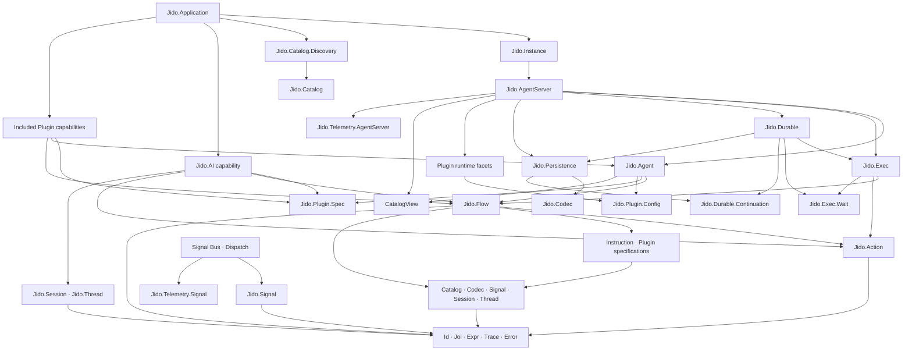

# Jido aspirational module dependency map

## Purpose

This is the one living namespace and dependency map for Jido V3. It consolidates the former versioned aspirational maps and the implemented namespace map.

Update this file in place when module ownership or dependency direction changes. Do not create another map version. Use normal source-control history or backups when an earlier state must be preserved.

The map has two states:

- **Current:** the implemented consolidation baseline and its enforced Reach layers.
- **Target:** the accepted aspirational ownership, dependency direction, and migration order.

An arrow `A --> B` means that `A` depends on `B`.

Read this map with the [package vision](package-vision.md). The vision defines the product and runtime contract. This map assigns those responsibilities to namespaces.

## Review scope

This map reviews all production modules at these namespace depths:

- `Jido.X`
- `Jido.X.Y`

For example, `Jido.Signal.Telemetry` is in scope. `Jido.Signal.Telemetry.Foo` is not in scope.

The shallow review snapshot found 188 compiled modules in scope. Generated error classes and nested runtime records are included as module families. Deeper implementation modules can change later when their owning shallow module changes.

This is an aspirational map. A `move`, `merge`, or `remove` decision is not a statement that the code already has that shape.

## Current consolidation baseline

The first source consolidation is complete in `jido/`. The target has one Mix project, one `:jido` OTP application, and one `Jido.Application` composition root.

The production source baseline is:

| Source package | Branch | Commit | Import state |
|---|---|---|---|
| `jido_signal` | `release/v3` | `7b825f1d050a0e0159bb2a72ba79c100b5d362d3` | Complete except its old application module |
| `jido_action` | `release/v3` | `177e7a4ce4342a9a6b7bc668f540dafbd7169d54` | Complete except its old application module |
| `jido` | `release/v3` | `21d0dd4c4da2f9c096fbd1cec9ad1d22dce95e61` | Complete; its application module is the composition root |
| `jido_ai` | `release/v3` | `2d3cac6700fcb850b632c2ce5f552ccfd0e5459e` | Complete except its old application module |

The Runic baseline is commit `0c15a9c107137b8c13ebbc3340abd207d8f1f3ff`.

The obsolete `Jido.Signal.Application`, `Jido.Action.Application`, and `Jido.AI.Application` roots are not in the target. Their children and startup actions moved to `Jido.Application`.

The verified consolidation snapshot contains:

- 374 production `.ex` files;
- 355 `_test.exs` files;
- 431 files in the strict test-environment compile;
- 3,287 passing tests out of 3,288 in the full coverage run, with one asynchronous cleanup race that passed on focused rerun;
- 78 tests excluded by shared test configuration;
- 92.41% line coverage against the 90% rule.

These checks passed at the snapshot:

```text
mix format --check-formatted
MIX_ENV=test mix compile --force --warnings-as-errors
mix reach.check --arch --smells
mix test --cover, except for one asynchronous cleanup race that passed on rerun
application startup and current Discovery readiness smoke test
```

This evidence is a baseline, not a permanent status report. Re-run the checks after implementation changes.

### Current OTP startup tree

```text
Jido.Application
├── Jido.Signal.Registry
├── Jido.Exec.TaskSupervisor
├── Jido.Catalog.Discovery temporary initialization task
├── Jido.Telemetry.AI.CorrelationStore
├── Jido.Instance.NamespaceRegistry
├── Jido.Persistence.ETS.Owner
└── Runic.Runner for the default Jido execution name
```

`Jido.Application` is the only composition root. Catalog Discovery and AI
telemetry now use their target namespace owners. They do not create new
application roots.

### Current enforced layer model

`.reach.exs` is the executable current-state architecture. It assigns every production module to one layer and rejects layer cycles.

```text
primitives <- value_model <- definitions <- execution <- agent_domain <- live_runtime <- capabilities <- composition
```

| Current layer | Current namespace slices | Allowed lower layers |
|---|---|---|
| `primitives` | `Jido.Id`, `Jido.Joi`, `Jido.Expr`, `Jido.Error`, `Jido.Trace`, and standalone Codec mechanics | None |
| `value_model` | Signal, Session, Thread, immutable Catalog values, and common Codec contracts and portable values | `primitives` |
| `definitions` | `Jido.Action`, `Jido.Flow`, `Jido.Instruction`, `Jido.Plugin.Config`, `Jido.Plugin.Manifest`, `Jido.Plugin.Spec`, Signal catalogs and routers, and definition codecs | `primitives`, `value_model` |
| `execution` | `Jido.Exec` and Jido-owned Runic implementations | `primitives`, `value_model`, `definitions` |
| `agent_domain` | `Jido.Agent`, `Jido.Agent.Codec`, the generic Plugin behavior, callback contexts, input, and normalizer | All lower layers through `execution` |
| `live_runtime` | AgentServer, Persistence, Instance, Signal Bus and Dispatch, telemetry, tracing, and root runtime services | All lower layers through `agent_domain` |
| `capabilities` | `Jido.AI` and bundled Plugin implementations | All lower layers through `live_runtime` |
| `composition` | `Jido.Application`, `Jido.Catalog.Discovery` | All lower layers |

The current Reach check covers all 348 production files and reports no layer
violations.

### Covenant ownership rule

Each Covenant component owns modules from one Reach layer. The `modules:` list
in an obligations file is an ownership and mutation scope. It is not a list of
all dependencies used by the component tests.

A component test can call a lower Reach layer. For behavior that crosses
layers, the Covenant component belongs to the highest layer that owns the
result. Lower-layer modules keep their own contracts and do not enter the
higher component's `modules:` list.

Each module has no more than one primary Covenant owner. See
[`covenant-component-refactor-plan.md`](covenant-component-refactor-plan.md)
for the current audit and the ordered realignment.

### Current dependency cycles

`mix xref graph --format cycles --label compile-connected` reports no cycles.
The full runtime graph reports one smaller process-internal relationship:

1. A seven-file AgentServer relationship across its root process, Effects,
   Lifecycle, Plugin, Status, Supervisor, and Topology modules.

The Action Inline, expression, Signal Router, Scheduler, Signal and Codec, Bus,
Heartbeat, Sensor Manager, AI ReAct, AI telemetry, AI strategy,
AI InferenceClient, AI Context, AI Agent authoring, Flow, Exec, Agent,
Persistence, and cross-namespace runtime cycles are removed. Instance and root
runtime ownership are also acyclic. The remaining seven-file relationship is
inside one AgentServer process boundary. It has no compile-connected cycle.
Further work can reduce it when that work gives clearer lifecycle ownership.

### Current namespace inventory

The earlier source survey grouped the current files as follows:

| Current slice | Files | Main responsibility |
|---|---:|---|
| Signal | 33 | Signal values, routing, Bus, dispatch, codec, context, and compatibility helpers |
| Stable definitions and execution | 110 | Id, Joi, Action, Codec, Discovery, Expr, Instruction, Session, Thread, Flow, and Exec |
| Core Agent runtime | 162 | Agent, AgentServer, Plugin, Persistence, Instance, telemetry, tracing, and application services |
| AI | 70 | AI Agent authoring, context, tools, inference, reasoning, budget, usage, and telemetry |

These survey counts are orientation data. They can overlap or drift and must not be used as the parity total. They do not define target public API size.

## Accepted target decisions

1. Remove `Jido.Signal.ID`. Use `Jido.Id`.
2. Keep portable term, portable JSON value, and reference encoding under
   `Jido.Codec` for this reduction. Do not add a `Jido.Portable` namespace.
3. Put each domain wire codec with its owner: `Jido.Signal.Codec`,
   `Jido.Flow.Codec`, and `Jido.Agent.Codec`.
4. Replace the two Trace models with one `Jido.Trace` value and one `Jido.Trace.Context` runtime context.
5. Put all telemetry APIs under `Jido.Telemetry` while each feature layer still owns its event definitions.
6. Keep `Jido.Session`, `Jido.Thread`, and `Jido.Thread.Entry` outside `Jido.AI`. They are agent-neutral Session and Thread values.
7. Remove repeated Action, Flow, Signal, and Plugin runtime error taxonomies. Use `Jido.Error`.
8. Replace `Jido.Discovery` with application-wide `Jido.Catalog.Discovery`. Move general definition identity out of Codec and into `Jido.Catalog`.
9. Move live Agent admission data from `Jido.Agent.Command` to `Jido.AgentServer.Command`.
10. Remove compatibility-only pass-through modules. Keep a small module when it owns a stable contract or adapter boundary.
11. Define Jido as a configurable actor runtime. Agent is the configurable definition and state. AgentServer is the OTP actor shell.
12. Make `Jido.Flow` the Agent behavior boundary. Actions are leaf work units. Direct Action routes lower to one-step Flows.
13. Keep `Jido.AI` as a unique top-level, first-party Plugin capability. AI reasoning is a Flow.
14. Publish a definite included Plugin list for each release. The list can evolve through a deliberate release-design decision.
15. Give direct, AgentServer-managed, and durable execution the same Flow semantics. Execution contexts add lifecycle policy but do not change Flow meaning.
16. Put typed wait and continuation values in `Jido.Exec`. AgentServer owns their live admission, expiry, single-resume, and recovery lifecycle. Persistence owns their durable representation.
17. Publish stable semantic events for AgentServer, Flow, Actions, and Plugins under `Jido.Telemetry`. Status, history, tracing, and a live inspector derive from those events.
18. Keep Catalog passive: resolve registered values by ID and version. Consumers validate domain roles. See ADR 0004.
19. Keep Ash, Spark, Runic, and application-specific frameworks out of the required public Agent model. Integrations use external packages, Actions, Flows, Plugins, and Catalog manifests.
20. Keep code sandboxing outside the actor kernel. An optional sandbox capability can call approved Actions, but OTP process isolation is not a sandbox.
21. Treat source-aware validation and inspection data as namespace contracts. Generated modules cannot be the only source of errors, status, or plans.
22. Remove the broad `Jido.Config` root module. Move deferred Plugin option references and resolution to `Jido.Plugin.Config`. Keep instance settings in `Jido.Instance.Options` and application composition in `Jido.Application`.

## Consolidation rules

Use these rules for all later decisions:

The refactor goal is the target architecture, not compatibility with an
unreleased V3 shape. These rules supersede the earlier compatibility clause in
the active refactor goal and any earlier instruction to preserve old public
modules, functions, argument shapes, return shapes, or call paths.

- One concept has one canonical module.
- V3 is unreleased. Backward compatibility with the split V3 packages or an
  earlier consolidated V3 shape is not a goal. Preserve intended behavior, not
  old module names, argument shapes, return shapes, or call paths.
- Make each migration direct. Move callers to the canonical owner and delete
  the old module in the same slice. Do not add aliases, forwarding modules,
  wrappers, deprecation shims, or other compatibility layers for an obsolete
  V3 API.
- Remove a forwarding module or function when its only purpose is to keep an
  old name, bind hidden context, or reshape arguments or results.
- Keep an entry point that owns a stable public composition API, dependency
  boundary, behavior, protocol implementation, data type, or process boundary.
  It can delegate an implementation step when callers depend on its contract.
- `Jido.Joi` stays. It is the Jido validation boundary over Zoi and owns Jido
  validation policy. It is not an obsolete compatibility facade.
- Runtime operations on `Jido` require an explicit instance. `Jido.Default` is
  the explicit instance for scripts and Livebook. `Jido` does not copy
  AgentServer pending-reply operations or Telemetry debug operations.
- Keep a public entry-point module only when it owns a substantial, stable
  contract and policy of its own. Delete a module when its main purpose is delegation,
  renaming, argument reshaping, or return reshaping, even when that module was
  public before consolidation.
- A public name is not enough reason to keep a module. Migrate production
  callers and tests to the canonical owner. Change function names, arguments,
  and return values when that change produces a clearer target contract.
- Preserve semantic behavior, safety properties, and required capabilities.
  Do not preserve obsolete API structure. A successful refactor has one real
  owner for each policy and no compatibility-only path to that owner.
- Data types belong below the runtimes that use them.
- Encoding and portability rules belong to Codec.
- Registered value identity, version, provider, and target lookup belong to Catalog.
- Catalog is application-wide inventory. It is not authorization.
- Installed Jido-aware packages contribute deterministic static Catalog manifests.
- Flow is the only Agent behavior boundary. Actions are Flow leaf work units.
- A validated Agent Turn contains a Flow executable and an explicit managed or
  durable execution mode. AgentServer does not infer lifecycle policy from the
  normalized executable kind.
- Direct, managed, and durable execution preserve the same Flow meaning.
- Typed waits and continuations are Exec values. AgentServer owns their live lifecycle.
- Plugin capabilities own their state and lifecycle facets. They cannot bypass the Agent commit boundary.
- Semantic events are public observation data. Telemetry and tracing do not decide behavior.
- Validation, authorization, process isolation, and sandboxing are separate controls.
- The basic Agent path cannot require Ash, Spark, Runic, or another application framework.
- Configuration ownership follows its consumer. Plugin option references belong to `Jido.Plugin.Config`; instance options remain under `Jido.Instance`.
- Event producers can stay in their feature layer, but their public namespace is `Jido.Telemetry`.
- W3C trace data has one representation.
- A domain does not own a copy of the common runtime error taxonomy.
- A module can stay small when it defines a real protocol, behavior, data type, or process boundary.
- Do not merge unrelated code only to reduce the file count.
- Split a large module when the split creates a one-way boundary. Do not split it only for size.

### Retained adapter audit

The remaining direct delegates and simple owner calls have these selected
contracts:

| Adapter group | Reason it stays |
|---|---|
| `Jido.Joi` to Zoi | Public validation dependency boundary and Jido validation policy |
| `Jido.Agent`, `Jido.Flow`, `Jido.Exec`, and `Jido.Expr` entry points | Stable public composition APIs over internal owners |
| Agent DSL helpers | Generated Agent authoring contract |
| Jido-owned Runic implementations | Protocol and workflow-node adapter contracts |
| Plugin Bus Client and Manager callbacks | Plugin behavior and OTP child-spec contracts |
| AI ReqLLM calls | `Jido.AI.InferenceClient` behavior adapter |
| Signal Context and Catalog Discovery accessors | Stable value-context and application-wide snapshot APIs |
| Bus subscription helpers | Internal orchestration-to-durable-state owner boundary |

Do not remove these adapters only because their implementation uses one call.
Remove one if its contract is deleted or its callers move to the same owner.

## Why the current duplicates exist

The first consolidation preserved modules from separate packages. Each package had local ID, Codec, Trace, Telemetry, and Error helpers. Those helpers kept their old namespace after the package boundary went away.

This history explains the current layout. It does not justify the target layout.

### ID

`Jido.Signal.ID` is only a thin facade over `Jido.Id`. It has no separate
identity policy. Move its callers to `Jido.Id` and remove it in the same slice.

### Trace

`Jido.Signal.Trace` owns a W3C trace value and Signal attachment. `Jido.Tracing.Trace` converts that value into a second map shape and adds causation data. The two representations create conversion code and inconsistent ownership.

The target is:

- `Jido.Trace`: one pure W3C trace value.
- `Jido.Signal.Context`: attaches or removes a `Jido.Trace` value on a Signal.
- `Jido.Trace.Context`: owns process-local and OpenTelemetry context.

Remove `Jido.Signal.Trace`, `Jido.Tracing.Trace`, and `Jido.Tracing.Context` after migration.

### Telemetry

Telemetry modules do different work because their dependency layers differ. The
canonical namespace makes the common observation system visible:

- `Jido.Telemetry.Signal`
- `Jido.Telemetry.Exec`
- `Jido.Telemetry.AgentServer`
- `Jido.Telemetry.Persistence`
- `Jido.Telemetry.AI`
- `Jido.Telemetry.OpenTelemetry`
- `Jido.Telemetry.Semantic`

`Jido.Telemetry` is the public inventory and configuration facade. Reach must assign each feature module to the layer of the feature that it observes. A shared namespace does not make all telemetry code one dependency layer.

### Codec

`Jido.Codec.Compiler` is the small general compile-time layer. It generates
strict JSON codecs for structs and named maps from Joi schemas. Joi remains the
only source for field types, required fields, defaults, coercion, validation,
unknown-key policy, and JSON Schema output.

The current `Jido.Codec` facade keeps its versioned document functions during
this reduction. Those functions and their support modules are real retained
capabilities, not compatibility modules. Do not add new domain behavior to
them. Remove one only after its current library capability moves to a direct
owner API.

Domain and portability rules stay with their owners:

- `Jido.Signal.Codec` owns Signal CloudEvents maps and encoding.
- `Jido.Flow.Codec` owns retained Flow encoding.
- `Jido.Agent.Codec` owns retained Agent encoding.
- `Jido.Codec.Term` owns portable Erlang term validation.
- `Jido.Codec.Value` owns the restricted portable JSON value format.
- `Jido.Codec.Reference` owns stable Catalog reference encoding.
- `Jido.Joi.validate_static/1` owns static authoring-data policy.

Do not add a forwarding module for an old Codec owner name. Moves are direct,
and all callers move in the same change.

### Session and Thread

`Jido.Session` and `Jido.Thread` are agent-neutral values. They describe an Agent Session and its append-only Agent Thread. `Jido.Thread.Entry` is the portable entry value inside that Thread.

These modules stay outside `Jido.AI`:

- An Agent can own a Session without using an AI model.
- AI reasoning can use a Session, but AI does not own the type.
- Session and Thread do not own a process or a persistence adapter.
- Session, Thread, and Thread Entry cannot depend on `Jido.AI`, `Jido.AgentServer`, or a persistence implementation.
- Higher layers can depend on these values and can decide how to store them.

Reach assigns these modules to `value_model`. Their only allowed Jido dependencies are primitives and other modules in the same value-model layer. `Jido.Codec.Term` defines the general process-free storage-term policy used by these and other values.

### Actor, Flow, and Plugin capability model

Jido is a configurable actor runtime on OTP:

- `Jido.Agent` is the configurable actor definition and immutable state.
- `Jido.AgentServer` is the OTP shell that owns serialized Turns, commit, effects, recovery, and lifecycle.
- `Jido.Signal` is the canonical message value.
- `Jido.Flow` is the Agent behavior boundary.
- `Jido.Action` is a validated leaf work unit inside a Flow.
- `Jido.Plugin` adds owned capability facets without changing Agent or AgentServer core.
- `Jido.AI` is a unique, top-level, first-party Plugin capability. Its reasoning unit is a Flow.
- `Jido.Exec.Wait` and `Jido.Durable.Continuation` describe portable suspension and resume data.
- `Jido.AgentServer.Lifecycle` owns live Turn, wait, cancellation, commit, effect, and recovery transitions.
- `Jido.AgentServer.Status` is the public, process-neutral runtime view used by inspection tools.

The current included Plugin list is AI, Scheduler, Sensor Manager, Bus Manager, Bus Client, Heartbeat, and Audit. Publish the exact list for each release. A later release can add or remove an included Plugin through a deliberate release-design decision.

### Catalog

`Jido.Catalog` is a passive registry of values under stable IDs and versions. It records registration sources; consumers validate domain roles.

`Jido.Catalog.Discovery` collects static manifests from installed Jido-aware OTP applications, validates the complete result, and publishes the current Catalog asynchronously. Failed refreshes keep the last valid Catalog. Registration does not grant execution permission.

Catalog has no semantic kinds, filtered Views, revision tracking, or operation snapshots. Hydration uses current lookups; callers can supply an explicit Catalog. See [ADR 0004](../adr/0004-passive-catalog-reference-resolution.md).

### Developer experience and authority

The namespace map must support the first-hour path without exposing generated implementation modules:

```text
Action -> Flow -> Agent -> AgentServer -> Status and semantic events
```

- `Jido.Action`, `Jido.Flow`, and direct `Jido.Agent` Turns remain process-free test boundaries.
- `Jido.Error`, `Jido.Joi`, `Jido.Flow.Validation`, and `Jido.Agent.Validation` preserve definition paths and source locations.
- `Jido.AgentServer.Status` and `Jido.Telemetry.AgentServer` support inspection without private process access.
- Ash integration stays in `ash_jido` or another external integration package. It does not create a required `Jido.Ash` core namespace.
- A sandbox implementation is an optional Plugin or extension package. It cannot bypass Action validation, Catalog view limits, application authorization, budgets, or telemetry.

## Revised target dependency map



The Telemetry, Codec, Plugin, Persistence, and Catalog namespaces span more than one target layer. Reach assigns each module to the layer of the responsibility that it owns. A shared namespace does not permit reverse dependencies.

## Target layer model

The target direction is:

```text
primitives
  <- value_model
  <- definitions
  <- execution
  <- agent_domain
  <- live_runtime
  <- capabilities
  <- composition
```

| Target layer | Main modules | Dependency rule |
|---|---|---|
| `primitives` | `Jido.Id`, `Jido.Joi`, `Jido.Expr`, `Jido.Error`, `Jido.Trace`, and standalone Codec mechanics | General policies and tools that do not know the Jido domain model |
| `value_model` | `Jido.Signal`, `Jido.Session`, `Jido.Thread`, immutable Catalog values, and common Codec contracts and portable values | Process-free Jido values, inventories, references, and serialization contracts |
| `definitions` | `Jido.Action`, `Jido.Flow`, `Jido.Instruction`, `Jido.Plugin.Spec`, `Jido.Plugin.Config`, Signal routing, and definition codecs | Declarative behavior and capability definitions that use only lower values and validation |
| `execution` | `Jido.Exec`, Wait, compiler, and runtime policy | Executes definitions but does not commit Agent state |
| `agent_domain` | `Jido.Agent`, routes, Turns, Directives, validation, and pure Plugin reduction | Defines candidate transitions without process ownership |
| `live_runtime` | `Jido.Durable`, `Jido.AgentServer`, `Jido.Instance`, Persistence stores and adapters, Signal delivery, and runtime context | Owns processes, commit, effects, continuation lifecycle, and recovery |
| `capabilities` | `Jido.AI` and bundled or external Plugin implementations | Uses the common lower contracts; core cannot depend on a capability |
| `composition` | `Jido.Application`, `Jido.Catalog.Discovery` | Starts and publishes the complete application runtime |

Cross-layer namespace rules:

- `Jido.Telemetry.*` belongs to the feature layer that emits the event.
- `Jido.Codec.*` belongs with the value or definition that it encodes.
- `Jido.Plugin.Spec` and other portable Plugin values are declarative. Plugin runtime children and post-commit work are live runtime or optional capability code.
- `Jido.Plugin.Config` owns deferred option references and the resolver helper. The Plugin runtime owner decides when resolution occurs.
- Catalog values belong to `value_model`. `Jido.Catalog.Discovery` belongs to `composition`.
- Persistence records and snapshots are portable values. Store invocation and adapters are live runtime.

## Full shallow-module pass

Disposition terms:

- **Keep**: the module has one clear target responsibility.
- **Move**: keep the responsibility under a different namespace.
- **Merge**: put the behavior in an existing owner.
- **Remove**: delete the target module after migration.
- **Review**: the module is valid, but a later detailed design must confirm its boundary.

### Root and cross-cutting modules

| Current module | Disposition | Target or reason |
|---|---|---|
| `Jido` | Keep | Canonical public runtime API and supervisor for one selected instance; runtime calls require the instance, and `use Jido` only declares instance configuration and a supervision child |
| `Jido.Application` | Keep | Only OTP application composition root |
| `Jido.Config` | Removed | Deferred Plugin references and resolution moved to `Jido.Plugin.Config`; instance settings remain in `Jido.Instance.Options` |
| `Jido.Discovery` | Removed | `Jido.Catalog.Discovery` now builds and publishes the application-wide Catalog |
| `Jido.Dispatch.Preparation` | Removed | Trace propagation belongs to `Jido.Trace.Context`; bus scope belongs to `Jido.Signal.Dispatch` |
| `Jido.Id` | Keep | Canonical ID API |
| `Jido.Instruction` | Keep | Stable invocation data; remove its compile dependency on Flow |
| `Jido.PortableTerm` | Removed | Portable term policy is owned directly by `Jido.Codec.Term` |
| `Jido.RuntimeStore` | Moved | `Jido.Instance.RuntimeStore`; it is per-instance runtime infrastructure |
| `Jido.Session` | Keep | Agent-neutral Session value; AI and non-AI Agents can use it |
| `Jido.Thread` | Keep | Agent-neutral append-only interaction value |
| `Jido.Thread.Entry` | Keep | Portable entry value owned by `Jido.Thread` |

### Action

| Current module | Disposition | Target or reason |
|---|---|---|
| `Jido.Action` | Keep | Stable executable contract |
| `Jido.Action.Error` | Removed | Action, Instruction, Exec, and AgentServer failures use `Jido.Error` |
| `Jido.Action.Inline` | Keep | Real compile-time boundary for embedded Actions |
| `Jido.Action.Output` | Keep | Distinct successful-output envelope |
| `Jido.Action.Validation` | Keep | Owns Action schema validation below Exec |

### Common error taxonomy

| Current module | Disposition | Target or reason |
|---|---|---|
| `Jido.Error` | Keep | Canonical error construction and normalization facade |
| `Jido.Error.Invalid` | Keep internal | Canonical invalid-input error class |
| `Jido.Error.Execution` | Keep internal | Canonical execution error class |
| `Jido.Error.Routing` | Keep internal | Canonical routing error class |
| `Jido.Error.Timeout` | Keep internal | Canonical timeout error class |
| `Jido.Error.Internal` | Keep internal | Canonical internal error class |
| `Jido.Error.ValidationError` | Keep | Canonical validation exception |
| `Jido.Error.ExecutionError` | Keep | Canonical execution exception |
| `Jido.Error.RoutingError` | Keep | Canonical routing exception |
| `Jido.Error.TimeoutError` | Keep | Canonical timeout exception |
| `Jido.Error.InternalError` | Keep | Canonical internal exception |

### Codec

| Current module | Disposition | Target or reason |
|---|---|---|
| `Jido.Codec` | Reduce | Public compile-time JSON codec entry point and retained versioned-document facade |
| `Jido.Codec.Compiler` | Keep | Compiles Joi schemas into JSON map and struct codecs; this is not instruction compilation |
| `Jido.Instruction.Compiler` | Move | `Jido.Instruction.Compiler` owns instruction compilation |
| `Jido.Instruction.Config` | Move | `Jido.Instruction.Config` owns instruction authoring configuration |
| `Jido.Codec.Contract` | Keep for now | Retained versioned document contract used by current Agent and Flow codecs |
| `Jido.Codec.Document` | Keep for now | Retained bounded JSON document checks |
| `Jido.Codec.Encoder` | Keep for now | Retained versioned-document encoder selection protocol |
| `Jido.Codec.Error` | Keep for now | Retained versioned-document encode errors |
| `Jido.Codec.Issue` | Keep for now | Retained versioned-document decode issues |
| `Jido.Codec.Limits` | Removed | The small generator owns its bounded input checks directly |
| `Jido.Codec.Manifest` | Removed | General definition entries moved to `Jido.Catalog.Manifest`; each domain owner validates its own data |
| `Jido.Codec.Registry` | Removed | Catalog owns stable references, and domain codecs use direct owner calls |
| `Jido.Codec.Static` | Removed | Static authoring-data policy belongs to `Jido.Joi.validate_static/1` |
| `Jido.Codec.Reference` | Keep | Stable Catalog reference encoding used by current domain codecs |
| `Jido.Codec.Value` | Keep | Restricted portable JSON values used by current domain codecs |
| `Jido.Codec.Term` | Keep | Strict portable Erlang term validation used across current library code |
| `Jido.Signal.Codec` | Move | `Jido.Signal.Codec` owns Signal CloudEvents maps and encoding |
| `Jido.Flow.Codec` | Move | `Jido.Flow.Codec` owns retained Flow encoding behavior |
| `Jido.Agent.Codec` | Move | `Jido.Agent.Codec` owns retained Agent encoding behavior |
| `Jido.Codec.Index` | Keep for now | Retained private index used by Catalog discovery and document routing |

### Catalog

| Current or target module | Disposition | Target or reason |
|---|---|---|
| `Jido.Catalog` | Added | Application-wide immutable definition inventory and query API |
| `Jido.Catalog.Entry` | Added | Stable ID, version, kind, target, provider, and descriptive metadata |
| `Jido.Catalog.Manifest` | Added | Static package and provider contribution validation |
| `Jido.Catalog.Discovery` | Added | Composition-owned collection and atomic application-wide publication; `included_plugins/0` publishes the exact first-party list for this release |

### Joi and expression primitives

| Current module | Disposition | Target or reason |
|---|---|---|
| `Jido.Joi` | Keep | Stable Jido validation boundary over Zoi; owns Jido parse issues, static-value policy, and struct projection |
| `Jido.Joi.Error` | Removed | Parse issue helpers now belong to `Jido.Joi` |
| `Jido.Joi.ParseError` | Keep | Real exception type |
| `Jido.Joi.Runtime` | Keep | Internal checked runtime access to Zoi values |
| `Jido.Joi.Schema` | Keep | Internal schema inspection boundary |
| `Jido.Joi.Static` | Removed | Its policy is now `Jido.Joi.validate_static/1` |
| `Jido.Joi.Struct` | Removed | Struct field projection now belongs directly to `Jido.Joi` |
| `Jido.Expr` | Keep | Public grammar, construction, validation, and evaluation API |
| `Jido.Expr.Error` | Keep | Specific expression construction and evaluation error |
| `Jido.Expr.Limits` | Keep internal | Shared resource accounting, callback containment, and bounded error policy for Parser and Runtime |
| `Jido.Expr.Operation` | Added | Canonical inert expression value; separates data ownership from the public API implementation |
| `Jido.Expr.Parser` | Keep | Internal parsing boundary |
| `Jido.Expr.Runtime` | Keep | Internal evaluation boundary |

### Signal

| Current module | Disposition | Target or reason |
|---|---|---|
| `Jido.Signal` | Keep | Canonical event envelope and definition macro |
| `Jido.Signal.Bus` | Keep | Ordered local Signal delivery service |
| `Jido.Signal.Catalog` | Keep | Explicit Signal definition catalog |
| `Jido.Signal.Codec` | Keep | Canonical owner of Signal CloudEvents maps and encoding |
| `Jido.Signal.Context` | Keep | CloudEvents extension attributes and Trace attachment |
| `Jido.Signal.Dispatch` | Keep | Signal target validation and delivery |
| `Jido.Signal.Error` | Removed | Signal validation, routing, dispatch, and transport failures use `Jido.Error` |
| `Jido.Signal.ID` | Removed | Callers use `Jido.Id` directly |
| `Jido.Signal.Router` | Keep | Pure route definition and matching |
| `Jido.Signal.Router.State` | Added internal | Canonical opaque route-index value; Index owns its construction and mutation |
| `Jido.Signal.Sanitizer` | Review | Keep a pure `Jido.Signal.Boundary` only when a production transport caller needs it; telemetry previews belong to `Jido.Telemetry.Signal` |
| `Jido.Signal.Serialization` | Removed | Replaced by direct `Jido.Signal.Codec` behavior |
| `Jido.Signal.Telemetry` | Moved | `Jido.Telemetry.Signal` |
| `Jido.Signal.Trace` | Removed | Pure value became `Jido.Trace`; attachment moved to `Jido.Signal.Context` |
| `Jido.Signal.UTF8` / `Jido.Signal.Codec.UTF8` | Removed | The UTF-8 check belongs directly to `Jido.Signal.Codec` when it is needed |

### Trace and telemetry

| Current module | Disposition | Target or reason |
|---|---|---|
| `Jido.Tracing.Trace` | Removed | Its causation and conversion rules moved into `Jido.Trace` |
| `Jido.Tracing.Context` | Moved | `Jido.Trace.Context` |
| `Jido.Trace` | Added | One pure W3C trace value |
| `Jido.Trace.Context` | Added | Process and OpenTelemetry context propagation |
| `Jido.Telemetry` | Keep | Public metrics and observability facade |
| `Jido.Telemetry.OpenTelemetry` | Keep | Core OpenTelemetry bridge |
| `Jido.Telemetry.Persistence` | Keep | Persistence event definitions |
| `Jido.Telemetry.Semantic` | Keep | Metadata normalization and bounded semantic logging |
| `Jido.Exec.Telemetry` | Moved | `Jido.Telemetry.Exec` |
| `Jido.AI.Telemetry` | Moved | `Jido.Telemetry.AI` |
| `Jido.Telemetry.Signal` | Added | Signal, Bus, and Dispatch event definitions |
| `Jido.Telemetry.AgentServer` | Added | Owns the stable lifecycle, Turn, commit, Directive, effects, and settlement event contract |

### Flow

| Current module | Disposition | Target or reason |
|---|---|---|
| `Jido.Flow` | Keep | Canonical declarative graph artifact and authoring API |
| `Jido.Flow.Codec` | Keep | Flow-owned encoding behavior, if current production use requires it |
| `Jido.Flow.Component` | Keep | Canonical component union and validation |
| `Jido.Flow.DSL` | Keep | Compile-time DSL boundary |
| `Jido.Flow.Defaults` | Keep | Substantial canonical default construction |
| `Jido.Flow.Definition` | Keep | Canonical definition preparation |
| `Jido.Flow.Error` | Removed | Flow failures use `Jido.Error` with Flow details |
| `Jido.Flow.Extension` | Keep | Flow DSL extension behavior |
| `Jido.Flow.FieldError` | Removed | Flow Component uses canonical `Jido.Error.ValidationError` values with field and source paths |
| `Jido.Flow.Graph` | Keep | Graph analysis owner |
| `Jido.Flow.GraphValidation` | Removed | Structural graph validation now belongs to `Jido.Flow.Validation` |
| `Jido.Flow.Identity` | Keep | Semantic digest and stable identity |
| `Jido.Flow.Inline` | Keep | Embedded Flow compilation boundary |
| `Jido.Flow.Ref` | Keep | Portable graph reference value |
| `Jido.Flow.TargetValidator` | Removed | Executable target validation now belongs to `Jido.Flow.Validation` |
| `Jido.Flow.Value` | Keep | Canonical Flow value union |
| `Jido.Flow.Validation` | Added | One owner for structural graph and executable target validation |

### Exec

| Current module | Disposition | Target or reason |
|---|---|---|
| `Jido.Exec` | Keep | Public compilation and execution API |
| `Jido.Exec.Compiler` | Keep | Runic workflow compiler |
| `Jido.Exec.Fact` | Keep | Exec fact value and local-value boundary |
| `Jido.Exec.Frame` | Keep | Execution frame value |
| `Jido.Exec.Handoff` | Removed | Runtime normalizes a Handoff directly to the canonical `Jido.Instruction` value |
| `Jido.Exec.NestedCompiler` | Added | Explicit compiler capability for runtime Invoke expansion |
| `Jido.Exec.Portable` | Removed | Strict storage checks use `Jido.Codec.Term`; process-local execution checks belong to Runtime |
| `Jido.Exec.Runtime` | Keep | Execution host policy |
| `Jido.Exec.Source` | Removed | Source attachment now belongs to `Jido.Exec.Validation` |
| `Jido.Exec.Telemetry` | Moved | `Jido.Telemetry.Exec` |
| `Jido.Exec.Validation` | Keep | Shared Action and Flow execution-boundary validation |
| `Jido.Exec.ValueResolver` | Keep | Runtime Flow value resolution |
| `Jido.Exec.Waits` | Removed | Portable data moved to Wait and workflow host operations moved to Runtime |
| `Jido.Exec.Wait` | Keep | Canonical portable wait, ID, match, deadline, and input-validation value |
| `Jido.Durable.Continuation` | Keep | Canonical portable suspended Flow and Handoff state with stable identity and definition fingerprint |

### Agent domain

| Current module | Disposition | Target or reason |
|---|---|---|
| `Jido.Agent` | Keep | Public Agent definition and data API |
| `Jido.Agent.Authoring` | Removed | Common authoring normalization now belongs to `Jido.Agent.Validation` |
| `Jido.Agent.Callback` | Keep | Canonical safe Agent callback invocation and error normalization boundary; avoids coupling validation and persistence to Runner |
| `Jido.Agent.Codec` | Keep | Agent-owned encoding behavior, if current production use requires it |
| `Jido.Agent.Command` | Removed | Live admission now belongs to `Jido.AgentServer.Command`; Agent Runner consumes an admitted structural value without a server dependency |
| `Jido.Agent.Composition` | Removed | State composition and binding now belong to `Jido.Agent.Mutation` |
| `Jido.Agent.Contract` | Removed | Emission normalization now belongs to `Jido.Agent.Directive` |
| `Jido.Agent.Data` | Removed | Authoring and stored-state checks now belong to `Jido.Agent.Validation` |
| `Jido.Agent.Diff` | Keep | Distinct final-state difference value |
| `Jido.Agent.Directive` | Keep | Domain changes and deferred runtime work; owns AgentSend, ParentSend, and ServerStop values and constructors; `Jido.Agent.Directive.Kind` owns built-in classification |
| `Jido.Agent.DSL` | Keep | Agent authoring DSL boundary |
| `Jido.Agent.Error` | Removed | Agent validation uses `Jido.Error.ValidationError` with path and code |
| `Jido.Agent.Extension` | Keep | Agent DSL extension behavior |
| `Jido.Agent.Mutation` | Keep | Pure Agent state and topology changes |
| `Jido.Agent.Options` | Removed | Agent macro option preparation now belongs to the public `Jido.Agent` authoring boundary |
| `Jido.Agent.Plugin` | Keep | Pure Agent-owned Plugin callback execution |
| `Jido.Agent.Ref` | Keep | Stable logical Agent identity |
| `Jido.Agent.Route` | Keep | Pure Flow-route normalization and selection; direct Action authoring lowers to a one-step Flow |
| `Jido.Agent.Runner` | Keep | Pure turn preparation and direct execution; remove AgentServer dependencies |
| `Jido.Agent.Schema` | Keep | Canonical generic Agent authoring checks, struct schema, defaults, and schema traversal |
| `Jido.Agent.Topology` | Keep | Logical members and output connections |
| `Jido.Agent.Turn` | Keep | Process-independent prepared Flow turn with explicit managed or durable execution mode |
| `Jido.Agent.Validation` | Keep | Absorbs Authoring and Data checks |
| `Jido.Agent.View` | Keep | Safe framework-neutral Agent view |

### Plugin

| Current module | Disposition | Target or reason |
|---|---|---|
| `Jido.Plugin` | Keep | Public Plugin behavior and package macro |
| `Jido.Plugin.Audit` | Keep | Included audit Plugin; no runtime process |
| `Jido.Plugin.Bus` | Removed | Empty namespace module added no contract; Manager, Client, and DSL remain canonical owners |
| `Jido.Plugin.Config` | Added | Deferred Plugin option references and runtime-owner resolution in the definitions layer; does not load env files or own instance configuration |
| `Jido.Plugin.DirectiveContext` | Removed | Directive callbacks use the explicit `:directive` phase of `Jido.Plugin.Context` |
| `Jido.Plugin.Error` | Removed | Callback policy now belongs to `Jido.Plugin`; failures use `Jido.Error` values |
| `Jido.Plugin.Heartbeat` | Keep | Included heartbeat Plugin |
| `Jido.Plugin.Init` | Keep | Runtime child initialization value |
| `Jido.Plugin.Input` | Keep | Separate portable prepared and transient runtime inputs |
| `Jido.Plugin.Manifest` | Keep | Static callback ownership and option assignment metadata in the definitions layer |
| `Jido.Plugin.Normalizer` | Keep | Real normalization boundary; split internally before adding more behavior |
| `Jido.Plugin.Scheduler` | Keep | Included scheduler Plugin; the root owns Agent state, Plugin runtime callbacks, and public scheduling algorithms, with no Agent or Server delegate modules; `Occurrence.from_signal/1` is the only occurrence parser |
| `Jido.Plugin.SensorManager` | Keep | Included sensor supervision Plugin; the root owns Agent state and Plugin runtime callbacks, with no Agent or Server delegate modules |
| `Jido.Plugin.SignalContext` | Removed | Outbound callbacks use the explicit `:signal` phase of `Jido.Plugin.Context` |
| `Jido.Plugin.Context` | Added | Owns the phase-tagged Signal and Directive public context API; Admission, Commit, and Persistence remain distinct lifecycle records under this namespace |
| `Jido.Plugin.Spec` | Keep | Normalized Plugin package and consumer facet values; Agent, AgentServer, and Persistence facet structs moved here from higher namespaces |

### Persistence

| Current module | Disposition | Target or reason |
|---|---|---|
| `Jido.Persistence` | Keep | Public checkpoint save and restore facade |
| `Jido.Persistence.Adapter` | Removed | The byte-store behavior now belongs to `Jido.Persistence.Store` |
| `Jido.Persistence.AdapterOps` | Removed | Safe adapter invocation now belongs to `Jido.Persistence.Store` |
| `Jido.Persistence.AgentCheckpoint` | Removed | Agent dump, load, identity, and state-conversion policy now belong to `Jido.Persistence.Checkpoint` |
| `Jido.Persistence.Bedrock` | Keep | Bedrock adapter |
| `Jido.Persistence.Checkpoint` | Keep | Durable Agent checkpoint value |
| `Jido.Persistence.ContinuationStore` | Keep | Canonical Runic workflow checkpoint, fact, and saved wait receipt store |
| `Jido.Persistence.Ecto` | Keep | Ecto adapter |
| `Jido.Persistence.ETS` | Keep | ETS adapter |
| `Jido.Persistence.File` | Keep | File adapter |
| `Jido.Persistence.Identity` | Removed | The Persistence facade resolves Agent Refs and Record owns stable key construction |
| `Jido.Persistence.Mnesia` | Keep | Mnesia adapter |
| `Jido.Persistence.Plugin` | Keep | Persistence-owned Plugin callback execution |
| `Jido.Persistence.Record` | Keep | Stored record envelope |
| `Jido.Persistence.Redis` | Keep | Redis adapter |
| `Jido.Persistence.S3` | Keep | S3 adapter |
| `Jido.Persistence.Snapshot` | Keep | Portable Agent snapshot value |
| `Jido.Persistence.Source` | Removed | Configuration and instance-source resolution now belong to `Jido.Persistence` |
| `Jido.Persistence.Store` | Keep | Canonical byte-store behavior and safe invocation boundary |

### AgentServer and instance runtime

| Current module | Disposition | Target or reason |
|---|---|---|
| `Jido.AgentServer` | Keep | Serialized live Agent runtime |
| `Jido.AgentServer.Command` | Keep | Canonical live admission envelope; the old Agent command module is removed |
| `Jido.AgentServer.CompositionRuntime` | Removed | Child and resource operations now belong to AgentServer.Topology; the AgentServer commit owner coordinates topology and Plugin checks directly |
| `Jido.AgentServer.Core` | Removed | Turn transition, admission, outcome, and commit policy now belong to AgentServer.Lifecycle |
| `Jido.AgentServer.Directive` | Keep | AgentServer-specific runtime requests; shared AgentSend, ParentSend, and ServerStop values now belong to Agent.Directive |
| `Jido.AgentServer.Durable` | Removed | Durable lifecycle policy now belongs to Lifecycle, durable conversion belongs to Persistence, and stable member identities belong to Agent.Topology |
| `Jido.AgentServer.DurableTurn` | Removed | Portable suspension data and host-neutral execution belong to Jido.Durable, Agent commit policy belongs to Lifecycle, and workflow bytes belong to Persistence.ContinuationStore |
| `Jido.AgentServer.Effects` | Keep | Post-commit effect execution boundary |
| `Jido.AgentServer.Pending` | Keep internal | Private pending-turn record generated inside AgentServer |
| `Jido.AgentServer.Plugin` | Keep | Canonical live Plugin lifecycle owner |
| `Jido.AgentServer.RegistrationGuard` | Keep internal | Registry ownership and duplicate-start guard |
| `Jido.AgentServer.RegistryWorker` | Removed | Bounded Registry startup belongs to RegistrationGuard; there is no separate lifecycle |
| `Jido.AgentServer.ReplyGate` | Keep internal | Independent reply ordering process |
| `Jido.AgentServer.Store` | Removed | Its Runic storage callbacks now belong directly to Persistence.ContinuationStore |
| `Jido.AgentServer.Supervisor` | Keep | Agent runtime supervision boundary |
| `Jido.AgentServer.Topology` | Keep | Canonical live child, connection, and local Bus topology owner |
| `Jido.AgentServer.TopologyBus` | Removed | Bus lifecycle and publication now belong to `Jido.AgentServer.Topology` |
| `Jido.AgentServer.TopologyRuntime` | Removed | Live topology reconciliation now belongs to `Jido.AgentServer.Topology` |
| `Jido.AgentServer.Lifecycle` | Keep | Canonical Turn, wait, cancellation, commit, effect, and recovery policy owner |
| `Jido.AgentServer.Status` | Keep | Public typed process-neutral status view for state, active Turn, waits, effects, revision, and last failure |
| `Jido.AgentServer.Topology` | Added | One live topology reconciliation boundary |
| `Jido.Instance.Names` | Keep internal | Canonical per-instance runtime naming and partition-key policy |
| `Jido.Instance.NamespaceRegistry` | Keep | Instance namespace ownership process |
| `Jido.Instance.Options` | Keep | Instance option materialization and validation |
| `Jido.Instance.RefFacade` | Removed | Public calls are in `Jido`; Ref-specific validation is in `Jido.Agent.Ref` |
| `Jido.Instance.RuntimeStore` | Keep internal | Per-instance runtime infrastructure and live settings; replaces `Jido.RuntimeStore` and root setting delegates |

### AI

| Current module | Disposition | Target or reason |
|---|---|---|
| `Jido.AI` | Keep | Unique top-level first-party Plugin capability and AI public entry point |
| `Jido.AI.Agent` | Keep | Owns the AI Agent `use` contract, installs the AI Plugin, and imports only its explicit authoring macros |
| `Jido.AI.Agent.DSL` | Removed | Its parsing and validation policy now belongs directly to `Jido.AI.Agent.Plugin`; no forwarding DSL module remains |
| `Jido.AI.Agent.Plugin` | Keep | Owns AI declarations, normalized authoring data, static prepared tools, the request route, and authoring codecs |
| `Jido.AI.Budget` | Keep | Request resource limits; do not merge with measured Usage yet |
| `Jido.AI.Context` | Keep | One model-call lifecycle value |
| `Jido.AI.Context.Identity` | Added internal | Owns deterministic request identity, portable conversion, redaction, and digests |
| `Jido.AI.Context.Projectable` | Added internal | Owns Runic identity projection for AI Context without a reverse Context dependency |
| `Jido.AI.Context.Snapshot` | Keep | Owns portable lifecycle inspection records, encoding, and snapshot comparison |
| `Jido.AI.InferenceClient` | Keep | Model execution behavior only; it does not select an implementation |
| `Jido.AI.InferenceClient.Selection` | Added internal | Owns default, application, and per-operation inference client selection and contract validation |
| `Jido.AI.Reasoning` | Keep | Owns root reasoning Flow lookup, inspection, request validation, and compile preflight |
| `Jido.AI.Reasoning.Actions.ExpandDecision` | Added internal | One canonical expander for complete or explicit model-continuation decisions |
| Six strategy-specific `Actions.ExpandNext` modules | Removed | They duplicated one two-clause continuation rule and created reverse Flow dependencies |
| `Jido.AI.Skill` | Keep | Trusted Skill tool source |
| `Jido.AI.Telemetry` | Moved | `Jido.Telemetry.AI` |
| `Jido.AI.ToolResult` | Keep | Separates local tool results from bounded model-visible content |
| `Jido.AI.ToolSource` | Keep | Dynamic tool source behavior |
| `Jido.AI.Toolset` | Keep | Owns selected tool validation, policy, model definitions, and call resolution; it does not read Plugin storage |
| `Jido.AI.Usage` | Keep | Normalized model usage aggregation |

## Target namespace summary

The target public and major internal namespaces are:

```text
Jido
├── Action
├── Agent
├── AgentServer
│   ├── Lifecycle
│   ├── Status
│   └── Topology
├── AI
├── Catalog
│   ├── Discovery
│   ├── Entry
│   ├── Manifest
│   └── View
├── Codec
│   ├── Agent
│   ├── Flow
│   ├── Signal
│   └── Term
├── Error
├── Durable
│   └── Continuation
├── Exec
│   └── Wait
├── Expr
├── Flow
│   └── Validation
├── Id
├── Instance
├── Instruction
├── Joi
├── Persistence
├── Plugin
│   ├── Audit
│   ├── Bus
│   ├── Config
│   ├── Heartbeat
│   ├── Scheduler
│   ├── SensorManager
│   └── Spec
├── Session
├── Signal
├── Telemetry
│   ├── AI
│   ├── AgentServer
│   ├── Exec
│   ├── Persistence
│   └── Signal
├── Thread
│   └── Entry
└── Trace
    └── Context
```

This tree describes ownership. It does not require every listed node to be public.

## Reach implications

The target changes layer ownership in these ways:

- Keep the removed `Jido.PortableTerm` name forbidden. Use `Jido.Codec.Term`.
- Put pure `Jido.Trace` in `primitives`.
- Put the immutable `Jido.Catalog`, Entry, Manifest, and View values in `value_model`.
- Put `Jido.Catalog.Discovery` in `composition`. It cannot share the process-free `value_model` layer with Catalog values.
- Put `Jido.Codec.Compiler` in `primitives`. Keep the retained `Jido.Codec`
  document facade and its current shared values in `value_model`.
- Keep `Jido.Codec.Term`, `Jido.Codec.Value`, and `Jido.Codec.Reference` in
  their current Codec ownership. Do not create `Jido.Portable` modules.
- Put `Jido.Signal.Codec` in `value_model`, `Jido.Flow.Codec` in
  `definitions`, and `Jido.Agent.Codec` in `agent_domain`.
- Keep the global runtime Codec router, provider index, and current readers
  until each retained capability has a direct replacement and no library
  contract uses it.
- Put `Jido.Exec.Wait` in execution and `Jido.Durable.Continuation` in durability. They cannot depend on AgentServer or a Persistence adapter.
- Put `Jido.AgentServer.Lifecycle` and `Jido.AgentServer.Status` in `live_runtime`.
- Put `Jido.Telemetry.Signal`, `Jido.Telemetry.Exec`, `Jido.Telemetry.Persistence`, `Jido.Telemetry.AgentServer`, and `Jido.Telemetry.AI` in their owning feature layers.
- Put `Jido.Session`, `Jido.Thread`, and `Jido.Thread.Entry` in `value_model`.
- Prevent Session and Thread from depending on AI, live runtime, or persistence implementations.
- Put `Jido.AgentServer.Command` in `live_runtime`.
- Put `Jido.Plugin.Config` in `definitions`. It cannot depend on AgentServer, Instance, or an application-specific Plugin implementation.
- Keep `Jido.AI` in `capabilities` as a first-party Plugin capability. Core Plugin and Agent layers cannot depend on it.
- Let Agent depend on Flow as its behavior boundary. Flow cannot depend on Agent runtime.
- Keep Ash integration and sandbox implementations outside the required core layers. They enter through defined integration and Plugin boundaries.
- Add removed thin facades to `source[:forbidden_modules]` and their old paths
  to `source[:forbidden_files]` in `.reach.exs`.

Reach patterns must be explicit for Catalog, Codec, Plugin, Signal, and Telemetry because those namespaces contain modules from more than one layer.

## Implementation status and final closure path

The namespace migrations in the earlier consolidation order are implemented.
The fastest path to close the remaining work is:

1. **Complete:** Record the refined facade rule. `Jido.Joi` and other real
   public contract, behavior, protocol, data, and process boundaries stay.
2. **Complete:** Put Signal values, Context, Router, and codecs in the low
   `value_model` or `definitions` layer by responsibility. Put Bus, Dispatch,
   and Signal runtime telemetry in `live_runtime`.
3. **Complete:** Remove the accidental
   `Jido.AgentServer.Plugin.commit_specs/1` forwarding function. Its callers
   now use the callback owner.
4. **Complete:** Review the remaining delegates. They implement public
   composition contracts, behaviors, protocols, DSL adapters, or internal
   owner boundaries. They are not compatibility paths.
5. **Complete:** Add acceptance tests for one Flow across direct, managed, and
   durable execution, and for the exact included Plugin list through Catalog.
6. **Complete:** Run the full suite, Covenant obligations, coverage rule, startup
   smoke test, xref cycle check, Reach check, and formatting check.
7. **Complete, last gate:** Run one forced test-environment compile with
   warnings as errors. Do not run this strict compile between slices.

The closure checks before the last strict compile report:

- 348 production files pass Reach;
- no compile-connected xref cycles;
- 3,275 tests pass and 78 are excluded by shared test configuration;
- 320 of 320 Covenant obligations pass;
- line coverage is 92.08%, above the 90% rule;
- application startup, Catalog readiness, and all seven included Plugin
  entries pass the smoke test.
- the final forced test-environment compile builds 405 files with warnings as
  errors.

Each step preserves required semantics, safety properties, and capabilities.
It does not preserve an obsolete name, argument shape, result shape, or call
path. A retained adapter must own a selected target contract.

## Completion criteria

The target map is complete when all these statements are true:

- `docs/aspirational-module-dependency-map.md` is the only module dependency map.
- Every production module matches exactly one Reach layer.
- Reach encodes the target dependency direction and reports no violations.
- All current xref cycles are removed or replaced by smaller, documented process-only relationships.
- One Flow has the same meaning in direct, AgentServer-managed, and durable execution.
- Wait and continuation data do not depend on a live process or storage adapter.
- AgentServer has one explicit Turn lifecycle and one public status view.
- A live inspector can explain a Turn by using public status and semantic events only.
- Catalog publishes one atomic application-wide revision and supports deterministic extension-package contributions.
- Catalog View limits inventory without becoming an authorization system.
- The broad `Jido.Config` root module is removed. Deferred Plugin options use `Jido.Plugin.Config`, and instance settings remain under `Jido.Instance`.
- Core Agent, Flow, Exec, AgentServer, Session, and Thread do not depend on `Jido.AI`.
- The basic Agent path does not require Ash, Spark, Runic internals, or generated implementation modules.
- An optional sandbox capability cannot bypass Action validation, Catalog view limits, application authorization, budgets, or telemetry.
- The release publishes the exact included Plugin list and each Plugin has clear state and lifecycle ownership.
- All compatibility-only facades are removed. A forwarding module or function
  stays only when it owns a stable public composition contract, behavior,
  protocol implementation, DSL adapter, data type, process boundary, or
  internal owner boundary. Reach prevents removed modules and source paths
  from returning.
- Production callers and tests use the canonical APIs directly. No test keeps
  an obsolete API alive only to prove backward compatibility.
- Each retained public entry-point module owns substantial policy, composition,
  or a stable contract. No retained module exists only to rename, delegate,
  reshape arguments, or reshape return values.
- `Jido.Joi` stays as the selected validation dependency boundary over Zoi.
- The V3 release contains no compatibility-only module, function, alias,
  wrapper, deprecated path, or test. A replaced API is deleted when its callers
  move to the canonical owner.
- Formatting, strict compilation, architecture checks, tests, and the coverage rule pass.
