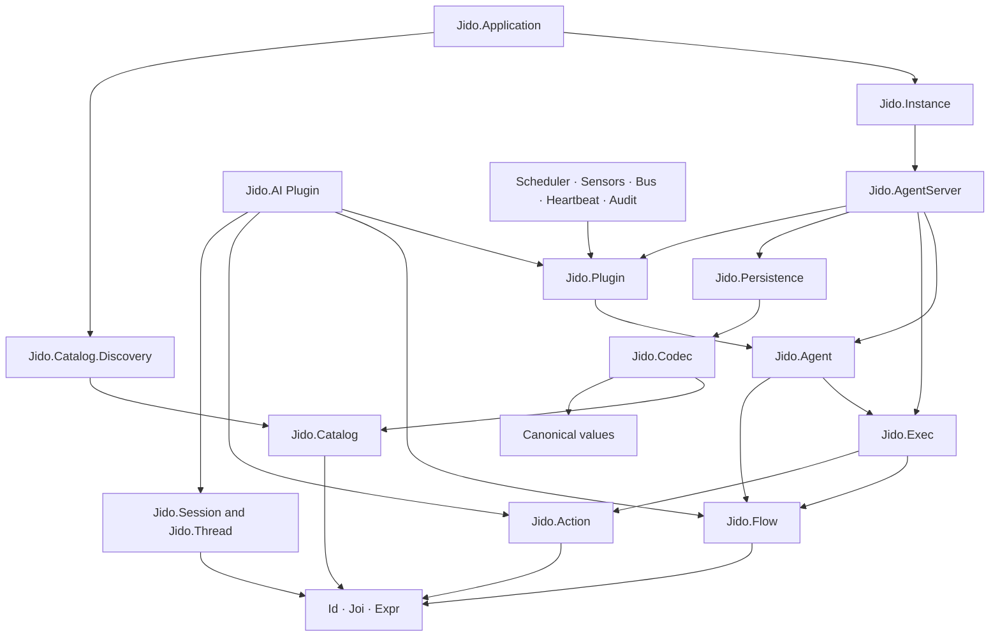

# Jido package vision

This document is a discussion draft. It separates confirmed direction from inferred design. It does not authorize a production refactor.

## Vision statement

Jido is an accessible, configurable actor runtime for Elixir, with AI capabilities built on the same runtime.

Jido V3 makes configurable, durable, and observable actors as easy to define and test as ordinary Elixir data, while OTP remains the runtime foundation. The V3 capability leap comes from one coherent runtime contract. It does not come from collecting every feature found in other Agent frameworks.

An Agent is the fixed definition and current immutable state value of an actor. AgentServer is its OTP runtime shell. A Signal enters the actor mailbox. A Flow defines the actor behavior for that Turn. Actions are the validated units of work inside the Flow. The Flow returns a complete next state plus explicit runtime requests. AgentServer serializes Turns, commits accepted state, and owns effects, recovery, timers, and process lifecycle.

Plugins add complete capabilities without changing the Agent core. AI, scheduling, sensors, Signal buses, heartbeat, and audit are first-party Plugins. AI reasoning is implemented as a Flow. AI tools are Actions or Flows.

Catalog gives definitions stable identity and application-wide discovery. Extra packages, such as Jido Chat, publish definitions into the same Catalog so Agents can find and use installed capabilities without package-specific wiring. Codec controls representation at transport and storage boundaries. Persistence controls durable bytes and recovery contracts.

The package is one Mix project and one OTP application. Its namespace boundaries still let each concept change independently.

Developer experience is a primary product goal. OTP gives experts excellent primitives, but many developers struggle to combine actor state, message protocols, supervision, workflow execution, effects, persistence, and AI safely. Jido breaks that work into solid, named primitives with one progressive path from an Action to a complete Agent runtime.

## Confirmed direction

- `Jido.Catalog` is a new top-level concept.
- Jido is a configurable actor runtime with AI capabilities.
- Jido makes actor and Agent development accessible without hiding the important OTP lifecycle and failure model.
- An Agent is the configurable definition and state hosted by the actor runtime.
- A Flow that composes Actions is the behavior boundary for an AgentServer Turn.
- A direct Action route is convenience syntax. The runtime normalizes it to a one-step Flow.
- Catalog is application-wide. All Jido instances in the OTP application use the same immutable Catalog revision.
- Installed Jido packages can contribute definitions to Catalog automatically.
- `Jido.AI` is a first-party Plugin capability.
- An AI Agent selects a root reasoning `Jido.Flow`.
- AI tools are ordinary Actions or Flows.
- `Jido.Session` and `Jido.Thread` are Agent-neutral values. AI consumes them but does not own them.
- Jido has a definite, release-specific included Plugin list. The list can evolve between releases.
- Scheduler and Sensor Manager are on the current included Plugin list.
- `Jido.AI` keeps its unique top-level namespace.
- The consolidated package keeps one Mix project and one OTP application.

## V3 capability thesis

Jido enters V3 with strong adoption and brand recognition in the Elixir Agent ecosystem. This is useful distribution leverage. It is not proof that the architecture is correct. V3 must convert that leverage into a better runtime, a clearer developer experience, and a larger extension ecosystem.

V3 is a leap forward when the same contract covers these six concerns:

| Capability | V3 target | Why it matters |
|---|---|---|
| Behavior | One Flow model for direct, managed, AI, and durable execution | Developers learn one composition language |
| Runtime | One explicit AgentServer Turn lifecycle | Cancellation, commit, effects, waits, and recovery have one owner |
| Continuation | One typed suspend and resume contract | Human approval, timers, webhooks, and external jobs use the same mechanism |
| Ecosystem | One application-wide Catalog | Installed packages can contribute capabilities without host-specific wiring |
| Developer experience | One path from Action to a running and inspectable Agent | Runtime safety becomes accessible to normal Elixir developers |
| Authority | Separate validation, authorization, and sandbox boundaries | Jido makes accurate safety claims and supports protected execution |

The product category remains broader than an AI harness. Jido is the actor runtime. `Jido.AI` is a first-party capability on that runtime. A non-AI actor and an AI Agent use the same state, Flow, AgentServer, Plugin, persistence, and observability contracts.

Jido must not compete by matching every feature in every framework. It must make the common runtime boundaries more coherent than any one specialist framework.

## Core mental model

```text
Signal
  ↓
Agent definition + current Agent state
  ↓ route
Flow
  ↓ compose
Actions and nested Flows
  ↓ execute
candidate Agent state + Directives
  ↓ validate and commit
AgentServer
  ↓ after commit
Plugin hooks, dispatch, persistence, and runtime effects
```

The state transition is data-first. OTP processes own lifecycle and failure. A process does not become the owner of a domain rule only because it runs that rule.

## Actor and Agent model

Jido uses actor and Agent as two views of one runtime unit:

- **Actor view:** identity, mailbox, serialized Turns, isolation, supervision, failure, and lifecycle.
- **Agent view:** configurable definition, immutable state, routes, Flows, Plugins, and capabilities.
- **AgentServer:** the OTP process that hosts the Agent and enforces the actor rules.
- **Jido instance:** the local actor system. It owns Agent supervision and runtime services.

This model does not replace OTP. It defines a constrained Agent execution contract on top of OTP.

Plain GenServer remains the correct tool for a small process with a fixed message protocol and local state. Jido is for actors whose behavior, capabilities, persistence, and AI or workflow composition must be configured, inspected, and evolved as application data.

## Developer experience is an architecture boundary

Most developers do not struggle with one GenServer callback. They struggle with the complete system around it:

- choosing canonical state and message data;
- separating decisions from effects;
- composing several operations;
- managing tasks, timeouts, cancellation, and stale replies;
- supervising dynamic children;
- persisting and recovering state safely;
- adding telemetry and useful status output;
- integrating AI model calls and tools;
- making all these choices consistent across several actors.

Jido must make that full problem accessible through a small set of stable primitives.

### Progressive learning path

A developer should be able to learn Jido in this order:

1. **Action:** Define and test one validated unit of work.
2. **Flow:** Compose Actions into one deterministic behavior graph.
3. **Agent:** Add identity, state, routes, and the selected Flow behavior.
4. **Plugin:** Add one reusable capability with explicit state and lifecycle ownership.
5. **AgentServer:** Run the Agent as a supervised actor with commit, effects, waits, and recovery.
6. **Jido instance:** Operate many Agents with shared runtime services and one application Catalog.

Each step must be useful by itself. A developer must not learn AgentServer internals to test an Action, Flow, or Agent transition.

### Developer experience promises

- One common path exists for the common case.
- Simple definitions use strong defaults and few required options.
- Advanced lifecycle policy is explicit and grouped by owner.
- Actions, Flows, and direct Agent Turns can be tested without starting an OTP process.
- Direct execution and AgentServer execution use the same Flow semantics.
- Compile and validation errors identify the definition, field, and source location.
- Generated definitions and plans can be inspected as data.
- Status, history, and telemetry use the same runtime vocabulary.
- A live inspector can use public semantic events without reading private process state.
- Documentation teaches the same architecture that the code enforces.
- Escape hatches use normal Elixir modules, Actions, Plugin runtime children, and OTP supervision.
- The basic path does not require knowledge of Ash, Spark, Runic, `:gen_statem`, or generated implementation modules.
- Ash and other application frameworks can integrate without becoming mandatory Jido concepts.
- Jido does not hide process crashes, supervision, mailboxes, or delivery guarantees behind misleading language.

### First-hour outcome

A developer who knows Elixir but does not know Jido should be able to complete these tasks in the first hour:

1. Define validated Agent state.
2. Define and test one Action.
3. Compose and test one Flow without starting a process.
4. Route one Signal to that Flow.
5. Start the Agent under AgentServer.
6. Inspect the current state, active Turn, waits, effects, and last failure.

If this path requires knowledge of internal DSL expansion, generated modules, or AgentServer callbacks, the developer experience has failed.

### Complexity budget

Every public primitive must remove more concepts from application code than it adds to the Jido API.

A new option, callback, behavior, or data type must satisfy at least one of these tests:

- it protects a runtime invariant;
- it hides repeated lifecycle or boundary policy;
- it defines a real extension or adapter contract;
- it makes a runtime decision inspectable as data.

If it only renames an OTP operation or forwards options, it does not belong in the public model.

## Package promises

### 1. Canonical values stay portable

Agent, Signal, Flow, Instruction, Session, Thread, and Trace are immutable values with explicit invariants.

Portable values do not contain PIDs, task references, timers, ports, storage adapters, or process-local context.

### 2. Decisions precede effects

An Agent Turn produces a complete candidate state and a list of Directives. AgentServer validates and commits the candidate before it executes runtime-owned work.

A failed post-commit effect does not roll back an accepted Agent state.

Recovery classifies an external effect as known complete, known failed, safe to retry, or uncertain. It does not silently run an uncertain effect again.

### 3. Flow is the Agent behavior boundary

Flow composes Actions and other Flows. An Agent route selects a Flow as the
executable behavior for one Turn. A direct Action route is authoring sugar
for a one-step Flow.

`Jido.Agent.Runner` keeps one private prepared execution value. It lowers both
Action and Flow routes to a Flow instruction before execution. Each
AgentServer Turn selects managed or durable host policy from the activation's
persistence capability, not from the authored route kind. Host policy does not
change Flow meaning.

AI reasoning recipes, business workflows, tool orchestration, waits, handoffs, parallel work, and loops can use the same Flow model and Exec semantics.

Actions remain useful and independently testable leaf units. They do not become an alternative actor behavior model beside Flow.

The same Flow supports three execution contexts:

- direct execution for tests and local composition;
- managed execution inside AgentServer;
- durable execution with checkpoints, typed waits, and later continuation.

These contexts can add lifecycle policy. They cannot change Flow meaning. Durable execution is a runtime policy over Flow, not a second workflow language.

### 4. Plugins add vertical capabilities

A Plugin can contribute only the facets it needs:

- Agent authoring data and DSL sections;
- one owned Agent state field;
- route selection or preparation;
- Directives and pure state reduction;
- AgentServer admission or post-commit work;
- a supervised runtime child;
- persistence conversion for its owned state.

The Plugin contract owns callback order and separation. Each Plugin owns only its state and lifecycle.

### 5. Catalog names definitions application-wide

Catalog owns stable identity for discoverable definitions. It answers which definition exists for a stable ID, version, kind, or target.

One Catalog revision is shared by the complete OTP application. A Jido instance does not own a private catalog.

Installed packages contribute static definitions automatically. Jido Chat, for example, can publish Agents, Flows, Actions, Plugins, schemas, and codec providers without adding package-specific registration code to the host application.

Catalog is trusted inventory. It is not authorization. It does not grant permission to execute a module.

Catalog converts Jido adoption into ecosystem value. A package becomes more useful when its definitions can appear in every Jido application through one stable contribution protocol.

### 6. Codecs own representation

Codec owns document versions, JSON and storage representations, value limits, encode and decode issues, and codec providers.

Codec can use an explicit Catalog to resolve stable references. Catalog does not own JSON or storage formats.

### 7. Runtime services do not leak into values

AgentServer, Signal Bus, Plugin runtimes, Persistence adapters, and AI inference clients can depend on stable values. Stable values cannot call those runtime services.

### 8. Observability does not own behavior

Telemetry and tracing observe a feature. They do not decide Agent state, recovery, routing, or retry policy.

AgentServer, Flow, Actions, and Plugins emit stable semantic events. Status views, history, traces, metrics, and a live inspector derive from those events. An operational tool does not need private process inspection to explain a Turn.

### 9. Accessibility without false simplicity

Jido makes the actor pattern accessible through solid primitives, coherent defaults, pure test boundaries, and a common runtime vocabulary.

It does not pretend that distribution, external effects, supervision, or failure are simple. It exposes those concerns at the layer that owns them.

### 10. Waits and continuations are general runtime values

A Flow can suspend with a typed wait. AgentServer persists or retains the continuation, receives a matching Signal, validates the response, and resumes the Flow once.

Human approval, timers, webhooks, external jobs, and AI tool approval use this same boundary. AI middleware does not own a separate pause and resume system.

### 11. Authority and sandboxing stay explicit

Action validation, application authorization, Catalog visibility, process isolation, and code sandboxing are different controls.

An Action is the approved application facade for work. A Catalog view limits which definitions an Agent can select. An optional execution capability can add a real sandbox, network policy, secret injection, or resource limits.

Jido does not describe an ordinary BEAM process as a sandbox.

## Main design boundaries

| Namespace | Owns | Does not own |
|---|---|---|
| `Jido.Agent` | Agent definitions, instances, routes, topology, candidate transitions | Process lifecycle, durable commit, effect execution |
| `Jido.Action` | One validated unit of work | Workflow structure or Agent commit |
| `Jido.Flow` | The Agent behavior boundary, composition, and graph invariants | Live process lifecycle or durable Agent state |
| `Jido.Exec` | Binding, compilation, execution semantics, typed waits, continuations, and handoffs | Agent commit and Plugin lifecycle |
| `Jido.Plugin` | Capability extension contract and facet ownership | Core Agent commit policy |
| `Jido.AgentServer` | Admission, serialization, commit, continuation lifecycle, recovery, effects, timers, tasks, status, and semantic events | Canonical Agent definition policy |
| `Jido.Signal` | Canonical event envelope and pure routing data | Bus lifecycle and external delivery ownership |
| `Jido.Catalog` | Application-wide definition identity, version, kind, provider, and target lookup | Encoding, authorization, and execution |
| `Jido.Codec` | Boundary representation and codec selection | Definition discovery and runtime startup |
| `Jido.Persistence` | Durable records, byte store, adapters, and recovery contracts | Live Agent process state |
| `Jido.Session` | Agent Session identity, revision, lifecycle, and Thread | AI model calls and storage |
| `Jido.Thread` | Append-only Agent interaction entries | AI projection, process lifecycle, and storage |
| `Jido.AI` | AI Plugin authoring, reasoning Flows, tools, model boundary, budget, and usage | Agent core, Session ownership, and Thread ownership |
| `Jido.Instance` | Per-instance supervision, names, configuration, and Agent Address resolution | Package-global application startup |
| `Jido.Application` | The single package application composition root | Per-Agent business rules |

## Catalog working design

The current `Jido.Codec.Registry`, `Jido.Codec.Manifest`, and `Jido.Discovery` contain the start of Catalog. The target separates identity from representation and publishes one Catalog for the complete OTP application.

### Proposed shallow modules

```text
Jido.Catalog
├── Entry
├── Manifest
└── Discovery
```

- `Jido.Catalog` is an immutable catalog value and its query API.
- `Jido.Catalog.Entry` is one stable definition record.
- `Jido.Catalog.Manifest` validates static entries published by a provider.
- `Jido.Catalog.Discovery` collects package manifests and atomically publishes the application-wide default.

### Proposed entry data

```elixir
%Jido.Catalog.Entry{
  id: "my_app/send-email",
  vsn: 1,
  kind: :action,
  target: MyApp.SendEmail,
  provider: MyApp.SendEmail,
  application: :my_app,
  name: "Send email",
  description: "Sends one validated email"
}
```

Catalog can include Actions, Flows, Agents, Plugins, schemas, atoms, and codec providers. A consumer decides which kinds it accepts.

The likely provider hook becomes catalog-neutral, such as
`__jido_catalog_manifest__/0`. Because V3 is unreleased, migrate all callers
and remove `__jido_codec_manifest__/0` in the same change. Do not keep a thin
compatibility hook.

### Package contribution protocol

An installed package must be able to contribute definitions without host-specific registration code.

The preferred model is deterministic package metadata, not an unrestricted scan that executes arbitrary modules:

1. A package builds one static Catalog manifest or one known provider list.
2. Its OTP application metadata identifies that provider.
3. Catalog Discovery collects providers from loaded Jido-aware applications.
4. It validates all entries and rejects conflicts before publication.
5. It publishes one immutable Catalog revision atomically.
6. A package loaded later can trigger one explicit refresh.

This makes Jido Chat and other extension packages visible automatically while keeping startup behavior inspectable and repeatable.

Automatic appearance means automatic inventory. It does not mean that every Agent can execute every entry. An Agent, Plugin, or application policy can restrict the Catalog kinds and targets it accepts.

### Dependency rule

```text
Catalog value ← Codec, Flow documents, Agent documents, tools, and user interfaces
Catalog Discovery ← Application composition and installed package metadata
Catalog value must not depend on Codec or Discovery
```

The application-wide default Catalog is a runtime convenience. Pure APIs receive a Catalog value explicitly. All Jido instances see the same published revision.

### Shape points

- Use one public, application-wide Catalog instead of separate public definition and codec registries.
- Let Codec derive codec indexes from Catalog entries if this stays simple.
- Keep a private codec index only when it materially improves validation or lookup.
- Keep Catalog refresh atomic and revisioned.
- Reject duplicate stable references and conflicting targets before publication.
- Make package contributions visible in Catalog inspection and diagnostics.
- Keep authorization outside Catalog.

## Plugin capability model

The package has a small kernel and a set of included capabilities.

```text
Included capability
  ↓ implements
Jido.Plugin contract
  ↓ extends
Jido.Agent definition and state
  ↓ selects
Jido.Flow
  ↓ composes
Jido.Action and nested Jido.Flow
  ↓ runs through
Jido.Exec
  ↓ coordinated by
Jido.AgentServer
```

### Current included Plugin list

The included list is definite for each Jido release. It is not a claim that every current Plugin must remain forever. A Plugin is added or removed through a deliberate package and compatibility decision.

`Jido.AI` is unique and keeps its top-level namespace. Its implementation still uses the Plugin contract.

| Capability | Primary role | Portable ownership | Runtime ownership |
|---|---|---|---|
| `Jido.AI` | Model-backed reasoning and tools | Reasoning Flow, defaults, tools, Session and Thread references | Inference calls and AI telemetry integration |
| `Jido.Plugin.Scheduler` | Delayed and recurring Signals | Recurring schedule definitions and generations | Local timers or an external delivery adapter |
| `Jido.Plugin.SensorManager` | Supervised input sensors | Desired sensor definitions | Sensor child lifecycle and reconciliation |
| `Jido.Plugin.Bus.Manager` | Agent-owned Signal Bus | Bus configuration | Bus child lifecycle |
| `Jido.Plugin.Bus.Client` | Signal Bus input | Subscription configuration | Subscription, acknowledgement, and retry lifecycle |
| `Jido.Plugin.Heartbeat` | Periodic Agent input | Plugin options | One timer and Signal delivery |
| `Jido.Plugin.Audit` | Committed domain audit | Bounded audit records in Agent state | No runtime process |

Persistence is a Plugin facet, not a separate Plugin product. Any Plugin can define how its owned state dumps and loads. `Jido.Persistence.Plugin` executes that contract.

Catalog exposes the installed included Plugins and extension-package Plugins as definitions. Documentation and runtime inspection must be able to show the exact list for the running application.

## AI as a Plugin

`Jido.AI.Agent` is a convenience authoring facade over a normal `Jido.Agent` with the AI Plugin installed.

The AI Plugin contributes:

- the `ai`, `reasoning`, and `tools` authoring sections;
- one `jido.ai.request` route;
- the selected reasoning Flow and its defaults;
- the ordered tool set;
- Session and Thread projection for model messages;
- model-call context, budgets, usage, and AI telemetry.

The root reasoning unit is a Flow. A reasoning strategy is therefore a reusable Flow recipe, not a hidden AgentServer pipeline.

Model calls and tool execution are Actions inside that Flow. The model vendor is behind `Jido.AI.InferenceClient`.

This boundary gives these useful properties:

- Core Agents do not depend on AI.
- Non-AI Agents can still use Session and Thread.
- New reasoning methods use ordinary Flow composition.
- AI tools use the same Action and Flow contracts as other work.
- AgentServer does not need AI-specific lifecycle rules.

## Distribution model

The consolidated package is one distribution with explicit internal layers.

This gives users:

- one dependency;
- one configuration root;
- one OTP application;
- one compatible set of Agent, Flow, Plugin, Codec, and Persistence contracts;
- included capabilities that work together without cross-package version drift.

Consolidation does not mean that every feature is core. AI and runtime integrations remain optional capabilities in the dependency graph, even when their code ships in the same package.

## External comparison baseline

The detailed [agent framework comparison references](agent-framework-comparison-references.md) review current Hex packages and relevant repositories from Mike Hostetler's GitHub stars.

Jido has stronger current adoption signals than most direct peers. This gives V3 a migration path, an audience, and a base for extension packages. Adoption does not replace technical evidence. Hex downloads can include indirect and automated use, and brand recognition cannot make a weak runtime contract safe.

These references are tests, not target architectures:

| Reference | Strongest idea | Jido should learn | Jido should not copy |
|---|---|---|---|
| Sagents | Complete interactive AI developer experience | Setup help, approval flow, semantic events, persistence, and live debugging | An AI-specific Agent core or one generic middleware chain for every concern |
| Aikido | Ash resources with durable keyed activation | Stable identity, shared runtime ownership, snapshot policy, and explicit recovery limits | Mandatory Ash and Spark knowledge for the basic Jido path |
| Alloy | A small and disciplined model and tool loop | Keep provider and loop policy inside `Jido.AI` | Reduce Jido to an AI harness that leaves actor lifecycle to every application |
| Condukt and Legion | Protected execution and explicit authority | Separate sandbox, network, secret, and authorization controls | Treat OTP process isolation as a security sandbox |
| GenAgent | Explicit state-machine lifecycle | Separate runtime mechanics from Turn semantics | Define every Agent as a persistent LLM session |
| BeamWeaver and Hayata | Graph execution, checkpoints, and recovery | Make Flow inspectable and define uncertain-effect recovery | Add a second graph language or one process for each Flow abstraction |
| ExAgent and Nous | Progressive layers and useful included features | Give developers a direct path and strong defaults | Put every AI, memory, workflow, and user-interface feature in the kernel |
| Synapse | A full downstream orchestration system | Make Signals, Flow, Catalog, persistence, and telemetry sufficient for extension packages | Require a downstream package to build a second Agent runtime around Jido |
| Imp | Declared and measurable model programs | Keep AI definitions and Flow plans inspectable and evaluable | Let optimization mutate a running Agent definition invisibly |

### Feedback from the comparison

**Strongest opportunity:** Jido can combine a general actor runtime, one Flow behavior model, optional AI, durable continuation, and application-wide discovery. No reviewed specialist framework combines these boundaries with the same product position.

**Strongest risk:** Jido can become a large set of DSLs, callbacks, and included features without one clear runtime model. Popularity would then increase migration cost without improving developer confidence.

**Most important developer-experience gap:** Sagents makes an interactive AI agent easy to start and inspect. Jido must match that clarity for both AI and non-AI actors. A live inspector and source-aware errors are more valuable than several new Plugins.

**Most important runtime gap:** A Turn needs an explicit lifecycle and durable continuation contract. The contract must cover cancellation, commit, post-commit effects, waits, recovery, and uncertain work.

**Most important ecosystem advantage:** Catalog can turn Jido adoption into a shared capability market. An extension package can publish definitions once and make them visible to every Jido application through a deterministic manifest.

**Scope feedback:** Jido core stays useful without AI. `Jido.AI` owns model and tool-loop policy. Flow remains the one behavior composition model. AgentServer owns lifecycle and commit rules. Human approval uses the general wait and continuation boundary. Sandboxing remains a separate capability.

### V3 delivery priority

The capability work should proceed in this order:

1. Define one exact Flow and AgentServer Turn contract.
2. Define the AgentServer lifecycle, commit, continuation, effect, and recovery state machine.
3. Make direct tests, source-aware errors, semantic events, status, history, and live inspection excellent.
4. Define application-wide Catalog contribution and policy-filtered views.
5. Fix Plugin ownership and make each included capability removable from an Agent.
6. Implement `Jido.AI` through the normal Flow, Action, wait, and AgentServer contracts.
7. Add or refine included Plugins only after the kernel contracts are stable.

This order prevents feature breadth from hiding a weak kernel.

## Pressure test: why not use GenServer directly?

### The strongest argument against Jido

OTP already gives Elixir applications GenServer, `:gen_statem`, Supervisor, Registry, Task, message passing, process isolation, and failure recovery.

A capable Elixir team can build an actor with a GenServer, pattern-matched messages, a state struct, supervised tasks, telemetry, and a persistence adapter. A framework can add abstraction cost, hide OTP behavior, reduce performance, create configuration sprawl, and make debugging harder.

If Jido only renames `handle_call`, `handle_cast`, and supervisor children, it has no strong reason to exist.

### The claim Jido must earn

Jido is useful when actor behavior is not one fixed callback module. The actor must combine installed capabilities, declarative workflows, application definitions, durable state, and AI-driven decisions while preserving one runtime contract.

Jido must make these concerns safer and more consistent than repeated application-specific GenServer code:

| Runtime problem | Plain OTP work that applications repeat | Jido promise |
|---|---|---|
| Configurable behavior | Message clauses and callback wiring | One Flow boundary composed from validated Actions |
| State transition | Ad hoc map updates inside callbacks | Complete candidate state with schema validation |
| Effects | I/O mixed with state mutation | Commit before explicit Directives and Plugin effects |
| Capability extension | Custom callbacks and supervisor wiring | One Plugin contract with owned facets and lifecycle |
| Durable recovery | Per-process record, revision, and conflict rules | Shared persistence contracts and explicit recovery semantics |
| Package integration | Manual module registration and configuration | Application-wide Catalog with deterministic package contribution |
| AI behavior | A separate loop and tool runtime | AI as a Plugin using normal Flow and Action semantics |
| Inspection | Custom status and telemetry for each process | Standard status, history, semantic events, and explainable Flow data |
| Runtime control | Custom timeout, cancellation, and task cleanup | One AgentServer Turn lifecycle and failure boundary |
| Developer accessibility | Expert assembly of several OTP and data boundaries | Progressive Action → Flow → Agent → Plugin → AgentServer model |

The value is not less OTP. The value is one reviewed way to use OTP for configurable Agents.

### What “safe runtime layer” means

Jido can make concrete safety claims at its boundaries:

- Signals are validated before behavior selection.
- Agent state is schema-checked before commit.
- One AgentServer serializes Turns for one Agent identity.
- A Flow is validated and compiled before execution.
- Plugin state ownership and callback order are explicit.
- Runtime effects occur after the accepted state transition.
- Timeouts, cancellation, tasks, waits, and stale messages have one lifecycle owner.
- Durable writes use explicit revision or compare-and-swap semantics.
- Portable values exclude local runtime capabilities.
- Catalog entries have stable identity, version, kind, and conflict checks.
- AI model and tool work follows the same bounded execution model as other Flow work.

Safe does not mean that all Agent code is correct or trusted.

### What Jido cannot promise

- Exactly-once external effects without cooperation from the external system.
- Correct business decisions from an Action, Flow, or model.
- Automatic authorization for every Catalog entry.
- Durable recovery when a Plugin stores local process values.
- Zero-cost abstraction over GenServer.
- Safe execution of untrusted BEAM modules.
- A replacement for application-specific supervision and security policy.

### Failure modes of the vision

The vision fails if Jido develops any of these properties:

- A simple actor requires knowledge of many internal runtime concepts.
- Common use requires knowledge of Spark, Runic, `:gen_statem`, or generated implementation modules.
- Validation errors expose generated code instead of the developer's definition and source line.
- Agent behavior can bypass Flow through several hidden callback paths.
- Direct and managed execution produce different semantic results.
- Plugins can mutate state they do not own.
- Catalog discovery is nondeterministic or executes arbitrary provider code during lookup.
- Debugging a Jido Agent is harder than debugging the equivalent GenServer.
- AI adds special runtime rules that other Plugins cannot use.
- AgentServer becomes the owner of domain rules instead of lifecycle rules.
- Framework overhead is unbounded or invisible.

### Evidence Jido should produce

The project should prove its value with executable checks and examples:

1. Implement the same configurable actor once with GenServer and once with Jido. State the extra guarantees that Jido provides.
2. Show that direct Agent evaluation and an AgentServer Turn use the same Flow semantics.
3. Add one external package to the application and show its definitions in Catalog without host registration code.
4. Add one Plugin without editing AgentServer or Agent core.
5. Recover a durable Agent after process failure without replaying an uncertain effect.
6. Explain one AI Turn from Signal through Flow nodes, Actions, model calls, state commit, and emitted Directives.
7. Measure mailbox, execution, memory, and startup overhead against a plain GenServer baseline.
8. Show that status, history, and telemetry identify the active Flow, waits, timeouts, and last committed revision.
9. Ask a developer who knows Elixir but not Jido to build one stateful actor, then record the concepts, code, errors, and time required.
10. Show that the same developer can test Action, Flow, and Agent behavior before learning AgentServer lifecycle details.
11. Build the same interactive AI agent in Jido and Sagents. Compare required concepts, setup code, approval, persistence, and debugging.
12. Build the same one-shot model and tool loop in `Jido.AI` and Alloy. Explain each extra Jido concept and guarantee.
13. Pause a nested Flow for human approval, restart its AgentServer, and resume without repeating an uncertain effect.
14. Build the same durable Agent in Jido and Aikido. Compare the public API, required framework concepts, activation, snapshots, recovery, and error messages.
15. Build a live inspector from public semantic events only. Show the active Flow, current node, wait, last commit, pending effects, and last failure.
16. Add an optional sandbox capability that can call approved Actions but cannot bypass validation, Catalog policy, authorization, budgets, or telemetry.

If Jido cannot show these differences, an application should use GenServer directly.

## What Jido is not

- It is not an AI-only framework.
- It is not a replacement for GenServer or OTP.
- It is not a process wrapper around mutable Agent state.
- It is not one GenServer for each abstraction.
- It is not a general dependency-injection container.
- Catalog is not an authorization system.
- Plugins cannot bypass Agent validation or the commit boundary.
- Flow is not only a serialization format or only an AI reasoning graph.
- Telemetry does not define business behavior.
- OTP process isolation is not a sandbox for untrusted code.
- Ash, Spark, Runic, or another application framework is not required for the basic Agent path.
- An included Plugin is not permission to place its rules in the AgentServer kernel.
- It is not the best tool for every small or fixed actor.

## High-level target dependency direction



Arrows point from consumer to dependency.

## Questions for shaping the vision

1. Does every Agent route store a Flow target, with direct Action authoring normalized to a one-step Flow?
2. What application metadata lets Jido Chat and other packages contribute Catalog manifests without scanning arbitrary modules?
3. Which layer restricts an Agent to an allowed view of the application-wide Catalog?
4. Should codec providers be ordinary Catalog entries, with no separate public Codec Registry?
5. How is the definite included Plugin list published, versioned, and changed between releases?
6. Is durable Agent state selected at the Agent, Jido instance, or individual activation level?
7. Which Plugin callbacks are stable public extension contracts and which are package-internal coordination contracts?
8. Should Session represent one Thread permanently, or can a future Agent Session own several Threads?
9. What startup, Turn, memory, and message-throughput overhead is acceptable compared with plain GenServer?
10. Which public compatibility names can change before the consolidated package reaches its stable release?
11. What must a developer accomplish in the first hour without learning Spark, Runic, or AgentServer internals?
12. What are the public AgentServer lifecycle states and allowed transitions for one Turn?
13. What data represents a durable continuation, and which runtime owns its expiry and single-resume rule?
14. Which effect outcomes are known complete, known failed, safe to retry, or uncertain?
15. What public semantic event set is sufficient for a live inspector without private process access?
16. What is the optional Ash integration boundary, and how does it avoid becoming a requirement for core Jido use?

## Suggested next discussion order

1. Define the exact AgentServer Turn and Flow contract.
2. Define the AgentServer lifecycle, continuation, commit, effect, and recovery state machine.
3. Define the first-hour developer journey and live inspection experience.
4. Pressure-test one actor against GenServer, Sagents, Aikido, and Alloy.
5. Define the Catalog package-contribution and policy-view model.
6. Publish the current included Plugin list, ownership rules, and release policy.
7. Set runtime safety, sandbox, durability, observability, and performance guarantees.
8. Set the public namespace, migration path, and compatibility plan.
