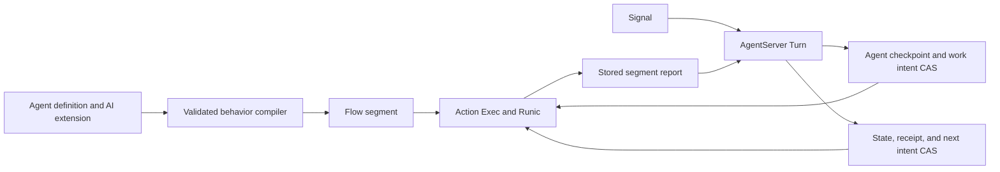

> Pending approval. Design proposal, 2026-10-15. No implementation is included.

# Durable Agents, compiled behavior, and execution commits

The durable unit is the logical Agent: its identity, committed domain state,
and accepted work obligations. A Turn is one atomic decision by that Agent.
A behavior can compile to many Runic nodes and can request several Agent
commits over its lifetime. One Agent can live through many AgentServer
processes.

This proposal defines an opt-in capability in Jido Core. Action and Runic keep
their current source and public contracts. The separate
[implementation plan](../../integration/2026-10-15-durable-agent-execution-plan.md)
defines the work order. All new DSL forms, records, and API names below are
proposals. Existing APIs are identified as current evidence. No source change
in Core, AI, Action, or Runic is authorized by this document.

This revision replaces the module-only, terminal-result-only model. It does
not require a Core Turn for each model call or tool call. Explicit commit
points divide a behavior into bounded Flow segments. Each segment can contain
many steps, loops, and parallel branches. Live graph suspension remains a
separate API proof gate.

## Scope and package decision

Core owns the atomic link between Agent state, command receipts, execution
intents, and execution commit receipts. Runic owns graph progress, runnable
scheduling, and workflow checkpoints. Action owns executable compilation and
result projection. `jido_ai` owns AI definitions, plan validation, graph
construction, model and tool policy, and AI state meaning. The storage adapter
owns the strength of a confirmed write.

This is a proposed change to the approved
[package boundary](../90_package-boundaries/design.md). That document places
durable receipts and recovery controllers outside Core. Review the narrow
exception here before implementation. Core gains recovery for executions that
its own Agents accepted. It does not gain a general workflow service, durable
transport, cluster placement, leases, or a universal Directive outbox.

The first version has these limits:

| Item | Proposed limit |
| --- | --- |
| Authority | One Jido instance on one BEAM node controls a Ref |
| Pending delegated work | One execution per behavior key; configurable finite capacity per Agent |
| Workflow target | An Action module, Flow module, or encoded runtime Flow value |
| Workflow output | Portable segment report; deferred effects use a later Agent Turn |
| Command entry | Commit-confirmed requests; no durable inbox or admission acknowledgement |
| Control Directive batch | One typed execution control Directive; internal receipt handling is part of the commit |
| Execution commits | Intermediate and final reports use ordinary Turns against current state |
| Recovery discovery | Known Refs activated by the application; no Store scan |
| External effects | Idempotent Actions, or explicit handling of uncertain work |

An ordinary attached Turn can still use an Action or Flow that returns a
complete candidate. Delegation is an explicit business decision. Duration and
target type do not select the execution mode. A native `%Runic.Workflow{}` is
not an accepted `Jido.Exec` target in the current Action API.

## OTP and Actor basis

An AgentServer is a replaceable process that controls one logical Agent.
Supervision restores the process tree. Stored records restore responsibility.
These are separate mechanisms. This follows the recovery separation in
[Armstrong's thesis, sections 4.3 and 8.3](https://www.erlang.org/download/armstrong_thesis_2003.pdf).

A delegated workflow receives data and sends commit proposals. It does not keep
authority over the Agent snapshot from its start. This applies the message and
delegation model in the
[Hewitt, Bishop, and Steiger Actor paper](https://www.ijcai.org/Proceedings/73/Papers/027B.pdf).
The record protocol below is a Jido proposal, not a protocol specified by those
papers.

Use `gen_statem` for admission, commit, and runtime control. Keep business
states such as `awaiting_approval` in `Agent.state`. Store execution waits in
execution records. Neither wait blocks AgentServer. A parallel graph branch
needs a separate Jido Agent only when it needs its own identity, inbox,
lifetime, or durable responsibility.



## Current evidence and required changes

Code and tests remain the source of truth. These facts describe the local
checkout at the date above. They are not claims that the new design exists.

| Current evidence | Consequence |
| --- | --- |
| [`Agent.Ref`](../../../lib/jido/agent/ref.ex) has namespace, partition, and id | Use that Ref as logical identity; keep PIDs out of durable identity |
| [`Persistence.Record`](../../../lib/jido/persistence/record.ex) uses exact format 3 keys | Add an explicit format migration; extra fields cannot be appended silently |
| [`Persistence.Store`](../../../lib/jido/persistence/store.ex) provides single-key byte CAS | Keep the Agent checkpoint and its work intent in one record |
| [`Storage`](../../../lib/jido/agent_server/storage.ex) saves the Agent and one revision | Separate record revision from domain state version |
| [`Turn`](../../../lib/jido/agent_server/turn.ex) replies at commit, before required hooks and Directives | Preserve that result boundary and hook order |
| [`Execution`](../../../lib/jido/agent_server/execution.ex) is the attached execution boundary | Recheck its options and cleanup against the fixed dependency revisions before implementation |
| [`ServerLifecycle`](../../../lib/jido/agent_server/server_lifecycle.ex) restores with no active Turn | Add recovery from stored execution intent |
| Action `Exec.start/6` and `resume/4` require portable data | Migrate live handles out of managed execution data |
| Action `Exec.Compiler` accepts `%Jido.Flow{}` values | Module-only delegation was a draft restriction, not an Action restriction |
| Action `Flow.Codec` uses a trusted Registry | Store a validated graph document with its registry version |
| Runic start replies before input persistence; completion callbacks do not confirm persistence | Add explicit checkpoint and recovery gates |
| Runic background Workers use transient restart | Construct Workers in manual dispatch mode so an automatic replacement cannot dispatch stale work |

The existing integration document `docs/integration/started-execution.md`
describes the earlier local execution approach. It needs a rewrite during
implementation. Its no-Store and owner-option claims are not prerequisites
for this proposal.

### Runic AI design evidence

The reference is `zblanco/runic_ai` at
`98d32c85fab8251c6da7b8ea2cde50b58505fef3`. These are source observations,
not test results from Jido:

- [WorkflowBlueprint](https://github.com/zblanco/runic_ai/blob/98d32c85fab8251c6da7b8ea2cde50b58505fef3/lib/runic_ai/assistant/rlm/workflow_blueprint.ex)
  represents a generated plan as data.
- [WorkflowCompiler](https://github.com/zblanco/runic_ai/blob/98d32c85fab8251c6da7b8ea2cde50b58505fef3/lib/runic_ai/assistant/rlm/workflow_compiler.ex)
  validates a blueprint and builds native Runic graph components.
- [ComponentFactory](https://github.com/zblanco/runic_ai/blob/98d32c85fab8251c6da7b8ea2cde50b58505fef3/lib/runic_ai/rlm/component_factory.ex)
  lowers map and reduce shapes to native components.
- The [state ownership guide](https://github.com/zblanco/runic_ai/blob/98d32c85fab8251c6da7b8ea2cde50b58505fef3/guides/stateless-vs-stateful-agents.md)
  distinguishes application state from workflow-owned state.

Runic AI also has a custom executor and an optional Runner path. Its session
server calls backend operations inside callbacks. Those facts do not prove
that Jido has a ready-made durable or nonblocking integration. Use the graph
compilation model as the reference; prove the Jido execution boundary below.

## State ownership and compilation

| Value | Authoritative owner | Stored form |
| --- | --- | --- |
| Agent identity and domain state | Core Agent commit | Agent checkpoint |
| Accepted behavior and work obligations | Core execution protocol | Agent runtime envelope |
| Published AI messages, accepted goals, approvals | AI Plugin through Core commit | Agent state or durable artifact references |
| Node progress, branch results, local accumulators | Runic | Runic checkpoint |
| Plan and graph meaning | AI compiler | Versioned plan and Flow document |
| Clients, credentials, PIDs, connections | Runtime services | Trusted configuration; portable service IDs in input |

A workflow input can include an immutable Agent view and a state version.
That view is not write authority. A later report is evaluated against current
Agent state. A published conversation is not also held as a second writable
copy in a workflow accumulator. Unpublished model outputs and branch history
can remain in the workflow log.

There are two compilation stages:

1. Definition compilation lowers the DSL or data input to one canonical Agent
   definition, ordinary routes, Plugin declarations, and behavior templates.
2. Execution compilation validates a selected or generated plan and constructs
   concrete Flow values from a trusted component catalog.

Runic executes the resulting graph. Core does not traverse the plan, select
nodes, implement map/reduce, or repair a failed AI plan. Core stores execution
identity and semantic handoffs. It does not store a second node cursor.

This follows the existing public AI authoring direction:
[`Jido.AI.Authoring.lower/2`](../../../../jido_ai/lib/jido_ai/authoring.ex)
already lowers profiles to ordinary Core definitions. The new authoring forms
below extend that model. They do not add a second Agent definition format.

## Concrete proposed Agent DSL

This example defines the target syntax. It is not executable with the current
DSL. The schema and route blocks follow current Core authoring. The `ai`,
`behavior`, `plan`, `commit`, `completed`, and `control` declarations are
proposed `jido_ai` extension syntax. Referenced application modules are
placeholders with declared Action or schema contracts.

```elixir
defmodule MyApp.ResearchAgent do
  use Jido.Agent,
    name: "research_agent",
    vsn: 2,
    metadata: %{domain: "research"},
    extensions: [Jido.AI.DSL]

  state do
    schema(MyApp.ResearchState.schema())
  end

  ai do
    behavior :research do
      input_schema(MyApp.ResearchRequest.schema())
      model(:research_model)
      tools([MyApp.Search, MyApp.ReadSource, MyApp.WriteReport])

      plan do
        planner(MyApp.ProposeResearchPlan)
        catalog(MyApp.ResearchComponents, version: 3)
        schema(MyApp.ResearchPlan.schema())
        max_nodes(24)
      end

      execution(key: [:data, :request_id], admission: :reject)
      limits(max_concurrency: 4, max_model_calls: 40,
             max_repair_attempts: 2, timeout_ms: 900_000)

      commit :plan, type: "research.plan.proposed",
        schema: MyApp.ResearchPlan.schema()
      commit :finding, type: "research.finding.proposed",
        schema: MyApp.Finding.schema(), rejects: [:stale_request]
      commit :approval, type: "research.approval.proposed",
        schema: MyApp.ApprovalRequest.schema()
      completed type: "research.completed",
        schema: MyApp.ResearchOutcome.schema()

      control :correct, type: "research.corrected"
      control :approve, type: "research.approved"
    end
  end

  routes do
    route "research.requested", ai(:research), as: :research, do: state(:unchanged)
    route "research.plan.proposed", MyApp.AcceptResearchPlan, do: state(:unchanged)
    route "research.finding.proposed", MyApp.PublishFinding, do: state(:unchanged)
    route "research.approval.proposed", MyApp.RequestApproval, do: state(:unchanged)
    route "research.completed", MyApp.CompleteResearch, do: state(:unchanged)
    route "research.corrected", MyApp.CorrectResearch, do: state(:unchanged)
    route "research.approved", MyApp.ApproveResearch, do: state(:unchanged)
  end
end
```

`ai(:research)` is an authoring reference. The lowerer replaces it with an
ordinary Action or Flow that accepts a goal and returns start intent. It is
not a runtime route target kind. The route still selects one executable.

`MyApp.ResearchState` owns accepted goals, a goal revision, published findings,
and approval state. The AI Plugin owns its declared fields. Model configuration,
tool definitions, and compiler templates belong to definition data. They are
not live clients in Agent state.

The proposed extension has these rules:

| Declaration | Lowered meaning |
| --- | --- |
| `input_schema` | Entry input contract |
| `model`, `tools` | Trusted capability bindings; no credentials |
| `plan` | Planner template, catalog version, plan schema, and node limit |
| `execution` | Portable business key and per-key admission rule |
| `limits` | AI policy plus supported Runic scheduling policy |
| `commit` | Allowed report name, Signal type, payload schema, and declared domain rejection codes |
| `completed` | Final report binding |
| `control` | Allowed external control Signal; ordinary route owns the decision |

The reference declaration uses `admission: :reject`: an active execution with
the same behavior and business key rejects a new start. Replacement and queued
admission need separate cancellation and inbox contracts. A behavior can use
many Runic branches without creating child Agents.

Equivalent module, Builder, and Codec inputs lower to the same canonical
definition. Store lowered data, not Spark entities. The compiler resolves
catalog and schema IDs through trusted registries. Unknown names, tools, report
bindings, and unsupported limits fail validation before work starts.

## Execution shape and Flow API gaps

### Recommended first path: explicit commit segments

An execution is a durable behavior instance. A segment is one managed Action
or Flow execution between semantic commit points. The compiler can place many
model calls, tool calls, choices, iterations, and map/reduce branches in a
segment. It splits only when authoritative Agent state or external input is
needed.

For example:

```text
planner Flow
  -> plan report -> Agent accepts plan
investigation Flow with native map/reduce and bounded repair
  -> finding report -> Agent publishes findings
review Flow
  -> approval report -> Agent records approval wait
ordinary approval Signal -> Agent validates approval
report Flow
  -> final report -> Agent commits completion
```

Each segment has its own public Runner workflow ID and Runic checkpoint. All
segments share one logical execution Ref and accepted plan lineage. The next
segment descriptor is data from trusted compiled behavior. Core starts that
descriptor after the related Agent commit and hook gate. It does not interpret
AI graph edges.

This path uses the existing final-result contract at each semantic boundary.
It does not claim that `Jido.Exec.result/2` can observe intermediate commit
ports or that a live workflow can wait durably for an arbitrary new input.
A future live commit node can use the same logical protocol only after its
public API, persistence, and cancellation tests pass.

### Gap register

These are current source observations, not executed compatibility tests.
Links cross sibling repositories and are for local review.

| Gap | Current public surface | Decision and proof gate | Owner |
| --- | --- | --- | --- |
| `FLOW-GAP-001` Runtime Flow targets | [Exec compiler](../../../../jido_action/lib/jido_exec/compiler.ex) accepts `%Jido.Flow{}` | Remove the draft module-only limit; prove start, checkpoint, resume, result, and Codec round trips for generated values | Core consumer and AI compiler |
| `FLOW-GAP-002` Stored graph identity | [Flow](../../../../jido_action/lib/jido_flow.ex) and [Codec](../../../../jido_action/lib/jido_flow/codec.ex) expose canonical data and registry encoding | Store encoded Flow, graph digest, registry version, compiler version, and deployment ID; semantic identity alone does not pin code | AI compiler; Core validates descriptors |
| `FLOW-GAP-003` Native graph targets | Exec accepts Instructions, modules, and Flow values; it rejects arbitrary `%Runic.Workflow{}` | No raw graph support in this plan; report which AI components cannot lower to Flow | Action owns a possible future executable contract |
| `FLOW-GAP-004` Stateful components | Flow lists step, subflow, choice, map, reduce, iterate, and dispatch | Prove each required AI shape; arbitrary rules and persistent accumulators are not exposed as general Flow component kinds | AI compiler; any lower-layer extension is separate work |
| `FLOW-GAP-005` Intermediate commits | [Exec result](../../../../jido_action/lib/jido_exec.ex) projects an execution result; no declared commit/ack port | Use segment reports first; keep live commit ports unimplemented until a public integration contract is proven | Core protocol and AI compiler |
| `FLOW-GAP-006` Wait and resume input | [Runic Runner](../../../../runic/lib/runic/runner.ex) has input and resume APIs; Exec adds its managed input identity and result projection | Use a stored semantic wait and a new segment; do not infer that raw Runner input is a supported Exec resume protocol | Core control; Action owns any future managed input API |
| `FLOW-GAP-007` Graph mutation | `Workflow.add` constructs graph values; no managed Exec graph replacement API is declared | Compile a new versioned segment after an accepted plan revision; no hot graph mutation | AI compiler |
| `FLOW-GAP-008` Runtime resources | Exec start and resume require portable context; Runic does not persist runtime context or policy | Rebind versioned service IDs and policy on every start/resume; no clients or secrets in graph closures | Runtime configuration and trusted Actions |
| `FLOW-GAP-009` Durable observations | Completion and observations are not Store acknowledgements | Confirm checkpoints, classify saved input, and test restored result selection | Core execution helper |
| `FLOW-GAP-010` Effect replay | A stored graph does not prove exactly-once external I/O | AI declares replay class; use provider idempotency or block uncertain work; do not auto-resume an unsafe scope | AI policy and Core release gate |
| `FLOW-GAP-011` Return effects | Flow can collect deferred effects from nodes | Delegated segments return report data with an empty effect list; commit reducers can return ordinary Directives | Core validation and AI compiler |

Do not hide a native Runic graph or a second scheduling loop inside one Action
to claim that these gaps are closed. A component that cannot lower faithfully
remains unsupported. Action and Runic stay unchanged. A failed proof produces
a named limit or a separate API proposal for review.

## Durable record model

### 1. Agent record, format 4

Keep the current Agent key derived from the Ref. Keep the existing Agent
checkpoint format inside the record. Add the following fields to active records:

```elixir
%{
  format: 4,
  kind: :active,
  namespace: namespace,
  partition: partition,
  agent_id: id,
  agent_module: module,
  agent_vsn: agent_vsn,
  revision: record_revision,
  state_version: state_version,
  checkpoint: agent_checkpoint,
  runtime: %{
    format: 2,
    incarnation_id: incarnation_id,
    command_epoch: 0,
    command_receipts: %{command_id => receipt},
    next_execution_seq: 2,
    retired_execution_seq: 0,
    executions: %{1 => execution},
    artifacts: %{artifact_digest => versioned_document}
  }
}
```

`revision` controls storage CAS. It increases by one on every record write.
`state_version` increases by one only when a normal Turn commits an Agent
candidate. Intent-control writes do not create business Turns. An activation id
remains transient observation data and is not a storage fence.

`incarnation_id` is created once for a new logical lifetime. Restore preserves
it. Delete and an explicit new creation use different incarnations. This
prevents old execution results from matching a newly created Agent with the
same Ref. Tombstones retain the incarnation and record revision.

One CAS can contain a new checkpoint, a command receipt, a report receipt, and
a next-segment intent. There is no transaction across the Agent key and the
Runic key. The stored intent and report receipt are the recovery link between
those writes. Runtime envelope format 2 is proposed; no deployed format 4 or
format 1 envelope is claimed by this document.

The runtime envelope is Core-owned data. Custom Agent checkpoint callbacks
cannot omit it. Agent domain state still contains the application's meaning,
such as the order id, pending operation id, and business status. Update the
conditional recoverable-work contract in
[seam 06](../06_commit-and-effects/design.md#explicit-recoverable-work)
to describe this atomic envelope.

### 2. Command receipt

```elixir
%{
  command_id: "confirm-order-184",
  epoch: 0,
  fingerprint_format: 1,
  fingerprint: <<...>>,
  state_version: 18,
  execution_refs: [execution_ref],
  status: :committed
}
```

The caller supplies the command id and epoch. The fingerprint covers the
complete portable source Signal and caller context, before Core adds runtime
fields. Fingerprint format 1 is SHA-256 over deterministic ETF encoding of
that pair. Store the fingerprint format with the receipt. A retry uses the
same Signal envelope and context. Equal id and equal fingerprint return the
original receipt. Different data return
`:command_conflict`. A receipt confirms the Agent commit, not workflow success
or hook success. It does not contain a stale Agent snapshot.

There is no stored `:accepted` command state in this version. Before commit,
the command has the same failure boundary as `call/3`. A retry can repeat
pre-commit I/O. Durable command decision Actions therefore use pure decisions,
or idempotent I/O. Work that needs recovery goes in the delegated execution.
The runtime can require this contract but cannot prove that user code is pure.

Default receipt capacity is 1,024 per epoch. Capacity exhaustion rejects a new
durable command before evaluation. No automatic expiry removes duplicate
protection. An explicit epoch close clears receipts and rejects every later
request from the closed epoch. A recreated Agent also rejects commands from
the previous incarnation.

### 3. Delegated execution record

```elixir
%{
  ref: %Jido.Execution.Ref{agent: agent_ref, incarnation: incarnation_id, seq: 1},
  behavior: %{id: :research, version: 2, key: "request-184"},
  requested_by: %{command_id: "research-184", state_version: 18},
  program: nil,
  segment_seq: 1,
  segment_history: %{},
  segment: %{
    workflow_id: {:jido_execution, agent_ref, incarnation_id, 1, 1},
    target: %{kind: :flow_document, digest: graph_digest, registry_version: 3},
    input: %{request_id: "request-184", goal: "Compare storage options"},
    report_id: "execution-1/segment-1/report-1",
    phase: :pending
  },
  context: %{tenant_id: "a", idempotency_key: "research-184"},
  profile: %{name: :default, version: 1, deployment_id: "release-42"},
  policy: %{max_concurrency: 4, replay: :require_idempotency},
  deadline_at: nil,
  report_bindings: %{plan: plan_binding, finding: finding_binding,
                     approval: approval_binding, completed: completion_binding},
  release: :awaiting_post_commit,
  required_after_commit_hooks: [],
  phase: :pending,
  control_version: 0,
  cancel_requested: nil,
  pending_report: nil,
  report_receipts: %{},
  input_receipts: %{},
  wait: nil,
  terminal: nil,
  delivery: :not_ready,
  completion_id: completion_id,
  acknowledged_at_state_version: nil,
  attention: nil
}
```

All values in this record are portable. Core assigns the execution sequence,
segment sequence, and Ref before commit. `workflow_id` is the public ID passed
to `Jido.Exec`. A segment retry keeps that ID. A new segment gets a new ID.
Core does not derive or read Action's private managed execution identity.

Target descriptors are `:action_module`, `:flow_module`, or `:flow_document`.
Module IDs resolve through a trusted registry. A Flow document is encoded with
`Jido.Flow.Codec`; it is not a raw executable struct in the Agent checkpoint.
Its digest identifies exact versioned document bytes. It is not a code-version
guarantee. The artifact envelope records compiler, catalog, and registry
versions plus deployment ID. Artifact and report bytes count toward the Agent
record limit. Large artifact storage needs a separate immutable-reference
contract; this plan does not silently add one.

`program` is generic executable provenance: a revision and artifact digest
committed by an Agent Turn. For AI, it identifies the accepted plan. Core
neither interprets that plan nor infers acceptance from a binding named `plan`.
The ordinary domain reducer validates the proposal. The binding explicitly
permits program adoption. Only that successful commit can install the new
program reference and release its graph.

The planner segment can run before a program exists. Effectful segments based
on that plan cannot start before acceptance. A revised plan is a new program
revision; it does not overwrite a running segment's provenance. A report from
an older revision can be rejected by the current Agent reducer.

The stored profile identifies versioned runtime configuration. Portable policy
values are stored with the intent. Hooks, callback functions, executors, and
credentials are resolved from trusted instance configuration. Start and resume
use the same profile version and deployment id. A mismatch blocks recovery;
it does not run new code against old work without an explicit migration.
This check does not pin BEAM code. In-place code changes during pending work
are outside the first version's contract.

Version one fixes the executor to Runic's native Task executor and the
checkpoint strategy to `:every_cycle`. Profiles can set supported execution
policy and concurrency values. Custom executors and dispatch hooks need a
separate cleanup and recovery contract before support is added.

The completion ID is stable for the logical execution. Intermediate report IDs
are allocated in segment input before dispatch. They are not generated by a
replayed node. Reports include execution and segment identity. They do not
carry an authoritative replacement Agent snapshot.

The hook id list records the required hook set at the intent commit. Recovery
does not infer an empty hook set from a changed Plugin definition.

### 4. Segment report and commit receipt

```elixir
%Jido.Execution.Report{
  format: 1,
  execution_ref: execution_ref,
  segment_seq: 2,
  report_id: "execution-1/segment-2/report-1",
  program_revision: 1,
  binding: :finding,
  payload: %{request_id: "request-184", findings: findings},
  basis: %{kind: :domain, value: %{request_revision: 3}},
  artifacts: %{},
  adopt_program: nil,
  next: {:segment, next_segment_descriptor}
}

%Jido.Execution.CommitReceipt{
  execution_ref: execution_ref,
  report_id: "execution-1/segment-2/report-1",
  fingerprint_format: 1,
  fingerprint: report_digest,
  decision: :committed,
  state_version: 20,
  continuation: %{segment_seq: 3, release: :awaiting_post_commit}
}
```

The allowed `next` values are `{:segment, descriptor}`, `{:wait, wait_spec}`,
and `:finish`. A wait specifies a stable ID, declared control binding, and
optional absolute deadline. It contains no timer reference or blocked caller.
Only a final report can use `:finish`. An ordinary final-result executable is
adapted to a final report using its declared completion binding.

`artifacts` contains versioned plan and Flow documents produced by the trusted
compiler. Each entry has a kind, exact document, compiler ID/version, catalog
ID/version, registry version, deployment ID, and SHA-256 digest. Core verifies
the envelope, document digest, allowed target IDs, and Flow validation before
the report Turn can commit. The domain reducer owns plan validity and
capability policy. A report cannot grant itself a new capability.

`adopt_program` is either `nil` or `%{revision: next_revision, digest: digest}`.
The new revision is exactly one above the accepted revision; no program uses
revision zero. A planner report uses `program_revision: 0` for its initial
input and can propose adoption of revision one. It carries the accepted plan
and next Flow documents in `artifacts`. A report that adopts no program keeps
its current revision. The receipt records the adopted revision. Rejection
installs no artifacts as accepted execution authority.

The report fingerprint covers the complete portable report, including basis,
program revision, artifacts, adoption request, and continuation. Use
deterministic ETF bytes and SHA-256 with
an explicit fingerprint version. Equal ID and equal fingerprint return the
stored receipt. Equal ID and different data produce `:report_conflict` and
block that execution. An execution has at most one pending report. Distinct
executions can each have a pending report; Agent Turns remain serialized.

The default report receipt capacity is 128 per execution. Receipts remain
until execution pruning. Capacity exhaustion blocks the next segment before
dispatch. It does not discard an uncommitted report or expire duplicate
protection. Bounded behaviors can configure a larger finite capacity.

`basis.kind: :domain` passes the declared business assumptions to the reducer.
The reducer checks them against current state. `basis.kind: :state_version`
requests an exact current state-version precondition. Core does not impose
equality with the state version at execution start.

The normal success of the report Turn produces a `:committed` receipt.
Declared domain rejection codes produce a `:rejected` receipt and no candidate
commit. Core stores that receipt in a control CAS; state version is unchanged.
Unexpected reducer errors retain the pending report for explicit recovery.
A rejected receipt never releases the proposed next segment. A business
control Signal can later select a new plan or cancel the execution.

A rejected final report is settled as `acknowledged` with a rejected receipt.
Its execution outcome remains available, but its value did not change Agent
domain state. This releases active capacity. It does not retry the same
rejected report as if it were new. Unexpected reducer errors remain pending.

### 5. Runic Store record

Add `Jido.Persistence.RunicStore` in Core. It implements the existing Runic
`init_store/1`, `save/3`, and `load/2` callbacks over Core's byte Store. The
first version uses full event-log snapshots. It does not implement an event
stream, fact store, or a second workflow engine.

Use a separate key prefix and a versioned record:

```elixir
%{
  format: 1,
  kind: :runic_snapshot,
  workflow_id: workflow_id,
  revision: snapshot_revision,
  digest: log_digest,
  log: runic_event_log
}
```

The bridge treats the Runic log as Runic-owned data. It uses Runic's public
snapshot and restore functions. Its codec is separate from the portable Agent
codec: Runic events include structs and executable descriptions. Reject an
unsupported log at save time. Do not strip fields or report a false save.
Use versioned ETF bytes with safe decode and validation of the allowed Runic
event types. Validate payload portability separately from Runic's executable
descriptions. Prove this codec for Action modules, Flow modules, and runtime
Flow documents before use. Each segment uses a distinct snapshot key.

Identical bytes after an uncertain CAS count as an acknowledged retry only
after a successful read confirms those bytes. A different saved value, an
unreadable value, or an unresolved write blocks the operation. Single-writer
control is a precondition; digest checks and CAS are not cluster fencing.

After a report acknowledgement, retain its segment snapshot until explicit
execution pruning. Then the bridge can replace it with a retired record by CAS.
Physical deletion and backend compaction remain adapter policy. A crash during
cleanup can leave an extra snapshot; it cannot create permission to resume it.

Default limits are 1 MiB for the complete Agent record, 64 KiB for execution
input plus context, 256 KiB for each report, 1 MiB for a terminal outcome, and
16 MiB for a Runic snapshot. The complete record limit also applies when a
smaller per-value limit passes. These
are configurable finite limits. An oversized live result becomes
`:needs_attention`; Core does not report it as a successfully stored result.

## Proposed public APIs

### Instance configuration

```elixir
use Jido,
  otp_app: :my_app,
  persistence: {MyApp.AgentStore, [name: MyApp.Store]},
  durable_execution: [
    enabled: true,
    store: :agent_persistence,
    deployment_id: "release-42",
    max_active_executions: 4,
    profiles: [default: [version: 1, max_concurrency: 4]]
  ]
```

Resolve `:agent_persistence` to the instance byte Store and build the Runic
Store bridge. Refuse durable execution for an Agent that uses a different
per-Agent Store in the first version. This keeps one configured durability
boundary. Add an explicit development profile for ETS; describe its scope as
VM-local recovery. An enabled flag does not prove disk or node durability.

Use two Runner children when the capability is enabled. The existing
`ExecRunner` serves attached Turns. `DurableExecRunner` uses the Store bridge
for delegated work. This keeps temporary Turn logs out of the durable workflow
key space. Core selects the Runner from the execution kind; callers do not
select it through Signal data.

### Command and inspection

```elixir
Jido.command(instance, agent_ref, signal,
  command_id: id, incarnation: incarnation_id, epoch: epoch, timeout: 5_000)
# => {:ok, %Jido.Command.Receipt{}} | {:error, error}

Jido.command_receipt(instance, agent_ref, command_id,
  incarnation: incarnation_id, epoch: epoch)
# => {:ok, receipt} | {:error, :not_found | :closed_epoch | error}

Jido.execution(instance, execution_ref)
# => {:ok, %Jido.Execution.Status{}} | {:error, error}

Jido.execution_commit_receipt(instance, execution_ref, report_id)
# => {:ok, %Jido.Execution.CommitReceipt{}} | {:error, error}

Jido.execution_input_receipt(instance, execution_ref, input_id)
# => {:ok, %Jido.Execution.InputReceipt{}} | {:error, error}

Jido.reconcile_execution(instance, execution_ref)
# => :ok | {:error, error}; requests a check, does not claim completion

Jido.close_command_epoch(instance, agent_ref, expected_epoch: epoch)
# => {:ok, next_epoch} | {:error, error}
```

`command/4` resolves an active AgentServer. It returns after confirmed commit.
It does not start a dormant Agent or queue durable input. A wait timeout means
the caller has no confirmed result. The caller reads its receipt or retries
the same command. `call/3`, `cast/2`, and OTP request APIs retain their existing
meanings and gain no implicit duplicate suppression.

Receipt and execution queries can read a dormant Agent record. They do not
activate it. Epoch close requires an idle Agent with no unacknowledged
execution. Status exposes incarnation, command epoch, per-execution phase,
segment identity, plan revision, pending report, and blocked release reason.

### Start, continue, and cancel

```elixir
Directive.start_execution(MyApp.FulfilOrder, %{order_id: "184"},
  behavior: :fulfil_order,
  key: "order-184",
  context: %{tenant_id: "a", idempotency_key: "fulfil-184"},
  profile: :default,
  completion: %{type: "order.fulfilment.finished", data: %{order_id: "184"}},
  deadline_at: nil)
# => %Jido.Agent.Directive.StartExecution{}

Directive.continue_execution(execution_ref, next_flow, %{approval_id: "a-7"},
  wait_id: "approval-184",
  input_id: "approval-a-7",
  basis: %{kind: :domain, value: %{request_revision: 3}})
# => %Jido.Agent.Directive.ContinueExecution{}

Jido.cancel_execution(instance, execution_ref, reason: "customer cancelled")
# => {:ok, :requested | :already_requested} | {:error, :too_late | error}

Directive.cancel_execution(execution_ref, reason: "business decision")
# => %Jido.Agent.Directive.CancelExecution{}

Jido.prune_executions(instance, agent_ref, through: sequence)
# => :ok | {:error, error}
```

The start constructor describes intent. It starts no process. Core validates
the target, record size, report routes, profile, key capacity, and portability
before Agent commit. A start can be returned by ordinary `call/3`, but that
caller then lacks durable command duplicate protection.

The decision Action records its business key, such as the order id, in Agent
state. Core allocates the execution Ref after candidate evaluation and returns
it in the command receipt. The report Signal provides that Ref on the next
Turn. Version one adds no callback that mutates the evaluated candidate to
insert a runtime-assigned id. Applications that need cancellation from a
business Signal use the reserved portable `context.agent_executions` map.
It is keyed by behavior ID and business key, with Ref, phase, wait ID, plan
revision, and cancel-request flag. Core supplies it from the current record at
Turn preparation. Caller context cannot replace it. Control Directives are
validated against the latest record before commit. Duplicate receipt lookup
does not allocate a new Ref. This plural context replaces the prior draft's
single-execution context; it is not a current public API migration.

Continue is permitted only for a matching stored wait. The ordinary control
Signal reducer validates the user decision against current Agent state and
selects a trusted next Flow. One Agent CAS stores candidate state, input
receipt, consumed wait, and next-segment intent. Equal input ID and data return
the saved receipt through lookup. Submit durable control Signals with
`Jido.command` and a stable command ID to get duplicate command replies before
evaluation. A different command that repeats an already consumed input gets
`:input_already_consumed` before commit, with its receipt location. Conflicting
input reuse gets `:input_conflict`. Neither commits a candidate or another
segment. Ordinary `call` return types stay unchanged. Inputs with new IDs are
rejected while there is no matching wait. This is not a durable inbox for a
live workflow.

Direct cancellation is an administrative control operation. It stores intent
before it stops work. It does not change business state. Use a normal Signal
and `CancelExecution` when cancellation also changes domain state. That
Directive can be the sole Directive in a batch in the first version.

The default capacity is four active executions per Agent and one per behavior
key. Capacity includes waits and pending reports. Limit checks occur before
commit. Admission uses rejection; it does not queue or replace work. A final
acknowledgement releases active capacity. Graph concurrency remains Runic policy.

Prune removes only an acknowledged prefix of execution records. It advances
`retired_execution_seq`; old completions at or below that value cannot run
again. Keep at most 128 unpruned terminal records by default. A full history
rejects a new start before commit. There is no automatic result expiry.

### Report and completion contract

The report Signal has a fixed Core envelope:

```elixir
%{
  execution_ref: execution_ref,
  segment_seq: segment_seq,
  report_id: report_id,
  program_revision: 1,
  binding: :finding,
  payload: %{request_id: "request-184", findings: findings},
  basis: %{kind: :domain, value: %{request_revision: 3}}
}
```

The Signal type and payload schema come from the declared report binding.
Core adds report identity; it does not accept a caller-selected arbitrary
route. Final payloads contain an outcome with kind `:succeeded`, `:failed`, or
`:cancelled`. Uncertain work is `:needs_attention`, not a fabricated outcome.
Core reserves the identity fields. Public Signal input cannot claim an
internal acknowledgement merely by copying those fields.

Store failures as a portable error value with a code, message, and validated
details. Keep raw runtime diagnostics outside durable records. A delegated
segment returns data. If `Jido.Exec` returns nonempty deferred effects, retain
the workflow and mark `:unsupported_execution_effects` for attention. Do not
drop those effects or execute them outside an Agent Turn. The report
Action for a final report can return ordinary Directives from result data.
An intermediate report with a successor or wait uses an empty Directive
batch in this first path. Its implicit continuation is part of the record
commit. This avoids adding an uncertain ordinary-Directive replay window to
the successor release gate. A report cannot also return an explicit execution
control Directive. The final receipt confirms Agent commit, not later success
of ordinary Directives.

The selected Action or Flow receives current Agent state and report data.
The continuation remains validated Core control data, not a replacement Agent
candidate. The candidate, receipt, and continuation intent share one CAS.
Duplicate reports skip admission and evaluation. Unexpected reducer failure
retains the report and records `:needs_attention`; it does not start an
unlimited retry loop. A final report uses the same protocol and also records
the logical execution's completion acknowledgement.

## Commit, handoff, and recovery protocol

### A. Accept responsibility

1. Evaluate one short Turn and validate its candidate and complete Directive
   batch. Check for a prior command receipt before evaluation.
2. Build the new checkpoint, command receipt when requested, and execution
   intent. CAS the complete Agent record.
3. On confirmed success, make the Agent candidate authoritative and reply.
   On conflict or uncertain write, stop this activation before another Turn.
4. Run required Plugin after-commit hooks in their existing order.
5. After hook success, CAS `release: :ready`. Only then request execution.

No Runic call for delegated work occurs before the Agent intent commit. The
start Directive is stored work, not a general replayable list of ordinary
Directives.

If the AgentServer dies with release pending and there were no required hooks,
recovery can release the intent. If required hooks existed, recovery cannot
know whether they ran. It records `:needs_attention` and starts no workflow.
A known hook failure has the same blocked release rule. Version one provides
inspection and cancellation for this case. It provides no automatic hook
replay or administrative bypass that asserts hook success. An application can
cancel the blocked intent, repair its hook, and issue a new business command.
This is a declared recovery limit, not lost intent.

### B. Start or recover a segment

Use a small Core helper called by AgentServer, not a new workflow scheduler:

1. Read the latest execution and segment control state. If cancellation is
   requested, skip start and perform cancellation recovery.
2. Resolve the stored profile, accepted plan, graph document, and deployment.
   Reject a missing artifact or version mismatch. Do not call the planner again
   to reconstruct an accepted plan.
3. CAS the operation to `:staging`, then construct its Worker with
   `dispatch_mode: :manual`. Use
   `Jido.Exec.start/6` for a new workflow or `Jido.Exec.resume/4` for a saved one.
4. Confirm admitted input with `Runic.Runner.checkpoint/2` before enabling
   automatic dispatch. Confirm the Store acknowledgement, not a callback.
5. Register the Worker PID and a dispatch permit in the instance RuntimeStore.
   CAS the Agent execution phase to `:running`, then call
   `Runic.Runner.continue/2`. Repeat this control action after a crash when the
   record and saved workflow establish that it is safe.

Before construction, check for a live Worker with a matching RuntimeStore
permit. Keep that Worker and reconcile its public status instead of starting
a second one. A stored phase of `:running` can still precede the first
continue call, so repeat continue only after confirming safe open admission.
Do not use continue to clear a stopped admission caused by failure or uncertain
work. Classify that result first and retain it for attention.

There is an important start window. A saved workflow can have a build log but
no admitted input. The Core bridge can load the log and use public
`Runic.Workflow.from_events/1` and `facts/1` to distinguish an initial graph
from a graph with an input root. For supported compiled targets, require one
root input before dispatch. A build-only record can be replaced only after
the Worker has stopped and the log proves that no input or runnable work was
accepted. Any other shape becomes `:needs_attention`.

This test is a required implementation proof gate. It must not copy Action's
private execution id or read Worker state. If public snapshot APIs cannot
prove the distinction for the supported targets, block this recovery case and
report the API gap. Do not change Action or Runic to make the test pass.

Runic can restart a background Worker from its original child specification.
The manual constructor prevents that replacement from dispatching work by
itself. After a Worker `DOWN`, Core stops a replacement, loads the latest
confirmed Store record, and resumes through the same gate. Core does not
treat a replacement PID as recovered progress. A cancelled or acknowledged
execution is never resumed.

The RuntimeStore permit is transient control data, not workflow progress.
Its table belongs to the instance supervisor and survives AgentServer and
RuntimeStore worker restarts. On AgentServer restart, adopt an existing Worker
only when its PID matches that permit. A different PID is an unapproved
replacement: stop it and restore the saved workflow. A missing permit cannot
authorize dispatch. If the permit table is unavailable, postpone control.
This avoids a second workflow process or a graph-progress comparison in Core.

### C. Store a report and commit the handoff

1. Treat `on_complete` as a wake-up hint. Polling the known execution covers a
   lost hint. Query APIs run outside Runic callbacks.
2. Use `Jido.Exec.result/2` plus Runic admission status to distinguish running,
   stopped, failed, and uncertain segment work. Validate the portable report
   and its declared binding. Do not infer success from an idle PID.
3. Confirm the completed segment's Runic checkpoint. Then stop its Worker with
   persistence enabled and require its acknowledgement.
4. CAS the report, its fingerprint, and `delivery: :pending` into the Agent
   record. A final report also stores the terminal outcome. Recover an
   uncertain write by record read; never infer its receipt from a callback.
5. Deliver the stable report Signal when the Agent can admit a Turn. Verify
   execution, segment, report, binding, and control identity against the
   stored report. Run normal admission and candidate validation. A report does
   not grant direct state update authority.
6. On success, CAS the current Agent candidate, report receipt, accepted plan
   revision if changed, and exactly one next action together. The next action
   is a stored segment intent, a semantic wait, or final acknowledgement.
7. Reply with the saved receipt. Run required after-commit hooks in existing
   order. Release a next-segment intent only after its hook gate succeeds.

There is no gap in which the Agent has acknowledged a report but forgotten its
successor. A crash before the CAS repeats report delivery. A crash after it
returns the saved receipt and reconciles the saved next action. It does not
repeat the reducer or allocate another segment ID.

For a declared domain rejection, store a rejected receipt without a candidate
commit or continuation release. For an unexpected reducer error, retain the
pending report and record attention. Explicit reconciliation can retry that
same report after repair. It cannot invent a different payload under its ID.

Internal delivery authority is attached by Core after it reads the confirmed
report. It is not derived from public Signal fields or copied into executable
input. A forged Signal can be handled as ordinary input, but cannot acknowledge
an execution. A duplicate internal report is checked before Plugin admission.

There is no default equality test against the Agent's state version at workflow
start. Other valid Turns can commit while the execution runs. An exact-version
basis is checked when requested. Domain assumptions are checked by the reducer
against current state. A correction can therefore invalidate findings from an
older goal revision without discarding unrelated valid Agent updates.

### D. Continue after a semantic wait

An approval report can commit `next: {:wait, wait_spec}`. No Worker remains
blocked on a mailbox or callback. AgentServer returns to `idle`. The wait and
its deadline remain stored if every process stops.

A later approval or correction is an ordinary Signal. Its Action validates
current domain state and can return `ContinueExecution` with a declared next
segment, stable input ID, and expected wait ID. The Agent commit consumes the
wait and stores the input receipt and next intent together. Its hook gate then
controls dispatch. Repeated input cannot start another segment. A repeated
command returns its command receipt; input lookup returns its input receipt.
A new command with a consumed input ID rejects before candidate commit.
Consumed or unknown waits reject new input IDs. Input receipt capacity is 128 per execution
by default; a full capacity rejects before commit.

A correction received during a running segment can update Agent domain state.
It does not mutate the live graph. The next report is checked against the new
goal revision. Interrupting work uses explicit cancellation; replacement needs
a later accepted intent. Live graph steering is not claimed by this path.

### E. Cancel, deadlines, and stop

The first terminal control CAS wins the race between final completion and
cancellation. A confirmed terminal outcome makes a later cancel too late.
A confirmed cancel request prevents later success from becoming the logical
outcome. Core then calls `Runic.Runner.cancel/2` and waits for Worker and native
task-scope stop before recording a cancelled terminal outcome.

Cancellation also blocks unstarted continuation intents and pending report
commits. It does not undo an earlier report commit. If the report CAS won
first, that publication remains committed; the latest control record decides
whether its successor can be released. A stored wait can be cancelled without
constructing a Worker. Recovery inspects every segment that can still have a
live Worker, not only the latest segment number.

Cancellation does not undo external I/O. A cancelled outcome states that local
work stopped; its external effect status can remain unknown. Keep any observed
late result as diagnostic data. Do not restart cancelled work from an older
Runic checkpoint.

A caller wait timeout is not cancellation. `deadline_at` is an optional UTC
deadline stored with the operation. On activation, derive a new local timer
from that value. An expired deadline uses the same stored cancel path. Timer
references and monotonic timestamps are never persisted. Wall-clock changes
limit deadline precision.

AgentServer death does not cancel delegated work. A live Worker can continue;
the next activation finds the same operation. Instance or VM stop can stop the
Worker; the next activation resumes from the Store. Hibernate, definition
replacement, and delete reject an unacknowledged execution in version one.
Explicit cancellation and completion acknowledgement make those operations
available again. Cluster takeover remains out of scope.

### F. External effects and replay policy

Each effectful AI component declares one of `:pure`, `:idempotent`, or
`:manual_on_uncertainty`. These are policy declarations, not proofs about user
code. The AI compiler rejects an undeclared tool replay class. A supported
idempotent component uses an execution-scoped effect ID and records its intent
before calling the provider. A provider result can then be replayed or queried
under that ID. Model calls also need an explicit replay decision; repeating a
request can incur cost and produce different output.

The Runic Store confirms graph progress. It does not by itself close the gap
between external I/O and a saved node result. An uncertain unsafe scope is not
continued automatically. If the current public APIs cannot establish its
safety, block it for attention. Per-node selective recovery is not replaced
with a Core retry scheduler. AI effect records and provider adapters belong
in `jido_ai`; their exact contract is a prerequisite for supporting such tools.

## `gen_statem` design

Keep one AgentServer as the only Agent record writer. Add no per-workflow Core
server. `Jido.AgentServer.Durability` is a private handler module. Runic calls
and Store calls use supervised tasks; only AgentServer applies their results.
Keep at most one workflow control task per Agent. Task results carry an
activation token, execution Ref, segment sequence, and control version. Reject
stale results. Select pending controls in rotating execution-sequence order
so one execution cannot consume every reconciliation slot. The configured
finite active capacity bounds this scan. This selects control requests, not
Runic nodes.

Use one write slot for every Agent-record CAS. A pending control write cannot
overlap a business commit. Postpone another write request through OTP until
the slot is free. On slot release, retry postponed control events through a
state change; do not leave them waiting for an unrelated Turn. Build each write
from the latest record envelope. A task returns an operation result, not a
replacement Agent record captured before another commit.

Use `{phase, write_epoch}` as the private state value. Increment `write_epoch`
when a write slot is released. This is a real state change for OTP postponed
events even when the Turn phase has not changed. Keep the epoch transient.
The table below names the phase part of that value.

### AgentServer phases

The table defines private states. Existing public phases remain compatible:
startup states map to `initializing`, evaluation and commit states to
`running`, and post-commit work to `directing`.

| State | Event | Action and next state |
| --- | --- | --- |
| `restoring` | Record and Agent validated | Restore runtime envelope; start Plugins; `recovering` |
| `recovering` | Plugins ready and record classified | Schedule known operation reconciliation; publish readiness; `idle` |
| `recovering` | Invalid Agent record or missing Agent persistence | Fail startup; no admission |
| `recovering` | Execution profile or deployment mismatch | Block the execution; retain inspection and cancel control; `idle` |
| `idle` | New command, report, or control Signal | Check receipt, capacity, and identity; `admitting` |
| `admitting` | Admission succeeds | Prepare one executable; `starting` |
| `starting` | Started attached evaluation available | Monitor execution; `evaluating` |
| `evaluating` | Complete result available | Validate candidate and Directives; `committing` |
| `committing` | Confirmed CAS | Replace Agent; reply; `after_commit` |
| `committing` | Conflict or uncertain write | Stop activation; no later effects |
| `after_commit` | Required hooks succeed | Release durable intent or run ordinary Directives; `directing` |
| `after_commit` | Hook fails | Keep commit, block durable release, publish failure; apply existing failure policy |
| `directing` | Required work settles | Publish Turn Outcome; `idle` |
| pre-commit state | Turn cancel or Turn deadline | Stop attached work; preserve checkpoint; settle; `idle` |
| any live state | Durable cancel control | Serialize a control-record CAS; do not cancel the current business Turn |
| any busy state | Ordinary Signal | Use bounded OTP postponement |
| any state | Stale task or report notification | Ignore after identity and generation checks |

`idle` means no active Turn. It does not mean that a delegated workflow has
finished. A report waits for the next admissible Turn. Keep existing
postponed Signal ordering. Reconciliation uses internal events with bounded
work and does not add a second Signal queue.

No top-level phase describes planning, model calls, tool calls, AI review, or
approval. Those meanings stay in the graph or domain state. Store and Runner
calls execute outside callbacks. Status and cancellation remain admissible
while those calls are pending, subject to the single Agent write slot.

### Orthogonal execution phases

The execution phase is record data, not the AgentServer's top-level state.
This permits status, cancellation, and other permitted business Turns during
workflow execution.

| Stored phase | Trigger | Next phase or action |
| --- | --- | --- |
| `pending` | Release gate confirmed | Begin manual start or restore; `staging` |
| `staging` | Input checkpoint confirmed | Store `running`, then continue Runic |
| `staging` | Crash | Reclassify the saved graph; no blind second admission |
| `running` | Segment completion hint or reconcile timer | Confirm report checkpoint; store report; `awaiting_commit` or final `terminal` |
| `awaiting_commit` | Report Turn CAS confirmed with next segment | Save receipt and next intent; `pending`; release after hooks |
| `awaiting_commit` | Report Turn CAS confirmed with wait | Save receipt and wait; `waiting` |
| `waiting` | Valid control Turn CAS confirmed | Consume wait; store input receipt and next intent; `pending` |
| `awaiting_commit` | Declared domain rejection | Save rejected receipt; `needs_attention`; release no successor |
| `pending`, `staging`, `running`, `awaiting_commit`, `waiting` | Cancel CAS confirmed | `cancelling` |
| `cancelling` | Worker and scope stopped | `terminal`, cancelled outcome, pending delivery |
| `terminal` | Agent available | Deliver final report; `delivery` remains pending |
| `terminal` | Completion Turn CAS confirmed | `acknowledged` |
| `terminal` | Declared final report rejection | Store rejected receipt; `acknowledged`; no domain state change |
| `acknowledged` | Retention prune | Remove record and advance retired sequence |
| any unsettled phase | Uncertain execution, unsafe recovery, or result rejection | `needs_attention` with saved reason |
| `needs_attention` | Explicit cancel control | Stop remaining work and deliver cancellation, unless terminal outcome already won |

If a terminal completion Turn fails, retry requires an explicit
`reconcile_execution/2` after application repair. The same stored outcome and
completion id are used. An uncertain Runic operation is not automatically
retried by that API; it returns the attention reason. A future explicit
business resolution API needs a separate contract.

The same explicit retry rule applies to an intermediate report error. A
rejected report remains rejected under its ID. Retrying it does not turn the
rejection into acceptance. A new domain decision can cancel it or create a
new accepted continuation with a new ID. Archived segment metadata retain
workflow IDs and report IDs until execution pruning; no archived graph is
automatically resumed.

Use `next_event` for immediate internal progress and named `gen_statem`
timeouts for reconciliation. Named timers can span ordinary Turn states.
Restore timers from the stored deadline and attempt state, not from timer
references. The default reconciliation interval is 1 second with a 30 second
maximum backoff on known transient read failures. Bound retries per callback
to one external control operation. Stop on any failed Agent-record write;
never continue with uncertain write authority.
These event and timer choices use the public
[`gen_statem` transition model](https://www.erlang.org/doc/apps/stdlib/gen_statem.html).

## Portability, attached Turns, and compatibility

The current restored Action API has no local managed mode and no managed
`owner:` option. Do not restore either patch. Managed execution context,
input, metadata, and output remain subject to Action's checks.

For the started AgentServer path, migrate PIDs, references, functions, and
Plugin runtime slots out of executable input and candidate state. Pass stable
service ids and resolve runtime resources in trusted Action or Plugin code.
Reject unsupported data with its field path. Do not silently remove fields or
serialize a PID to conceal the failure. Direct immutable Agent evaluation
retains its separate in-memory contract.

Attached Turns remain serial and pre-commit cancellable. They do not acquire
delegated workflow recovery or a durable command inbox. Core needs a bounded
execution guard for attached started work because Action does not expose
Runic's native owner option. The guard watches the AgentServer and cleans up
the known workflow id after startup settles, including owner death during
startup. It has no domain state or recovery policy. Its lifetime and cleanup
races are a prerequisite test gate, not a reason to change Action.

Format 3 reads migrate to format 4 with `state_version = revision`, an empty
runtime envelope, and a new incarnation saved by CAS before new work starts.
Unknown formats fail closed. Older binaries cannot write format 4. Offline
`save_agent`, tombstone, restore, upgrade, and hibernate paths need explicit
runtime-envelope handling. A plain snapshot save cannot erase pending work.
Public persistence `revision` remains the storage revision; expose
`state_version` separately and document the former equality change.

## Proposed requirements and acceptance mapping

Each requirement is pending approval. `DUR-Txx` names a required acceptance
group in the implementation plan. No group below is claimed as implemented.

| ID | EARS requirement | Acceptance |
| --- | --- | --- |
| `DUR-REQ-001` | The AgentServer shall be the sole writer of the active Agent record within one instance. | DUR-T01 |
| `DUR-REQ-002` | When a Turn accepts execution intent, the AgentServer shall CAS that intent with its Agent checkpoint. | DUR-T02 |
| `DUR-REQ-003` | When a Turn commits, the AgentServer shall increase state version by exactly one. | DUR-T01 |
| `DUR-REQ-004` | When a control write commits, Persistence shall increase record revision without changing state version. | DUR-T01 |
| `DUR-REQ-005` | When a matching committed command repeats, the AgentServer shall return its saved receipt without evaluation. | DUR-T03 |
| `DUR-REQ-006` | If a command id repeats with different input, then the AgentServer shall reject it before evaluation. | DUR-T03 |
| `DUR-REQ-007` | If a command uses a closed epoch or old incarnation, then the AgentServer shall reject it before evaluation. | DUR-T03 |
| `DUR-REQ-008` | If receipt capacity is full, then the AgentServer shall reject a new durable command before evaluation. | DUR-T03 |
| `DUR-REQ-009` | When a start intent is released, the execution helper shall use the stored workflow id. | DUR-T04 |
| `DUR-REQ-010` | When automatic dispatch is requested, the execution helper shall confirm an admitted-input checkpoint before dispatch. | DUR-T04 |
| `DUR-REQ-011` | If saved admission cannot be established, then the execution helper shall record needs-attention without dispatch. | DUR-T04 |
| `DUR-REQ-012` | When a delegated Worker is constructed, the execution helper shall select manual dispatch mode. | DUR-T05 |
| `DUR-REQ-013` | When a Worker restarts, the execution helper shall recover from confirmed Store data before continuing work. | DUR-T05 |
| `DUR-REQ-014` | When a completion callback arrives, the execution helper shall treat it only as a request to inspect progress. | DUR-T06 |
| `DUR-REQ-015` | When terminal delivery is requested, the execution helper shall confirm storage of the terminal Runic state before delivery. | DUR-T06 |
| `DUR-REQ-016` | When terminal delivery becomes pending, the AgentServer shall store the outcome in the Agent record. | DUR-T06 |
| `DUR-REQ-017` | When completion commits, the AgentServer shall CAS its acknowledgement with the new Agent checkpoint. | DUR-T07 |
| `DUR-REQ-018` | When an acknowledged completion repeats, the AgentServer shall skip candidate evaluation. | DUR-T07 |
| `DUR-REQ-019` | When completion is evaluated, the Turn evaluator shall use the current committed Agent state. | DUR-T07 |
| `DUR-REQ-020` | When cancellation is requested, the AgentServer shall confirm the cancel-intent CAS before stopping delegated work. | DUR-T08 |
| `DUR-REQ-021` | While cancel intent is confirmed, the execution helper shall not resume that execution. | DUR-T08 |
| `DUR-REQ-022` | If a caller wait expires, then the AgentServer shall preserve execution control state. | DUR-T08 |
| `DUR-REQ-023` | If an Agent-record write is unconfirmed, then the AgentServer shall stop before another Turn. | DUR-T09 |
| `DUR-REQ-024` | While required after-commit hooks are unconfirmed, the AgentServer shall keep durable launch blocked. | DUR-T10 |
| `DUR-REQ-025` | If stored execution data are non-portable, then Core validation shall reject the start before Agent commit. | DUR-T11 |
| `DUR-REQ-026` | Retired: the global one-execution limit is replaced by per-key admission in DUR-REQ-047. This ID is not reused. | Historical DUR-T12 |
| `DUR-REQ-027` | If execution configuration differs from the saved version, then recovery shall block that execution. | DUR-T11 |
| `DUR-REQ-028` | When a known Ref activates, the AgentServer shall classify its pending execution before normal admission. | DUR-T05 |
| `DUR-REQ-029` | When execution records are pruned, Persistence shall retain the retired sequence boundary. | DUR-T12 |
| `DUR-REQ-030` | If a completion reducer fails, then the AgentServer shall retain its outcome for explicit recovery. | DUR-T07 |
| `DUR-REQ-031` | When attached execution loses its AgentServer, the execution guard shall confirm cleanup before it releases that execution id. | DUR-T13 |
| `DUR-REQ-032` | If a record or result exceeds its configured size limit, then Core shall return or store an explicit size failure. | DUR-T11 |
| `DUR-REQ-033` | If a delegated result contains deferred effects, then the execution helper shall block delivery with an explicit unsupported-effects reason. | DUR-T06 |
| `DUR-REQ-034` | While an Agent-record CAS is pending, the AgentServer shall postpone another write to that record. | DUR-T09 |
| `DUR-REQ-035` | When equivalent authoring forms are lowered, the AI authoring extension shall produce equal canonical Agent definitions. | DUR-T14 |
| `DUR-REQ-036` | When a supported AI plan is compiled, the AI compiler shall lower its parallel collection operations to native Flow graph components. | DUR-T15 |
| `DUR-REQ-037` | When a segment based on a generated plan is requested, the AgentServer shall confirm its plan acceptance commit before release. | DUR-T17 |
| `DUR-REQ-038` | When an accepted execution is restored, the execution helper shall use its saved plan and graph documents. | DUR-T17 |
| `DUR-REQ-039` | The Runic execution shall have no authority to replace committed Agent state directly. | DUR-T19 |
| `DUR-REQ-040` | When a report Turn succeeds, the AgentServer shall CAS its receipt with the new Agent checkpoint. | DUR-T16 |
| `DUR-REQ-041` | If a report ID repeats with different report data, then the AgentServer shall block that execution with report-conflict. | DUR-T16 |
| `DUR-REQ-042` | When an intermediate report is evaluated, the Turn evaluator shall use current committed Agent state. | DUR-T16, DUR-T19 |
| `DUR-REQ-043` | When a report with a saved receipt repeats, the AgentServer shall return that receipt without admission or evaluation. | DUR-T16 |
| `DUR-REQ-044` | While either a report's committed receipt or its release gate is unconfirmed, the execution helper shall not dispatch its dependent segment. | DUR-T16, DUR-T10 |
| `DUR-REQ-045` | When a report accepts a successor, the AgentServer shall store that successor intent in the report receipt CAS. | DUR-T16 |
| `DUR-REQ-046` | When a control Turn consumes a wait, the AgentServer shall CAS its input receipt with the next-segment intent. | DUR-T18 |
| `DUR-REQ-047` | If a start exceeds the declared per-key or per-Agent active capacity, then the AgentServer shall reject it before commit. | DUR-T12 |
| `DUR-REQ-048` | While a semantic wait is stored, the AgentServer shall admit other permitted Signals. | DUR-T18 |
| `DUR-REQ-049` | If an execution scope has uncertain unsafe work, then the execution helper shall block automatic continuation. | DUR-T22 |
| `DUR-REQ-050` | The AgentServer shall keep AI planning, tool selection, and graph scheduling outside its transition logic. | DUR-T21 |
| `DUR-REQ-051` | If a required behavior cannot use the fixed public dependency APIs, then the integration plan shall record an unsupported case without a dependency patch. | DUR-T20 |
| `DUR-REQ-052` | If a generated plan selects an undeclared capability, then the AI compiler shall reject that plan before effectful dispatch. | DUR-T15, DUR-T17 |
| `DUR-REQ-053` | While progress is only an execution observation, the AgentServer shall not treat it as an Agent commit receipt. | DUR-T19 |
| `DUR-REQ-054` | When a declared domain rejection occurs, the AgentServer shall store a rejected receipt without releasing its proposed successor. | DUR-T16 |
| `DUR-REQ-055` | If public Signal data copy internal report fields, then the AgentServer shall not grant execution acknowledgement authority from those fields. | DUR-T16 |
| `DUR-REQ-056` | When an idempotent AI effect is requested, the AI effect adapter shall confirm storage of its stable effect intent before calling its provider. | DUR-T22 |
| `DUR-REQ-057` | If an intermediate report Turn returns a nonempty Directive batch, then Core validation shall reject that Turn before commit. | DUR-T16 |

## Review decisions and proof gates

Recommended decisions are the narrow Core ownership exception, format 4,
commit-confirmed receipts, explicit semantic commit points, runtime Flow
documents, per-key admission, and manual construction with confirmed checkpoint
gates. The segment path is the first implementation target. A native Runic
graph target, live commit port, persistent accumulator component, hot graph
mutation, and live multi-input harness are not implied support.

The following proof gates can block implementation without permitting a
dependency patch:

1. Confirm that supported compiled targets have an observable single input
   root and that a build-only log can be distinguished with public APIs.
2. Confirm full snapshot round trips for compiled Action, module Flow, and
   generated Flow documents through a Core byte Store, including uncertain
   write responses and registry restoration.
3. Confirm manual Worker construction prevents dispatch on native restart
   and does not run user conditions during unsafe restore.
4. Confirm attached execution cleanup for owner death during startup using
   only supported Action and Runic APIs.
5. Confirm one native map/reduce investigation graph through the public Flow
   surface. List every AI shape that cannot lower faithfully.
6. Confirm report receipt and successor intent in one Agent CAS, including a
   lost acknowledgement, reducer rejection, and a hook failure after commit.
7. Confirm a semantic approval wait through a full instance restart and one
   deduplicated ordinary control Signal.
8. Confirm an accepted generated plan restores without another planner call.
9. Confirm unsafe effect recovery blocks on uncertainty. A successful graph
   restore is not sufficient evidence for safe effect replay.

These gates do not approve implementation. A failed gate produces an explicit
limitation or a revised Core design for review. Action and Runic remain fixed.

Review prerequisites follow the seam order: package and error boundaries;
Agent and authoring; Turn and Plugin ownership; commit and persistence;
AgentServer; instance and observation. Existing authoring alignment is evidence
for canonical lowering. No existing alignment approves the new report protocol
or narrow Core recovery exception. Those are explicit pending decisions.

Moving all domain state into a Runic accumulator would be a different design.
It would change the Agent value and Turn contract. It is not an alternate mode
silently supported by this proposal.
