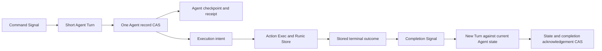

> Pending approval. Design proposal, 2026-10-15. No implementation is included.

# Durable Agents and delegated execution

The durable unit is the logical Agent. A Turn is one atomic decision by that
Agent. A delegated execution is a stored responsibility with its own identity
and progress. One Agent can live through many AgentServer processes.

This proposal defines an opt-in capability in Jido Core. Action and Runic keep
their current source and public contracts. The separate
[implementation plan](../../integration/2026-10-15-durable-agent-execution-plan.md)
defines the work order. All API names below are proposed names.

## Scope and package decision

Core owns the atomic link between Agent state, a command receipt, and an
execution intent. Runic owns graph progress, runnable scheduling, checkpoints,
and recovery of workflow work. Action owns executable compilation and result
projection. The storage adapter owns the strength of a confirmed write.

This is a proposed change to the approved
[package boundary](../90_package-boundaries/design.md). That document places
durable receipts and recovery controllers outside Core. Review the narrow
exception here before implementation. Core gains recovery for executions that
its own Agents accepted. It does not gain a general workflow service, durable
transport, cluster placement, leases, or a universal Directive outbox.

The first version has these limits:

| Item | Proposed limit |
| --- | --- |
| Authority | One Jido instance on one BEAM node controls a Ref |
| Pending delegated work | One execution per Agent, through completion acknowledgement |
| Workflow target | An Action module or Flow module; runtime Flow values are deferred |
| Workflow output | Portable result data; deferred effects are handled only through a later Agent Turn |
| Command entry | Commit-confirmed requests; no durable inbox or admission acknowledgement |
| Start Directive batch | One `StartExecution` and no other Directives |
| Completion | One ordinary Agent Turn against the latest state |
| Recovery discovery | Known Refs activated by the application; no Store scan |
| External effects | Idempotent Actions, or explicit handling of uncertain work |

An ordinary attached Turn can still use an Action or Flow that returns a
complete candidate. Delegation is an explicit business decision. Duration and
target type do not select the execution mode.

## OTP and Actor basis

An AgentServer is a replaceable process that controls one logical Agent.
Supervision restores the process tree. Stored records restore responsibility.
These are separate mechanisms. This follows the recovery separation in
[Armstrong's thesis, sections 4.3 and 8.3](https://www.erlang.org/download/armstrong_thesis_2003.pdf).

A delegated workflow receives data and sends a later result. It does not keep
authority over the Agent snapshot from its start. This applies the message and
delegation model in the
[Hewitt, Bishop, and Steiger Actor paper](https://www.ijcai.org/Proceedings/73/Papers/027B.pdf).
The record protocol below is a Jido proposal, not a protocol specified by those
papers.

Use `gen_statem` for admission and control. Keep business states such as
`awaiting_approval` in `Agent.state`. A business wait does not need a blocked
AgentServer or a generic workflow wait state in Core.



## Current evidence and required changes

Code and tests remain the source of truth. These facts describe the local
checkout at the date above. They are not claims that the new design exists.

| Current evidence | Consequence |
| --- | --- |
| [`Agent.Ref`](../../../lib/jido/agent/ref.ex) has namespace, partition, and id | Use that Ref as logical identity; keep PIDs out of durable identity |
| [`Persistence.Record`](../../../lib/jido/persistence/record.ex) uses exact format 3 keys | Add an explicit format migration; extra fields cannot be appended silently |
| [`Persistence.Store`](../../../lib/jido/persistence/store.ex) provides single-key byte CAS | Keep the Agent checkpoint and its work intent in one record |
| [`Storage`](../../../lib/jido/agent_server/storage.ex) saves the Agent and one revision | Separate record revision from domain state version |
| [`Turn`](../../../lib/jido/agent_server/turn.ex) replies at commit, before required hooks and Directives | Preserve that result boundary and hook order |
| [`Execution`](../../../lib/jido/agent_server/execution.ex) passes `mode: :local` and `owner:` | Remove reliance on options absent from restored Action |
| That helper cancels a Worker before Agent commit | Move durable cleanup after terminal data and Agent acknowledgement |
| [`ServerLifecycle`](../../../lib/jido/agent_server/server_lifecycle.ex) restores with no active Turn | Add recovery from stored execution intent |
| Action `Exec.start/6` and `resume/4` require portable data | Migrate live handles out of managed execution data |
| Runic start replies before input persistence; completion callbacks do not confirm persistence | Add explicit checkpoint and recovery gates |
| Runic background Workers use transient restart | Construct Workers in manual dispatch mode so an automatic replacement cannot dispatch stale work |

The existing integration document `docs/integration/started-execution.md`
describes the earlier local execution approach. It needs a rewrite during
implementation. Its no-Store and owner-option claims are not prerequisites
for this proposal.

## Durable record model

### 1. Agent record, format 4

Keep the current Agent key derived from the Ref. Keep the existing Agent
checkpoint format inside the record. Add the following fields to active records:

```elixir
%{
  format: 4,
  kind: :active,
  namespace: namespace,
  partition: partition,
  agent_id: id,
  agent_module: module,
  agent_vsn: agent_vsn,
  revision: record_revision,
  state_version: state_version,
  checkpoint: agent_checkpoint,
  runtime: %{
    format: 1,
    incarnation_id: incarnation_id,
    command_epoch: 0,
    command_receipts: %{command_id => receipt},
    next_execution_seq: 2,
    retired_execution_seq: 0,
    executions: %{1 => execution}
  }
}
```

`revision` controls storage CAS. It increases by one on every record write.
`state_version` increases by one only when a normal Turn commits an Agent
candidate. Intent-control writes do not create business Turns. An activation id
remains transient observation data and is not a storage fence.

`incarnation_id` is created once for a new logical lifetime. Restore preserves
it. Delete and an explicit new creation use different incarnations. This
prevents old execution results from matching a newly created Agent with the
same Ref. Tombstones retain the incarnation and record revision.

One CAS can contain a new checkpoint, a command receipt, and a new execution.
There is no transaction across the Agent key and the Runic key. The stored
intent is the recovery link between those writes.

The runtime envelope is Core-owned data. Custom Agent checkpoint callbacks
cannot omit it. Agent domain state still contains the application's meaning,
such as the order id, pending operation id, and business status. Update the
conditional recoverable-work contract in
[seam 06](../06_commit-and-effects/design.md#explicit-recoverable-work)
to describe this atomic envelope.

### 2. Command receipt

```elixir
%{
  command_id: "confirm-order-184",
  epoch: 0,
  fingerprint_format: 1,
  fingerprint: <<...>>,
  state_version: 18,
  execution_refs: [execution_ref],
  status: :committed
}
```

The caller supplies the command id and epoch. The fingerprint covers the
complete portable source Signal and caller context, before Core adds runtime
fields. Fingerprint format 1 is SHA-256 over deterministic ETF encoding of
that pair. Store the fingerprint format with the receipt. A retry uses the
same Signal envelope and context. Equal id and equal fingerprint return the
original receipt. Different data return
`:command_conflict`. A receipt confirms the Agent commit, not workflow success
or hook success. It does not contain a stale Agent snapshot.

There is no stored `:accepted` command state in this version. Before commit,
the command has the same failure boundary as `call/3`. A retry can repeat
pre-commit I/O. Durable command decision Actions therefore use pure decisions,
or idempotent I/O. Work that needs recovery goes in the delegated execution.
The runtime can require this contract but cannot prove that user code is pure.

Default receipt capacity is 1,024 per epoch. Capacity exhaustion rejects a new
durable command before evaluation. No automatic expiry removes duplicate
protection. An explicit epoch close clears receipts and rejects every later
request from the closed epoch. A recreated Agent also rejects commands from
the previous incarnation.

### 3. Delegated execution record

```elixir
%{
  ref: %Jido.Execution.Ref{agent: agent_ref, incarnation: incarnation_id, seq: 1},
  workflow_id: {:jido_execution, agent_ref, incarnation_id, 1},
  requested_by: %{command_id: "confirm-order-184", state_version: 18},
  target: MyApp.FulfilOrder,
  input: %{order_id: "184"},
  context: %{tenant_id: "a", idempotency_key: "fulfil-184"},
  profile: %{name: :default, version: 1, deployment_id: "release-42"},
  policy: %{max_attempts: 3, timeout: 30_000},
  deadline_at: nil,
  completion: %{type: "order.fulfilment.finished", data: %{order_id: "184"}},
  release: :awaiting_post_commit,
  required_after_commit_hooks: [],
  phase: :pending,
  control_version: 0,
  cancel_requested: nil,
  terminal: nil,
  delivery: :not_ready,
  completion_id: completion_id,
  acknowledged_at_state_version: nil,
  attention: nil
}
```

All values in this record are portable. Core assigns the sequence and Ref
before commit. `workflow_id` is the public id passed to `Jido.Exec`. Core does
not derive or read Action's private managed execution identity.

The stored profile identifies versioned runtime configuration. Portable policy
values are stored with the intent. Hooks, callback functions, executors, and
credentials are resolved from trusted instance configuration. Start and resume
use the same profile version and deployment id. A mismatch blocks recovery;
it does not run new code against old work without an explicit migration.
This check does not pin BEAM code. In-place code changes during pending work
are outside the first version's contract.

Version one fixes the executor to Runic's native Task executor and the
checkpoint strategy to `:every_cycle`. Profiles can set supported execution
policy and concurrency values. Custom executors and dispatch hooks need a
separate cleanup and recovery contract before support is added.

The completion id is derived once from the execution Ref. Its value never
changes on retry. Completion data include the execution Ref and outcome. They
do not include the Agent snapshot from execution start.

The hook id list records the required hook set at the intent commit. Recovery
does not infer an empty hook set from a changed Plugin definition.

### 4. Runic Store record

Add `Jido.Persistence.RunicStore` in Core. It implements the existing Runic
`init_store/1`, `save/3`, and `load/2` callbacks over Core's byte Store. The
first version uses full event-log snapshots. It does not implement an event
stream, fact store, or a second workflow engine.

Use a separate key prefix and a versioned record:

```elixir
%{
  format: 1,
  kind: :runic_snapshot,
  workflow_id: workflow_id,
  revision: snapshot_revision,
  digest: log_digest,
  log: runic_event_log
}
```

The bridge treats the Runic log as Runic-owned data. It uses Runic's public
snapshot and restore functions. Its codec is separate from the portable Agent
codec: Runic events include structs and executable descriptions. Reject an
unsupported log at save time. Do not strip fields or report a false save.
Use versioned ETF bytes with safe decode and validation of the allowed Runic
event types. Validate payload portability separately from Runic's executable
descriptions. Prove this codec for both supported target kinds before use.

Identical bytes after an uncertain CAS count as an acknowledged retry only
after a successful read confirms those bytes. A different saved value, an
unreadable value, or an unresolved write blocks the operation. Single-writer
control is a precondition; digest checks and CAS are not cluster fencing.

After Agent acknowledgement, retain the snapshot until explicit execution
pruning. Then the bridge can replace it with a small retired record by CAS.
Physical deletion and backend compaction remain adapter policy. A crash during
cleanup can leave an extra snapshot; it cannot create permission to resume it.

Default limits are 1 MiB for an Agent record, 64 KiB for execution input plus
context, 1 MiB for a terminal outcome, and 16 MiB for a Runic snapshot. These
are configurable finite limits. An oversized live result becomes
`:needs_attention`; Core does not report it as a successfully stored result.

## Proposed public APIs

### Instance configuration

```elixir
use Jido,
  otp_app: :my_app,
  persistence: {MyApp.AgentStore, [name: MyApp.Store]},
  durable_execution: [
    enabled: true,
    store: :agent_persistence,
    deployment_id: "release-42",
    profiles: [default: [version: 1, max_concurrency: 4]]
  ]
```

Resolve `:agent_persistence` to the instance byte Store and build the Runic
Store bridge. Refuse durable execution for an Agent that uses a different
per-Agent Store in the first version. This keeps one configured durability
boundary. Add an explicit development profile for ETS; describe its scope as
VM-local recovery. An enabled flag does not prove disk or node durability.

Use two Runner children when the capability is enabled. The existing
`ExecRunner` serves attached Turns. `DurableExecRunner` uses the Store bridge
for delegated work. This keeps temporary Turn logs out of the durable workflow
key space. Core selects the Runner from the execution kind; callers do not
select it through Signal data.

### Command and inspection

```elixir
Jido.command(instance, agent_ref, signal,
  command_id: id, incarnation: incarnation_id, epoch: epoch, timeout: 5_000)
# => {:ok, %Jido.Command.Receipt{}} | {:error, error}

Jido.command_receipt(instance, agent_ref, command_id,
  incarnation: incarnation_id, epoch: epoch)
# => {:ok, receipt} | {:error, :not_found | :closed_epoch | error}

Jido.execution(instance, execution_ref)
# => {:ok, %Jido.Execution.Status{}} | {:error, error}

Jido.reconcile_execution(instance, execution_ref)
# => :ok | {:error, error}; requests a check, does not claim completion

Jido.close_command_epoch(instance, agent_ref, expected_epoch: epoch)
# => {:ok, next_epoch} | {:error, error}
```

`command/4` resolves an active AgentServer. It returns after confirmed commit.
It does not start a dormant Agent or queue durable input. A wait timeout means
the caller has no confirmed result. The caller reads its receipt or retries
the same command. `call/3`, `cast/2`, and OTP request APIs retain their existing
meanings and gain no implicit duplicate suppression.

Receipt and execution queries can read a dormant Agent record. They do not
activate it. Epoch close requires an idle Agent with no unacknowledged
execution. Status exposes the current incarnation and command epoch.

### Start and cancel

```elixir
Directive.start_execution(MyApp.FulfilOrder, %{order_id: "184"},
  context: %{tenant_id: "a", idempotency_key: "fulfil-184"},
  profile: :default,
  completion: %{type: "order.fulfilment.finished", data: %{order_id: "184"}},
  deadline_at: nil)
# => %Jido.Agent.Directive.StartExecution{}

Jido.cancel_execution(instance, execution_ref, reason: "customer cancelled")
# => {:ok, :requested | :already_requested} | {:error, :too_late | error}

Directive.cancel_execution(execution_ref, reason: "business decision")
# => %Jido.Agent.Directive.CancelExecution{}

Jido.prune_executions(instance, agent_ref, through: sequence)
# => :ok | {:error, error}
```

The start constructor describes intent. It starts no process. Core validates
the target, record size, completion route, profile, capacity, and portability
before Agent commit. A start can be returned by ordinary `call/3`, but that
caller then lacks durable command duplicate protection.

The decision Action records its business key, such as the order id, in Agent
state. Core allocates the execution Ref after candidate evaluation and returns
it in the command receipt. The completion Signal provides that Ref on the next
Turn. Version one adds no callback that mutates the evaluated candidate to
insert a runtime-assigned id. Applications that need cancellation from a
business Signal use the reserved portable `context.agent_execution` value.
It is `nil` or a summary with the pending Ref, phase, and cancel-request flag.
Core supplies it from the current record at Turn preparation and validates a
returned CancelExecution against the latest record before commit. Caller
context cannot replace this field. Duplicate receipt lookup does not allocate
a new Ref.

Direct cancellation is an administrative control operation. It stores intent
before it stops work. It does not change business state. Use a normal Signal
and `CancelExecution` when cancellation also changes domain state. That
Directive can be the sole Directive in a batch in the first version.

Prune removes only an acknowledged prefix of execution records. It advances
`retired_execution_seq`; old completions at or below that value cannot run
again. Keep at most 128 unpruned terminal records by default. A full history
rejects a new start before commit. There is no automatic result expiry.

### Completion contract

The completion Signal has a fixed Core envelope:

```elixir
%{
  execution_ref: execution_ref,
  completion_id: completion_id,
  outcome: %{kind: :succeeded, value: value},
  data: %{order_id: "184"}
}
```

Outcome kinds are `:succeeded`, `:failed`, and `:cancelled`. Uncertain work is
`:needs_attention`, not a fabricated failed or successful outcome. The Signal
type comes from the validated completion specification. Core reserves the
completion identity fields. Public Signal input cannot claim an internal
acknowledgement merely by copying those fields.

Store failures as a portable error value with a code, message, and validated
details. Keep raw runtime diagnostics outside durable records. A delegated
workflow returns data. If `Jido.Exec` returns nonempty deferred effects, retain
the workflow and mark `:unsupported_execution_effects` for attention. Do not
drop those effects or execute them outside an Agent Turn. The completion
Action can return ordinary Directives from the result data.

The selected Action or Flow receives the latest Agent state and this outcome.
On successful validation, one Agent CAS stores the new state and acknowledges
the completion. A duplicate completion returns the stored acknowledgement
without running the reducer again. A failed completion Turn retains the result
for inspection and records `:needs_attention`; it does not run an unlimited
automatic retry of application code.

## Commit, handoff, and recovery protocol

### A. Accept responsibility

1. Evaluate one short Turn and validate its candidate and complete Directive
   batch. Check for a prior command receipt before evaluation.
2. Build the new checkpoint, command receipt when requested, and execution
   intent. CAS the complete Agent record.
3. On confirmed success, make the Agent candidate authoritative and reply.
   On conflict or uncertain write, stop this activation before another Turn.
4. Run required Plugin after-commit hooks in their existing order.
5. After hook success, CAS `release: :ready`. Only then request execution.

No Runic call for delegated work occurs before the Agent intent commit. The
start Directive is stored work, not a general replayable list of ordinary
Directives.

If the AgentServer dies with release pending and there were no required hooks,
recovery can release the intent. If required hooks existed, recovery cannot
know whether they ran. It records `:needs_attention` and starts no workflow.
A known hook failure has the same blocked release rule. Version one provides
inspection and cancellation for this case. It provides no automatic hook
replay or administrative bypass that asserts hook success. An application can
cancel the blocked intent, repair its hook, and issue a new business command.
This is a declared recovery limit, not lost intent.

### B. Start or recover the workflow

Use a small Core helper called by AgentServer, not a new workflow scheduler:

1. Read the latest execution control state. If cancellation is requested, skip
   start and perform cancellation recovery.
2. Resolve the stored profile and deployment. Reject a mismatch.
3. CAS the operation to `:staging`, then construct its Worker with
   `dispatch_mode: :manual`. Use
   `Jido.Exec.start/6` for a new workflow or `Jido.Exec.resume/4` for a saved one.
4. Confirm admitted input with `Runic.Runner.checkpoint/2` before enabling
   automatic dispatch. Confirm the Store acknowledgement, not a callback.
5. Register the Worker PID and a dispatch permit in the instance RuntimeStore.
   CAS the Agent execution phase to `:running`, then call
   `Runic.Runner.continue/2`. Repeat this control action after a crash when the
   record and saved workflow establish that it is safe.

Before construction, check for a live Worker with a matching RuntimeStore
permit. Keep that Worker and reconcile its public status instead of starting
a second one. A stored phase of `:running` can still precede the first
continue call, so repeat continue only after confirming safe open admission.
Do not use continue to clear a stopped admission caused by failure or uncertain
work. Classify that result first and retain it for attention.

There is an important start window. A saved workflow can have a build log but
no admitted input. The Core bridge can load the log and use public
`Runic.Workflow.from_events/1` and `facts/1` to distinguish an initial graph
from a graph with an input root. For supported compiled targets, require one
root input before dispatch. A build-only record can be replaced only after
the Worker has stopped and the log proves that no input or runnable work was
accepted. Any other shape becomes `:needs_attention`.

This test is a required implementation proof gate. It must not copy Action's
private execution id or read Worker state. If public snapshot APIs cannot
prove the distinction for the supported targets, block this recovery case and
report the API gap. Do not change Action or Runic to make the test pass.

Runic can restart a background Worker from its original child specification.
The manual constructor prevents that replacement from dispatching work by
itself. After a Worker `DOWN`, Core stops a replacement, loads the latest
confirmed Store record, and resumes through the same gate. Core does not
treat a replacement PID as recovered progress. A cancelled or acknowledged
execution is never resumed.

The RuntimeStore permit is transient control data, not workflow progress.
Its table belongs to the instance supervisor and survives AgentServer and
RuntimeStore worker restarts. On AgentServer restart, adopt an existing Worker
only when its PID matches that permit. A different PID is an unapproved
replacement: stop it and restore the saved workflow. A missing permit cannot
authorize dispatch. If the permit table is unavailable, postpone control.
This avoids a second workflow process or a graph-progress comparison in Core.

### C. Store and deliver the terminal outcome

1. Treat `on_complete` as a wake-up hint. Polling the known execution covers a
   lost hint. Query APIs run outside Runic callbacks.
2. Use `Jido.Exec.result/2` plus Runic admission status to distinguish running,
   stopped, failed, and uncertain work. Do not infer success from an idle PID.
3. Confirm a terminal Runic checkpoint. Then stop the Worker with persistence
   enabled and require its acknowledgement.
4. CAS the portable terminal outcome into the Agent record with
   `delivery: :pending`. If this write is uncertain, recover by record read.
5. Deliver the stable completion Signal to the Agent when it can admit a Turn.
   Run normal admission and candidate validation. A completion is not a
   privileged direct state update.
6. Commit current Agent state and the completion acknowledgement together.
   Then permit Store cleanup and a new delegated execution.

There is no equality test against the Agent's state version at workflow start.
Other valid Turns can commit while the execution runs. The completion matches
the incarnation, execution sequence, control state, and completion id. The
application decides whether its business facts still apply.

### D. Cancel, deadlines, and stop

The first terminal control CAS wins the race between completion and
cancellation. A confirmed terminal outcome makes a later cancel too late.
A confirmed cancel request prevents later success from becoming the logical
outcome. Core then calls `Runic.Runner.cancel/2` and waits for Worker and native
task-scope stop before recording a cancelled terminal outcome.

Cancellation does not undo external I/O. A cancelled outcome states that local
work stopped; its external effect status can remain unknown. Keep any observed
late result as diagnostic data. Do not restart cancelled work from an older
Runic checkpoint.

A caller wait timeout is not cancellation. `deadline_at` is an optional UTC
deadline stored with the operation. On activation, derive a new local timer
from that value. An expired deadline uses the same stored cancel path. Timer
references and monotonic timestamps are never persisted. Wall-clock changes
limit deadline precision.

AgentServer death does not cancel delegated work. A live Worker can continue;
the next activation finds the same operation. Instance or VM stop can stop the
Worker; the next activation resumes from the Store. Hibernate, definition
replacement, and delete reject an unacknowledged execution in version one.
Explicit cancellation and completion acknowledgement make those operations
available again. Cluster takeover remains out of scope.

## `gen_statem` design

Keep one AgentServer as the only Agent record writer. Add no per-workflow Core
server. `Jido.AgentServer.Durability` is a private handler module. Runic calls
and Store calls use supervised tasks; only AgentServer applies their results.
Keep at most one workflow control task per Agent. Task results carry an
activation token, execution Ref, and control version. Reject stale results.

Use one write slot for every Agent-record CAS. A pending control write cannot
overlap a business commit. Postpone another write request through OTP until
the slot is free. On slot release, retry postponed control events through a
state change; do not leave them waiting for an unrelated Turn. Build each write
from the latest record envelope. A task returns an operation result, not a
replacement Agent record captured before another commit.

Use `{phase, write_epoch}` as the private state value. Increment `write_epoch`
when a write slot is released. This is a real state change for OTP postponed
events even when the Turn phase has not changed. Keep the epoch transient.
The table below names the phase part of that value.

### AgentServer phases

The table defines private states. Existing public phases remain compatible:
startup states map to `initializing`, evaluation and commit states to
`running`, and post-commit work to `directing`.

| State | Event | Action and next state |
| --- | --- | --- |
| `restoring` | Record and Agent validated | Restore runtime envelope; start Plugins; `recovering` |
| `recovering` | Plugins ready and record classified | Schedule known operation reconciliation; publish readiness; `idle` |
| `recovering` | Invalid Agent record or missing Agent persistence | Fail startup; no admission |
| `recovering` | Execution profile or deployment mismatch | Block the execution; retain inspection and cancel control; `idle` |
| `idle` | New command or completion | Check receipt, capacity, and identity; `admitting` |
| `admitting` | Admission succeeds | Prepare one executable; `starting` |
| `starting` | Started attached evaluation available | Monitor execution; `evaluating` |
| `evaluating` | Complete result available | Validate candidate and Directives; `committing` |
| `committing` | Confirmed CAS | Replace Agent; reply; `after_commit` |
| `committing` | Conflict or uncertain write | Stop activation; no later effects |
| `after_commit` | Required hooks succeed | Release durable intent or run ordinary Directives; `directing` |
| `after_commit` | Hook fails | Keep commit, block durable release, publish failure; apply existing failure policy |
| `directing` | Required work settles | Publish Turn Outcome; `idle` |
| pre-commit state | Turn cancel or Turn deadline | Stop attached work; preserve checkpoint; settle; `idle` |
| any live state | Durable cancel control | Serialize a control-record CAS; do not cancel the current business Turn |
| any busy state | Ordinary Signal | Use bounded OTP postponement |
| any state | Stale task or completion notification | Ignore after identity and generation checks |

`idle` means no active Turn. It does not mean that a delegated workflow has
finished. A completion waits for the next admissible Turn. Keep existing
postponed Signal ordering. Reconciliation uses internal events with bounded
work and does not add a second Signal queue.

### Orthogonal execution phases

The execution phase is record data, not the AgentServer's top-level state.
This permits status, cancellation, and other permitted business Turns during
workflow execution.

| Stored phase | Trigger | Next phase or action |
| --- | --- | --- |
| `pending` | Release gate confirmed | Begin manual start or restore; `staging` |
| `staging` | Input checkpoint confirmed | Store `running`, then continue Runic |
| `staging` | Crash | Reclassify the saved graph; no blind second admission |
| `running` | Completion hint or reconcile timer | Query result and checkpoint; remain running or store terminal outcome |
| `pending`, `staging`, `running` | Cancel CAS confirmed | `cancelling` |
| `cancelling` | Worker and scope stopped | `terminal`, cancelled outcome, pending delivery |
| `terminal` | Agent available | Deliver completion; `delivery` remains pending |
| `terminal` | Completion Turn CAS confirmed | `acknowledged` |
| `acknowledged` | Retention prune | Remove record and advance retired sequence |
| any unsettled phase | Uncertain execution, unsafe recovery, or result rejection | `needs_attention` with saved reason |
| `needs_attention` | Explicit cancel control | Stop remaining work and deliver cancellation, unless terminal outcome already won |

If a terminal completion Turn fails, retry requires an explicit
`reconcile_execution/2` after application repair. The same stored outcome and
completion id are used. An uncertain Runic operation is not automatically
retried by that API; it returns the attention reason. A future explicit
business resolution API needs a separate contract.

Use `next_event` for immediate internal progress and named `gen_statem`
timeouts for reconciliation. Named timers can span ordinary Turn states.
Restore timers from the stored deadline and attempt state, not from timer
references. The default reconciliation interval is 1 second with a 30 second
maximum backoff on known transient read failures. Bound retries per callback
to one external control operation. Stop on any failed Agent-record write;
never continue with uncertain write authority.
These event and timer choices use the public
[`gen_statem` transition model](https://www.erlang.org/doc/apps/stdlib/gen_statem.html).

## Portability, attached Turns, and compatibility

The current restored Action API has no local managed mode and no managed
`owner:` option. Do not restore either patch. Managed execution context,
input, metadata, and output remain subject to Action's checks.

For the started AgentServer path, migrate PIDs, references, functions, and
Plugin runtime slots out of executable input and candidate state. Pass stable
service ids and resolve runtime resources in trusted Action or Plugin code.
Reject unsupported data with its field path. Do not silently remove fields or
serialize a PID to conceal the failure. Direct immutable Agent evaluation
retains its separate in-memory contract.

Attached Turns remain serial and pre-commit cancellable. They do not acquire
delegated workflow recovery or a durable command inbox. Core needs a bounded
execution guard for attached started work because Action does not expose
Runic's native owner option. The guard watches the AgentServer and cleans up
the known workflow id after startup settles, including owner death during
startup. It has no domain state or recovery policy. Its lifetime and cleanup
races are a prerequisite test gate, not a reason to change Action.

Format 3 reads migrate to format 4 with `state_version = revision`, an empty
runtime envelope, and a new incarnation saved by CAS before new work starts.
Unknown formats fail closed. Older binaries cannot write format 4. Offline
`save_agent`, tombstone, restore, upgrade, and hibernate paths need explicit
runtime-envelope handling. A plain snapshot save cannot erase pending work.
Public persistence `revision` remains the storage revision; expose
`state_version` separately and document the former equality change.

## Proposed requirements and acceptance mapping

Each requirement is pending approval. `DUR-Txx` names a required acceptance
group in the implementation plan. No group below is claimed as implemented.

| ID | EARS requirement | Acceptance |
| --- | --- | --- |
| `DUR-REQ-001` | The AgentServer shall be the sole writer of the active Agent record within one instance. | DUR-T01 |
| `DUR-REQ-002` | When a Turn accepts execution intent, the AgentServer shall CAS that intent with its Agent checkpoint. | DUR-T02 |
| `DUR-REQ-003` | When a Turn commits, the AgentServer shall increase state version by exactly one. | DUR-T01 |
| `DUR-REQ-004` | When a control write commits, Persistence shall increase record revision without changing state version. | DUR-T01 |
| `DUR-REQ-005` | When a matching committed command repeats, the AgentServer shall return its saved receipt without evaluation. | DUR-T03 |
| `DUR-REQ-006` | If a command id repeats with different input, then the AgentServer shall reject it before evaluation. | DUR-T03 |
| `DUR-REQ-007` | If a command uses a closed epoch or old incarnation, then the AgentServer shall reject it before evaluation. | DUR-T03 |
| `DUR-REQ-008` | If receipt capacity is full, then the AgentServer shall reject a new durable command before evaluation. | DUR-T03 |
| `DUR-REQ-009` | When a start intent is released, the execution helper shall use the stored workflow id. | DUR-T04 |
| `DUR-REQ-010` | Before automatic dispatch, the execution helper shall confirm an admitted-input checkpoint. | DUR-T04 |
| `DUR-REQ-011` | If saved admission cannot be established, then the execution helper shall record needs-attention without dispatch. | DUR-T04 |
| `DUR-REQ-012` | When a delegated Worker is constructed, the execution helper shall select manual dispatch mode. | DUR-T05 |
| `DUR-REQ-013` | When a Worker restarts, the execution helper shall recover from confirmed Store data before continuing work. | DUR-T05 |
| `DUR-REQ-014` | When a completion callback arrives, the execution helper shall treat it only as a request to inspect progress. | DUR-T06 |
| `DUR-REQ-015` | Before terminal delivery, the execution helper shall confirm storage of the terminal Runic state. | DUR-T06 |
| `DUR-REQ-016` | When terminal delivery becomes pending, the AgentServer shall store the outcome in the Agent record. | DUR-T06 |
| `DUR-REQ-017` | When completion commits, the AgentServer shall CAS its acknowledgement with the new Agent checkpoint. | DUR-T07 |
| `DUR-REQ-018` | When an acknowledged completion repeats, the AgentServer shall skip candidate evaluation. | DUR-T07 |
| `DUR-REQ-019` | When completion is evaluated, the Turn evaluator shall use the current committed Agent state. | DUR-T07 |
| `DUR-REQ-020` | Before stopping delegated work for cancellation, the AgentServer shall confirm the cancel-intent CAS. | DUR-T08 |
| `DUR-REQ-021` | While cancel intent is confirmed, the execution helper shall not resume that execution. | DUR-T08 |
| `DUR-REQ-022` | If a caller wait expires, then the AgentServer shall preserve execution control state. | DUR-T08 |
| `DUR-REQ-023` | If an Agent-record write is unconfirmed, then the AgentServer shall stop before another Turn. | DUR-T09 |
| `DUR-REQ-024` | While required after-commit hooks are unconfirmed, the AgentServer shall keep durable launch blocked. | DUR-T10 |
| `DUR-REQ-025` | If stored execution data are non-portable, then Core validation shall reject the start before Agent commit. | DUR-T11 |
| `DUR-REQ-026` | If an execution is unacknowledged, then the AgentServer shall reject a second start. | DUR-T12 |
| `DUR-REQ-027` | If execution configuration differs from the saved version, then recovery shall block that execution. | DUR-T11 |
| `DUR-REQ-028` | When a known Ref activates, the AgentServer shall classify its pending execution before normal admission. | DUR-T05 |
| `DUR-REQ-029` | When execution records are pruned, Persistence shall retain the retired sequence boundary. | DUR-T12 |
| `DUR-REQ-030` | If a completion reducer fails, then the AgentServer shall retain its outcome for explicit recovery. | DUR-T07 |
| `DUR-REQ-031` | When attached execution loses its AgentServer, the execution guard shall confirm cleanup before it releases that execution id. | DUR-T13 |
| `DUR-REQ-032` | If a record or result exceeds its configured size limit, then Core shall return or store an explicit size failure. | DUR-T11 |
| `DUR-REQ-033` | If a delegated result contains deferred effects, then the execution helper shall block delivery with an explicit unsupported-effects reason. | DUR-T06 |
| `DUR-REQ-034` | While an Agent-record CAS is pending, the AgentServer shall postpone another write to that record. | DUR-T09 |

## Review decisions and proof gates

Recommended decisions are the narrow Core ownership exception, format 4,
commit-confirmed command receipts, one unacknowledged execution per Agent,
module targets, and manual construction with confirmed checkpoint gates.

The following proof gates can block implementation without permitting a
dependency patch:

1. Confirm that supported compiled targets have an observable single input
   root and that a build-only log can be distinguished with public APIs.
2. Confirm full snapshot round trips for compiled Action and Flow workflows
   through a real Core byte Store, including uncertain write responses.
3. Confirm manual Worker construction prevents dispatch on native restart
   and does not run user conditions during unsafe restore.
4. Confirm attached execution cleanup for owner death during startup using
   only supported Action and Runic APIs.

These gates do not approve implementation. A failed gate produces an explicit
limitation or a revised Core design for review. Action and Runic remain fixed.
