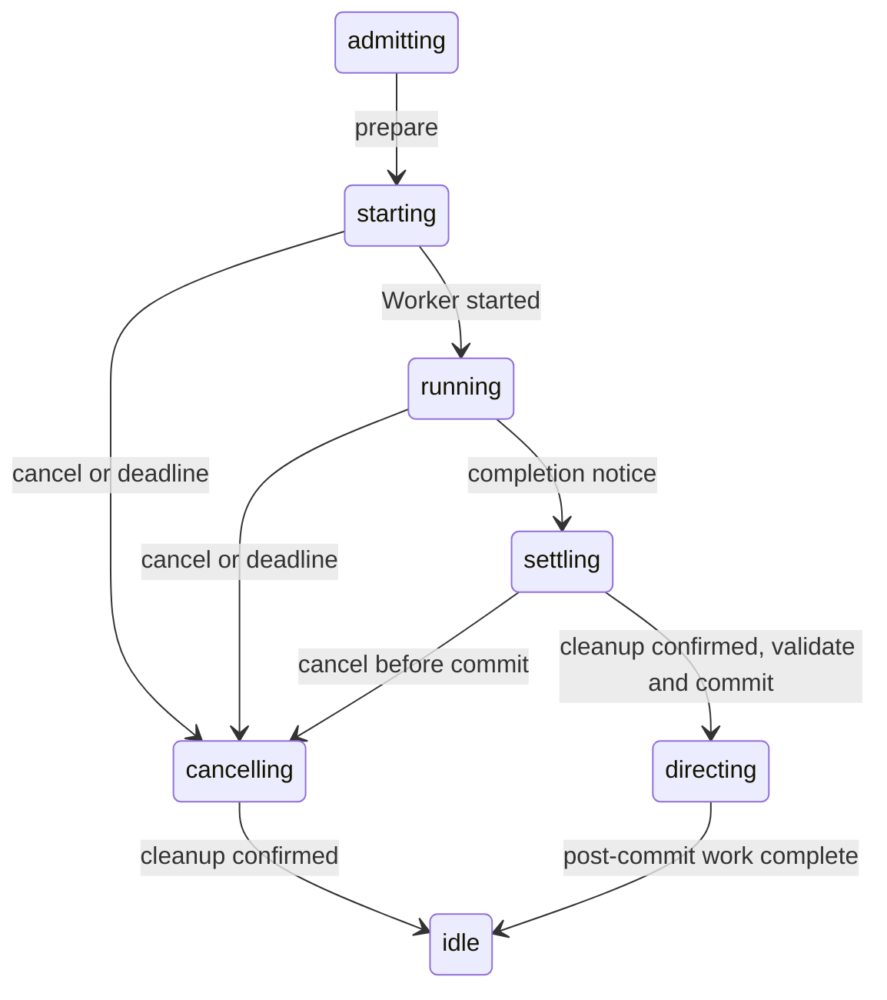

# Owned started execution

This integration replaces the removed async Exec API in AgentServer.
The checkpoint before implementation is `4e9112d` in `jido`.
Implementation changes span `jido`, `jido_action`, and `runic`.

## Execution contract

Each Turn starts one `Jido.Exec.start/6` execution with `mode: :local`
and `owner: server_pid`. Each Jido instance has a Runic Runner. The
application also provides a Runner for standalone AgentServers.

Runic owns the Worker, its native task scope, task dispatch, retries, and
per-attempt timeouts. Local execution accepts runtime values. It writes no
Runic Store data and cannot resume. Durable Exec behavior remains the default
for other callers.

Core uses private `:starting`, `:settling`, and `:cancelling` states within
the public `:running` phase. Short linked tasks call the blocking lifecycle
APIs. The Server can receive control requests during these calls. These tasks
use the existing core Task Supervisor. They add no execution controller.



Core reads the terminal Exec result and confirms native Worker cleanup before
it validates and commits the candidate. Cancellation during start or settlement
prevents commit. Failed cleanup stops the Server with an indeterminate outcome.
Owner death closes native work, including abrupt Server death.

The existing Turn deadline covers admission, start, execution, and settlement.
State changes do not reset it. Candidate validation, persistence, commit,
`after_commit`, and Directive order retain their existing boundaries.

## Simplification check

The ownership model is simpler. AgentServer uses the same started execution
API as other managed callers. Runic provides the execution tree and cancellation
barrier. Core has no replacement async handle API, scheduler, continuation loop,
or task-tree controller.

This change does **not** reduce total source size. Core runtime changes add
153 net lines, including the 173-line Execution module. Turn execution code
shrinks by 41 net lines. The extra lifecycle states handle blocking calls and
start, cancellation, and settlement races. Normal completion uses two short
lifecycle tasks. Runic owns the Action and Flow tasks in a separate pool.

The result is a smaller execution responsibility in core, with more explicit
transition code. It is not a claim of fewer processes or faster Turns.

## Verification

Checks used Elixir 1.20.4 and OTP 29 on 2026-10-14. Core selects the sibling
Action and Runic checkouts. Action's final standalone checks select the pinned
Runic fork at `d6f013c`, which is also the sibling checkout's HEAD.

Run each command from its package directory:

```sh
# jido
mix deps.get
mix quality
mix test.all --include fuzz --cover --warnings-as-errors
mix clean
mix compile --warnings-as-errors
mix docs --no-open -f html --warnings-as-errors
mix hex.audit
mix doctor --summary
mix hex.build --output /tmp/jido-review.tar

# jido_action
mix quality
mix test.all --include flaky --cover --warnings-as-errors
mix hex.audit
mix hex.build --output /tmp/jido-action-review.tar

# runic
mix format --check-formatted
mix compile --warnings-as-errors
MIX_ENV=test mix compile --warnings-as-errors
mix test
mix docs --warnings-as-errors
mix hex.audit
mix hex.build --output /tmp/runic-review.tar
```

| Check | Result |
| --- | --- |
| Runic complete suite | 2,027 passed; 13 existing skips |
| Runic formatting, strict compile, docs, and package build | Passed |
| Action complete suite, including fuzz and coverage | 1,059 passed; 95.06% coverage |
| Action quality, including Dialyzer and docs | Passed |
| Core quality, including Dialyzer and property tests | 1,488 passed; 51 excluded; no Dialyzer errors |
| Local Agent system tests across ETS, file, and Ecto adapters | 63 passed |
| Core complete local suite with fuzz and coverage | 2,451 passed; 2 existing skips; 147 service exclusions; 93.0% coverage |
| Core strict development compilation and docs | Passed after a clean build |
| Core and Action dependency audits | Passed |
| Core extra Doctor check | Failed: 247 modules; 65.9% function docs, 97.3% module docs, 54.0% specs |
| Core and Action Hex package builds | Blocked by non-Hex integration dependencies |
| Runic extra dependency audit | Failed on existing Bandit, Mint, and Req lock entries |

Regression tests cover runtime values, no Store writes, repeated Turn cleanup,
owner death, cancellation during start and settlement, parent death during
cancellation, and a full core lifecycle task pool. A barrier test confirms that
the absolute Turn deadline takes priority over a late admission error, even
before the timer message arrives. It also checks successful work after timeout.
Existing runtime tests cover pre-dispatch death, persistence faults, and commit
boundaries.

The first extended run exposed a property-test race: an Action can report its
start while AgentServer is still in its private `:starting` state. Tests that
inspect the native Worker handle now wait for the Server's `:running` state.
The public responsiveness test accepts both private states. All 42 focused
runtime tests pass, including the property and fuzz variants.

Commands and historical failure groups are recorded in the
[test inventory](v3-action-test-inventory.md). No tests were disabled or newly
skipped. External Redis, PostgreSQL, Bedrock, and MinIO profiles remain separate
opt-in suites under the repository test contract. They were not selected.

The Action authoring generator now emits `map()` for exportable schemas and
`no_return()` when JSON export always raises. The Action and Flow regression
checks the emitted specs, validation, and export behavior. This removes the
nine core Dialyzer diagnostics. A clean consumer build was required to replace
old generated modules that still called the removed internal `json!/1` helper.

## Example migration fixes

All seven example failures from the first full run are resolved:

- Executable continuation uses Dispatch to select Finish or a Flow with a
  bounded Iterate. Actions return normal success values. The native iteration
  limit replaces the removed `max_continuations` option.
- The tool loop selects a ToolRound Flow through Dispatch. ToolRound executes
  the tool and invokes ReasonFlow with its transcript. The existing application
  step budget limits model and tool work.
- Factory Review selects reviewer roles before its Map starts the reviewers.
  Quality and security then have the same causal depth. The original overlap
  assertion passes under Runic's existing stable causal-wave admission. No
  scheduler change or graph padding was required.

## Review limits

The extra `mix doctor --summary` check fails its current 100% thresholds. It
reports a package-wide documentation and spec gap. Doctor is not part of core's
configured `mix quality` or release preflight. The thresholds and module filters
were not changed. Strict ExDoc generation passes. This report does not claim
that every extra quality check passes.

One broad run failed the Registry restart test in
`test/jido/instance_ref_test.exs:119`: duplicate startup returned a new PID.
It did not recur in 51 focused runs or four repeated broad core runs. The test
remains enabled. The cause is not confirmed; no speculative Registry change
was made.

Runic's extra `mix hex.audit` check fails on existing lock entries for Bandit,
Mint, and Req. Bandit is a development dependency; Mint and Req are unused lock
entries. A compatible update attempt did not find a patched Bandit release.
The [upstream advisory](https://github.com/mtrudel/bandit/security/advisories/GHSA-69m6-wcv4-rwcf)
lists its patched version as TODO. No dependency version was changed or advisory
suppressed. Core and Action audits pass.

Hex package builds for Action and core stop on the current non-Hex dependencies.
The local paths support this integration. Restore release dependency sources
before package publication. Runic's local package build passes. No package was
published.

No commit was made by this work after the checkpoint. During verification,
Runic advanced separately to `d6f013c`, which contains the owned execution
changes. Action advanced separately to `58db4d05`, which pins that fork. Core
declares its direct Runic dependency as a sibling path for this integration.
Core and Action implementation edits remain uncommitted. The unrelated changes in
`docs/design/GAP_ANALYSIS.md` are outside this patch.
