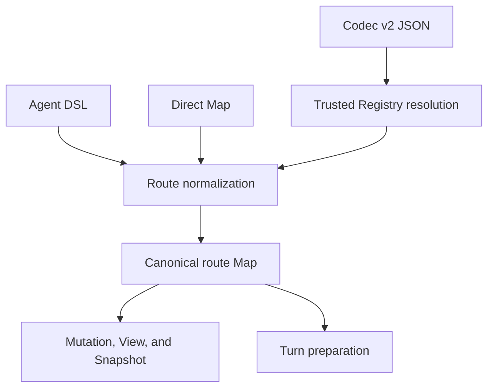
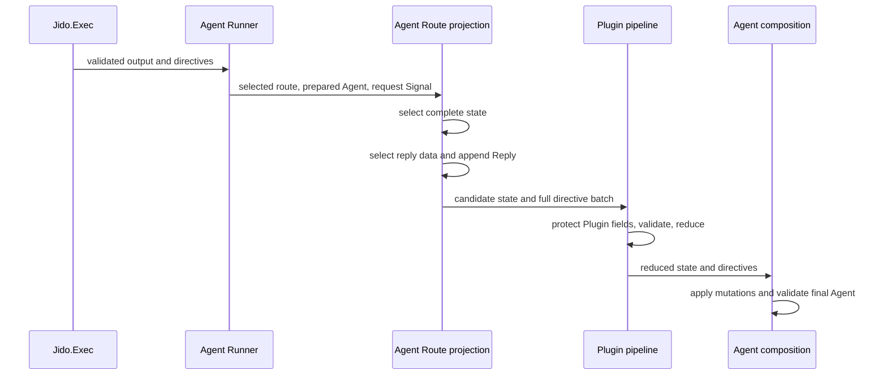

# Agent Route Contract - Plan

## Goal Capsule

- **Objective:** Make `Jido.Agent.Route` the one data-safe contract that maps a Signal to one handler, one next-state choice, and an optional correlated reply.
- **Authority:** The Product Contract defines behavior. The Key Technical Decisions define the mechanism. Current code and tests decide details that this plan does not change.
- **Execution profile:** This is a breaking refactor in the `jido` repository on `release/v3`.
- **Stop conditions:** Stop if the work needs a change in `jido_action`, `jido_signal`, or `jido_ai`. Stop if it needs a general expression language, runtime code from JSON, an Agent or Route `reduce/2` callback, or a legacy compatibility layer.
- **Tail ownership:** The executor owns implementation, simplification, tests, documentation, and one scoped `jido` commit. It must preserve unrelated working-tree changes.

---

## Product Contract

### Summary

`Jido.Agent.Route` becomes the Agent port contract. A route selects one Action, Flow, transform, or forward handler. An Action or Flow route then selects the next Agent state and optional reply data from the validated executable output. The contract has the same meaning in the DSL, direct Map authoring, JSON authoring, runtime mutation, pure execution, and AgentServer execution.

### Problem Frame

The current Action and Flow result is also the complete next Agent state. This prevents a route from using one result for two separate purposes: update Agent state and build a reply. `Jido.SignalAction` tries to solve part of this problem by adding another Action and Signal abstraction. That abstraction duplicates route concerns and does not give the Agent runtime one clear result-composition boundary.

The new contract must remain safe to store and author as JSON. Therefore, route result mapping must be inert data. It cannot contain callbacks or executable expressions.

### Requirements

**Route contract**

- R1. Every normalized route has `path`, `as`, `defaults`, `handler`, `state`, and `reply` fields.
- R2. Every route has exactly one handler: a referenced Action or Flow, an inline Action or Flow, a forward handler, or a transform handler.
- R3. Every Action or Flow route declares one state choice: `:unchanged`, the full output, or one static output field path.
- R4. A route can declare at most one reply with one Signal type and one output selector.
- R5. The handler `output_schema` is the only executable result schema. A route cannot declare a separate state or reply schema.
- R6. The DSL, direct Map form, and JSON form normalize to the same route value and reject the same invalid combinations.

**Safe selectors and validation**

- R7. An output selector is inert data with `source: :output` and a static object or struct field path. An empty path selects the full output.
- R8. A selector cannot contain a callback, MFA, Access function, dynamic map key, collection index, union branch choice, or code string.
- R9. Every `output()` selector requires a concrete target `output_schema`, including a root selector. Only `state: :unchanged` with no reply can use an executable that has no output schema.
- R10. Core resolves selector paths only through static object or struct fields when it validates the Agent definition. A selectable key is an atom or string with one unique textual name. JSON names resolve only against those declared keys, never create atoms, and reject unsupported or ambiguous keys.
- R11. A missing selected field fails the Turn. A present field with the value `nil` remains a selected value from the already validated executable output.

**Turn composition**

- R12. `Jido.Exec` continues to validate Action and Flow input and output. Route composition starts only after successful executable output validation.
- R13. The selected state is a complete next Agent state. Core validates it with the composed Agent schema and keeps existing Plugin-owned state protection.
- R14. `:unchanged` uses the prepared Agent state before existing Plugin reduction. Plugin `reduce/2` can still update fields that the Plugin owns.
- R15. A declared reply fetches data unchanged from the same validated executable output and builds one `Jido.Agent.Directive.Reply` Signal. Route projection does not parse or transform the selected reply value again.
- R16. A generated reply uses `agent.signal_source`, keeps the request trace, uses a fresh Signal ID, and sets the request Signal ID as `jidocausationid`.
- R17. An Agent definition with a reply route requires a non-empty `signal_source`.
- R18. Core appends the generated Reply after directives returned by the executable. Existing directive validation and the one-Reply rule then apply to the full batch.
- R19. A manual Reply directive remains a low-level supported Directive. A Turn that has both a manual Reply and a route-generated Reply fails before commit because the batch has two replies.
- R20. If state selection, reply selection, reply construction, Plugin reduction, mutation composition, or final state validation fails, the Turn commits no state and dispatches no directives.
- R21. `Agent.cmd/3` and AgentServer use the same route-composition path and preserve the existing `{:ok, agent, directives}` result for owned request modes. AgentServer cast or any live mode without a requester rejects a generated Reply before commit with the existing requester error.

**Handler forms and lifecycle**

- R22. Forward and transform are terminal route handlers. Their canonical state is `:unchanged`. They do not accept an output state selector or a reply declaration. Remove the old top-level `forward/2` DSL form.
- R23. An inline Action or Flow compiles to a normal target module. Stored Agent definitions and JSON documents reference that trusted module and never store inline source.
- R24. Route add, replace, update, set, diff, view, Codec, snapshot, and restore operations retain and validate the complete new route contract.
- R25. A handler update revalidates the complete state and reply mappings. It cannot leave mappings that are invalid for the new handler.

**Breaking replacement**

- R26. Remove `Jido.SignalAction`, its module-route lowering, its public helpers, and its contract surface.
- R27. Replace `route_action!/1` with `route_executable!/1`, which returns the Action or Flow target for an exact route path and raises for terminal handlers or an unknown path.
- R28. Use version 2 for Agent authoring documents, Agent View documents, and `Jido.Persistence.Snapshot`. Version 1 authoring documents and snapshots fail with an explicit version error. `Jido.Persistence.Record` stays at format 4.
- R29. This change modifies only the `jido` package. It uses the current `Jido.Action.Inline` and `Jido.Flow.Inline` APIs from the existing `jido_action` dependency.

### Key Flows

- F1. Author and validate a route
  - **Trigger:** A developer compiles an Agent DSL or supplies a direct Map or JSON document.
  - **Steps:** Core resolves one handler, normalizes selectors, resolves selector schemas, checks reply source requirements, and creates one canonical route.
  - **Outcome:** All authoring forms produce the same validated route or the same field-specific error.
  - **Covered by:** R1-R11, R17, R22-R23.

- F2. Execute an Action or Flow route
  - **Trigger:** A Signal selects an executable route.
  - **Steps:** `Jido.Exec` validates output. Core selects state and reply data. Core appends an optional Reply. Plugins validate and reduce the batch. Core applies mutations and validates the final state.
  - **Outcome:** Pure and live execution return the same Agent and directives, or both reject the Turn before commit.
  - **Covered by:** R12-R21, R25.

- F3. Execute a forward or transform route
  - **Trigger:** A Signal selects a forward or transform route.
  - **Steps:** The existing Signal handler creates its send or emit Directive. State stays unchanged before Plugin reduction.
  - **Outcome:** The existing forward or transform effect runs without executable output mapping.
  - **Covered by:** R14, R20-R22.

- F4. Change, inspect, save, and restore routes
  - **Trigger:** A caller mutates an Agent definition, projects an Agent view, writes JSON, or saves a snapshot.
  - **Steps:** Each boundary preserves the canonical route fields and validates the complete contract.
  - **Outcome:** A later Turn sees the changed route. A current Turn keeps the route that it selected during preparation.
  - **Covered by:** R24-R25, R28.

### Acceptance Examples

- AE1. **Covers R3, R5, R12-R16:** Given an Action output `%{state: next_state, reply: reply_data}`, when the route selects `output(:state)` and `output(:reply)`, then the Agent commits `next_state` and the returned directives contain one correlated reply with `reply_data`.
- AE2. **Covers R3, R14-R16:** Given a query route with `state :unchanged`, when the Action returns reply data, then domain state stays unchanged before Plugin reduction and the reply is built from the result.
- AE3. **Covers R11, R20:** Given a selector for an optional schema field that is absent from the validated runtime output, when the Turn runs, then the Turn fails and no state or Directive is committed.
- AE4. **Covers R10:** Given JSON path `"id"` and an output schema with both `:id` and `"id"`, when Core decodes the route, then decode fails without creating an atom.
- AE5. **Covers R18-R20:** Given an executable that returns one manual Reply and a route that declares a generated reply, when Core validates the batch, then the Turn fails with the existing one-Reply error.
- AE6. **Covers R21:** Given the same Agent and Signal, when `Agent.cmd/3` and AgentServer execute the route, then both produce equivalent state and directive values.
- AE7. **Covers R22:** Given a forward or transform route with an output state selector or reply, when Core validates the definition, then validation fails at that route field.
- AE8. **Covers R23:** Given an inline Flow route, when the owner module compiles, then the route stores the generated Flow module and Codec uses a trusted Registry reference to that module.
- AE9. **Covers R24-R25:** Given a route update that changes the handler but leaves an invalid old reply path, when mutation composition validates the candidate, then the mutation fails and the original route stays active.
- AE10. **Covers R26-R28:** Given code or stored data that uses `Jido.SignalAction` or an old route document, when it compiles or decodes after this change, then it fails without a compatibility path.
- AE11. **Covers R21:** Given a reply route with no live requester, when AgentServer receives it through cast, then the Turn fails before commit with the existing requester error.
- AE12. **Covers R9:** Given an output selector and a target with default `output_schema: []`, when Core validates the Agent definition, then validation fails before execution.

### Success Criteria

- All route authoring surfaces use one canonical data contract.
- One shared runtime path composes next state and reply for pure and live execution.
- The repository has no active `Jido.SignalAction` code, test component, guide, or example.
- Existing forward, transform, Plugin, mutation, and AgentServer effect rules remain valid.
- Agent authoring Codec version 2, Agent View version 2, and snapshot format 2 expose only the new route contract. Stored version 1 data fails clearly.
- Production code under `lib/` has a net line reduction after `Jido.SignalAction` and duplicate route paths are removed.
- The `jido` quality and contract gates pass.

### Scope Boundaries

**In scope**

- `Jido.Agent.Route`, Agent DSL, shared Runner finalization, Route Directives, Codec, View, mutation, persistence, contract tests, examples, and guides in `jido`.
- Referenced and inline Actions and Flows.
- The removal of `Jido.SignalAction` with no compatibility layer.

**Outside scope**

- Changes to `jido_action`, `jido_signal`, `jido_ai`, or example repositories outside `jido`.
- Runtime compilation of Action or Flow source from JSON.
- General schema projection for dynamic maps, lists, unions, intersections, lazy schemas, or arbitrary Zoi wrappers.
- A new Agent or Route callback, including `reduce/2`.
- Removal or redesign of the existing Agent Plugin `reduce/2` callback.

### Dependencies

- The current `jido_action` `release/v3` dependency supplies `Jido.Action.Inline`, `Jido.Flow.Inline`, Action and Flow output schemas, and `Jido.Exec` output validation.
- The current `jido_signal` `release/v3` dependency supplies Signal construction, trace, context, and causation behavior.
- Zoi `~> 0.18.11` has no general public child-schema selector. The implementation must keep the selector grammar within the static field boundary in R7-R10.

---

## Planning Contract

### Key Technical Decisions

- KTD1. **Use one canonical plain Map route value.** The canonical fields are `path`, `as`, `defaults`, `handler`, `state`, and `reply`. `state` is `:unchanged` or an output selector. `reply` is `nil` or a map with `type` and `from`. Do not add Route, Reply, or selector structs unless validation cannot stay clear without them. (session-settled: user-approved — chosen over separate Signal Action and Signal Flow contracts: one Agent Route owns the port behavior.) Governs R1-R6 and R24.
- KTD2. **Keep route mappings data-only.** Do not add an Agent or Route `reduce/2` callback. The existing Plugin `reduce/2` callback stays unchanged because it owns Plugin state after route composition. (session-settled: user-directed — chosen over an Agent result callback: JSON authoring must expose all route behavior as inert data.) Governs R7-R8 and R14.
- KTD3. **Use the executable output schema as the only result contract.** Resolve state and reply paths from the target output schema. Validate the selected complete state with the Agent schema at runtime. Do not store a duplicate reply schema. (session-settled: user-approved — chosen over separate route output schemas: separate schemas can conflict and duplicate the executable contract.) Governs R5, R9, R12-R13, and R15.
- KTD4. **Use a closed field-path selector.** Traverse only static `Zoi.Types.Map` and `Zoi.Types.Struct` fields. Selectable keys are atoms or strings with unique textual names. A selected leaf can use any schema, including nullable unions or refinements. Do not traverse through a union, list, lazy schema, or dynamic map. Treat optional and required markers as field-presence metadata, not as path containers. The DSL accepts root or explicit field paths. JSON uses strings that must resolve to one declared key. This avoids a new expression language and atom creation. Governs R7-R11.
- KTD5. **Compose route results in shared Runner finalization.** Add one Route projection step after executable result normalization and Directive normalization, but before Plugin pipeline validation and reduction. Remove the unused Route parameter from `Jido.Agent.Plugin.Pipeline.run/6` when projection no longer needs it there. Do not add result logic to AgentServer. (session-settled: user-approved — chosen over separate Agent and AgentServer composition: both execution modes must have one state boundary.) Governs R12-R21.
- KTD6. **Lower replies to the existing Reply Directive.** Use `agent.signal_source`, the prepared request Signal, and existing Signal trace/context helpers. Fetch reply data without a second `Zoi.parse/2` call. Append the generated Reply after executable directives. Keep manual Reply as a low-level API and let the existing one-Reply rule reject collisions. Governs R15-R21.
- KTD7. **Treat forward and transform as complete handler forms.** Their canonical state is `:unchanged`. Their DSL bodies contain only the handler declaration. Map and JSON values carry canonical unchanged state, but they cannot carry an output state selector or reply because these handlers have no Action or Flow output schema. Remove the old top-level `forward/2` form. (session-settled: user-approved — chosen over separate `SignalAction` and `SignalFlow` forms: `route ... do` contains one concrete handler form.) Governs R2 and R22.
- KTD8. **Compile inline handlers and store ordinary targets.** Add `Jido.Flow.Inline` owner setup beside `Jido.Action.Inline`. Replace `route_action!/1` with `route_executable!/1`. The helper returns the target module for an exact declared Action or Flow route path, whether referenced or inline. It raises for forward, transform, or an unknown path. JSON can reference generated modules through the trusted Registry, but it cannot contain source. (session-settled: user-approved — chosen over referenced-only routes: inline Action and Flow authoring are valid DSL conveniences, not new runtime types.) Governs R2, R23, and R27.
- KTD9. **Make the break explicit at data boundaries.** Set the Agent authoring Codec, Agent View document, and `Jido.Persistence.Snapshot` format to version 2. Keep the outer `Jido.Persistence.Record` at format 4. Accept or expose only the new route shape. Return explicit version errors for stored version 1 data. Do not add a migration decoder. (session-settled: user-directed — chosen over backward compatibility: the user requires one clean V3 contract.) Governs R24 and R28.
- KTD10. **Delete `Jido.SignalAction`.** Move its useful reply behavior into Route composition and use ordinary Action schemas for input. Route selection checks Signal type. It no longer checks a SignalAction `dataschema` identity. Do not retain aliases, deprecated macros, or module-route special cases. (session-settled: user-directed — chosen over keeping the indirection: the Agent Route is the Signal port and the executable stays an ordinary Action or Flow.) Governs R26.
- KTD11. **Make Route Directive changes explicit.** `route_add/3` and `route_replace/3` accept `state` and `reply` with the existing `as` and `defaults` options. Action and Flow handlers require `state`. Forward and transform handlers normalize omitted state to `:unchanged`. `route_update/2` accepts `handler`, `as`, `defaults`, `state`, and `reply` changes, then validates the complete candidate route. `routes_set/1` accepts complete route maps. Governs R24-R25.

### High-Level Technical Design

The sketches define contract shape and flow. They do not prescribe private function names.

**Focused DSL grammar**

```elixir
route "request.type", Target, as: :helper, defaults: %{} do
  state from: output(:state)
  reply "reply.type", from: output(:reply)
end

route "query.type", Query do
  state :unchanged
  reply "query.result", from: output()
end

route "inline.action" do
  action ..., schema: ..., output_schema: ... do
    ...
  end

  state from: output(:state)
end

route "inline.flow" do
  flow ..., schema: ..., output_schema: ... do
    ...
  end

  state from: output(:state)
end

route "forward.type" do
  forward to: agent(:worker)
end

route "transform.type" do
  transform signal do
    ...
  end
end
```

The route body accepts one handler only when the route has no positional target. An executable handler also accepts one `state` declaration and zero or one `reply` declaration. A forward or transform body accepts no result mappings.

**Canonical data shape**

```text
route
  path: Signal type pattern
  as: helper name or nil
  defaults: executable input defaults
  handler: one closed handler map
  state: unchanged | output selector
  reply: nil | {type, from: output selector}

output selector
  source: output
  path: [] | [static field key, ...]
```

**Codec version 2 route shape**

```json
{
  "path": "examples.thread_agent.ask",
  "as": null,
  "defaults": {"$type": "map", "entries": []},
  "handler": {
    "kind": "flow",
    "target": {"id": "examples/thread-agent-turn", "vsn": 1}
  },
  "state": {"source": "output", "path": ["state"]},
  "reply": {
    "type": "examples.thread_agent.answered",
    "from": {"source": "output", "path": ["reply"]}
  }
}
```

JSON uses `"unchanged"` for unchanged state and `null` for no reply. Forward and transform documents carry `"state": "unchanged"`.
The existing Registry and portable-value encodings still own `handler.target`, `as`, and `defaults`.

**Authoring convergence**



**Shared result composition**



### Implementation Constraints

- Preserve ordered first-match route selection and shallow `defaults` merge behavior.
- Preserve the existing `{:ok, agent, directives}` public result shape.
- Preserve commit-before-effect behavior in AgentServer.
- Keep selected state as a complete state map. Do not add implicit merging of partial domain state.
- Keep generated reply data unchanged from the selected executable output value. The derived field schema remains its data contract.
- Keep `Jido.Action.Output` envelopes invalid as Agent Route state or reply output. Agent routes compose plain map output.
- Require an `output_schema` other than the default `[]` for every output selector. Permit `[]` only for an unchanged-state route with no reply.
- Treat optional or required markers as field-presence metadata during schema-path resolution. Do not unwrap or weaken the selected leaf schema.
- Validate the route captured in the prepared Turn. A route mutation returned by that Turn affects only later Turns.
- Do not add schema caches, route fast paths, or executable descriptor caches in this refactor.
- Prefer private functions in existing owner modules. Do not add wrapper structs, callback layers, or compatibility modules for the new contract.

### Sequencing

1. Freeze canonical Route data, selector validation, and error paths.
2. Lower all DSL handler forms into that contract.
3. Add one shared Runner projection step and keep Plugin and AgentServer responsibilities stable.
4. Carry the contract through Codec, View, mutation, and persistence boundaries.
5. Remove `Jido.SignalAction`, migrate all active declarations, update contracts and guides, then run the full gates.

### System-Wide Impact

- **Public authoring API:** Existing Action and Flow routes must add a state declaration. Existing `Jido.SignalAction` and `route_action!/1` users must change code.
- **Execution:** Raw executable output is no longer assumed to be Agent state. Runner projects it before Plugin processing. AgentServer receives the same finished result as pure execution.
- **Plugin state:** The route selects complete state. The current ownership guard still prevents direct changes to Plugin-owned fields. Plugin reduction still runs after Reply insertion.
- **Effects:** Generated Reply ordering is observable. Earlier executable directives can prevent the appended Reply from running after commit if an earlier effect fails.
- **Mutation:** Route updates can become invalid when a handler changes. Candidate validation must reject the full mutation atomically.
- **Storage:** Agent JSON and snapshots have new required route data and new format versions. Old stored values fail instead of changing meaning.
- **Inspection:** Agent View must expose state and reply mappings as JSON-safe data. It must not expose a duplicate derived schema.
- **Security:** JSON decode resolves only registered executable references and declared schema keys. It never evaluates source or creates atoms from input.

### Risks and Mitigations

- **Schema projection risk:** Zoi supports forms that do not have one deterministic child schema. Limit selectors to root or static object/struct fields and reject all other forms during definition validation.
- **Migration breadth:** Active route declarations exist across many tests, fixtures, examples, and guides. Migrate central fixtures first. Then use repository search to remove every old shape.
- **Plugin regression risk:** A selected state can omit or change Plugin-owned fields. Keep the existing ownership check and add explicit unchanged, preserved, missing, and changed-field tests.
- **Reply lifecycle risk:** Reply order changes post-commit delivery behavior. Append it, document that rule, and test success, earlier-effect failure, call, submit/await, timeout, abandon, and cast.
- **Inline target risk:** Generated module identity must remain stable across compilation and persistence checks. Use the existing Inline owner APIs and Registry references. Do not invent another target format.
- **Dirty worktree risk:** Four DSL and Route files contain an incomplete draft. Refine those changes in place. Do not overwrite unrelated user work.

### Sources and References

- `lib/jido/agent/runner.ex` is the shared direct and AgentServer finalization seam.
- `lib/jido/agent/plugin/pipeline.ex` owns Directive validation, reply cardinality, causation, Plugin field protection, and Plugin reduction.
- `lib/jido/agent/route.ex` owns route normalization and selection.
- `lib/jido/agent/codec.ex` defines the exact Agent JSON document.
- `lib/jido/persistence/snapshot.ex` defines the saved Agent format and executable reference manifest.
- `Jido.Flow.Inline` in the configured `jido_action` dependency supplies the available inline Flow host API. This plan does not change that repository.
- `docs/design/90_package-boundaries/design.md` keeps executable validation in `jido_action` and Agent candidate assembly in `jido`.
- `docs/integration/started-execution.md` records the shared finalization and AgentServer lifecycle boundary.

---

## Implementation Units

### U1. Define and validate the canonical Route contract

- **Goal:** Make `Jido.Agent.Route` the only owner of route shape, output selectors, schema-path resolution, and handler/mapping compatibility.
- **Requirements:** R1-R11, R17, R22.
- **Decisions and flows:** KTD1-KTD4, KTD7; F1; AE4, AE7, AE12.
- **Dependencies:** None.
- **Files:** `lib/jido/agent/route.ex`, `lib/jido/agent/validation.ex`, `test/jido/agent/route_test.exs`, `test/jido/agent/authoring_test.exs`, `test/contract/jido.agent/authoring_contract_test.exs`.
- **Approach:** Replace the draft explicit reply schema with `state` and `reply.from` selectors. Keep normalized values as plain maps. In `related?: false` mode, normalize and validate structural selector data without loading targets. In `related?: true` mode, resolve handler modules, concrete output schemas, selector paths, and reply-source requirements. Make final `Agent.validate/1` perform all related checks. Normalize forward and transform state to `:unchanged`. Return field-specific `Jido.Agent.Error` values.
- **Test scenarios:** Normalize full-output, nested-output, and unchanged state routes. Normalize optional replies. Reject missing state declarations on executable routes, explicit reply schemas, unknown fields, unsafe selector terms, unresolved paths, ambiguous atom/string paths, missing output schemas, forward or transform output mappings, and reply routes without `signal_source`.
- **Verification:** Focused Route and authoring contract tests show the same canonical maps and error paths for direct definitions.

### U2. Lower the focused DSL to the canonical Route contract

- **Goal:** Support referenced and inline Action and Flow routes plus body-form forward and transform routes without another DSL layer.
- **Requirements:** R2-R6, R22-R23, R27.
- **Decisions and flows:** KTD1, KTD7-KTD8; F1, F3; AE7-AE8.
- **Dependencies:** U1.
- **Files:** `lib/jido/agent/dsl/macros.ex`, `lib/jido/agent/dsl/extension.ex`, `lib/jido/agent/dsl.ex`, `lib/jido/agent.ex`, `test/jido/agent/authoring_extension_test.exs`, `test/authoring/agents/composable_agent_test.exs`, `test/authoring/agents/format_consistency_test.exs`, `test/contract/jido.agent/authoring_contract_test.exs`, `test/property/authoring_contract_test.exs`.
- **Approach:** Parse handler, state, and reply declarations as separate route-body roles. Enforce one handler. Install both Inline owner APIs. Compile inline Flows to ordinary Flow modules. Replace the Action-only lookup with one executable lookup. Keep generated Signal helper behavior unchanged.
- **Test scenarios:** Compile each referenced and inline handler form. Compare DSL definitions with equivalent direct Maps. Reject zero or two handlers, two state clauses, two reply clauses, target plus inline handler, missing state, state or reply on terminal handlers, the removed top-level `forward/2` form, and invalid inline Flow bodies. Resolve referenced and generated Action and Flow targets through `route_executable!/1`. Reject terminal and unknown paths.
- **Verification:** Authoring and property tests prove that DSL lowering has no private shape that direct Map authoring cannot represent.

### U3. Compose state and reply once in shared Runner finalization

- **Goal:** Project validated executable output into candidate state and an optional Reply before existing Plugin and Agent composition.
- **Requirements:** R11-R21, R25.
- **Decisions and flows:** KTD2-KTD6; F2-F3; AE1-AE3, AE5-AE6, AE9, AE11.
- **Dependencies:** U1.
- **Files:** `lib/jido/agent/route.ex`, `lib/jido/agent/runner.ex`, `lib/jido/agent/plugin/pipeline.ex`, `lib/jido/agent/directive.ex`, `lib/jido/agent/directive/reply.ex`, `test/contract/jido.agent_evaluation/evaluation_contract_test.exs`, `test/jido/agent/direct_command_test.exs`, `test/jido/agent/turn_evaluation_test.exs`, `test/jido/agent/flow_effects_test.exs`, `test/contract/jido.agent_server/effects/reply_test.exs`, `test/contract/jido.agent_server/core/control_test.exs`, `test/jido/plugin/contract_test.exs`, `test/jido/plugin/ordering_test.exs`.
- **Approach:** Keep raw output separate from Agent state. Add Route projection in `Runner.do_finish/2`. Use the prepared Agent for unchanged state and the prepared source Signal for reply trace and causation. Append the generated Reply. Then run current Directive validation, Plugin ownership protection, Plugin reduction, mutation composition, and final state validation. Remove the unused Route argument from the Plugin pipeline.
- **Test scenarios:** Select root and nested state. Accept present `nil` from valid executable output. Reject executable output-schema failure, missing runtime fields, invalid complete state, `Jido.Action.Output`, and duplicate Replies. Prove that projection does not parse selected reply data twice. Prove directive order, trace, fresh ID, causation, Plugin reduction, no commit on failure, current-turn route mutation stability, and direct/live parity. Prove AgentServer call, submit/await, timeout, abandon, and cast behavior. Prove cancelled or stale results never project state or a reply.
- **Verification:** Evaluation and AgentServer effect contracts prove that one Runner path controls both pure and live results and that failures dispatch nothing.

### U4. Carry Route data through mutation, inspection, JSON, and persistence

- **Goal:** Preserve and validate the complete new Route value at every data boundary.
- **Requirements:** R6-R10, R23-R25, R28.
- **Decisions and flows:** KTD1, KTD4, KTD8-KTD9, KTD11; F1, F4; AE4, AE8-AE9.
- **Dependencies:** U1, U2, U3.
- **Files:** `lib/jido/agent/codec.ex`, `lib/jido/agent/view.ex`, `lib/jido/agent/mutation.ex`, `lib/jido/agent/directive.ex`, `lib/jido/agent/directive/route_add.ex`, `lib/jido/agent/directive/route_replace.ex`, `lib/jido/agent/directive/route_update.ex`, `lib/jido/persistence/snapshot.ex`, `test/jido/agent/codec_test.exs`, `test/jido/agent/mutation/foundation_test.exs`, `test/jido/agent/mutation/mutation_test.exs`, `test/contract/jido.agent/view_contract_test.exs`, `test/contract/jido.persistence/snapshot_test.exs`.
- **Approach:** Encode fixed JSON fields for state and reply mappings. Keep executable targets as Registry references. Bump Agent authoring, Agent View, and Snapshot formats to 2 without changing Persistence Record format 4. Apply KTD11 to Route Directive constructors and mutation allowlists. Project mappings and registered transform targets in Agent View. Preserve generated Action and Flow modules in snapshot reference manifests.
- **Test scenarios:** Round-trip every handler form through Codec version 2. Reject version 1, unknown fields, unregistered targets, unsafe selectors, and ambiguous paths. Project every handler and mapping through Agent View version 2. Add, replace, update, reorder, diff, snapshot, and restore routes without field loss. Reject a handler update with stale mappings. Prove that a route mutation affects the next Turn only.
- **Verification:** Codec, mutation, view, and persistence tests produce equal canonical routes before and after each boundary.

### U5. Remove SignalAction and migrate the repository to the new contract

- **Goal:** Delete the obsolete abstraction and leave no active route with implicit state behavior.
- **Requirements:** R26-R29.
- **Decisions and flows:** KTD9-KTD10; F1-F4; AE10.
- **Dependencies:** U1-U4.
- **Files:** `lib/jido/signal_action.ex`, `test/contract/jido.signal_action/`, `test/jido/agent/signal_action_test.exs`, `test/jido/agent/directive_test.exs`, `test/examples/guides/typed_signals_test.exs`, `test/contract/README.md`, `test/contract/coverage.json`, `test/contract/jido.agent/`, `test/contract/jido.agent_evaluation/`, `test/support/agent_contract.ex`, `test/contract/jido.agent_server/support.ex`, `test/jido/support/agent_fixtures.ex`, `test/support/agent_evolution_fixtures.ex`, `guides/typed-signal-actions.livemd`, `guides/build-agent-routes.livemd`, `guides/agent-results-and-directives.md`, `guides/types-and-validation.md`, `guides/typescript-concept-map.md`, `README.md`, `mix.exs`, and all active Route declarations under `lib/`, `test/`, `examples/`, and `guides/`.
- **Approach:** Delete `Jido.SignalAction` code and its Covenant component. Move required behavior coverage into Agent Route and AgentServer contracts. Migrate central fixtures before leaf tests. Add explicit state selection to every executable route. Delete the typed Signal Action guide and fold only the required reply examples into `guides/build-agent-routes.livemd`. Keep historical changelog entries unchanged.
- **Test scenarios:** Search for removed module and old DSL forms. Compile all migrated fixtures and examples. Prove ordinary Action input validation replaces SignalAction input validation. Prove the new Route reply covers the old correlated reply result without SignalAction metadata or helpers.
- **Verification:** Repository search finds no active `SignalAction`, no old implicit-state route, and no obsolete guide or contract component. The production diff has a net line reduction. Full example, contract, and quality gates pass.

---

## Verification Contract

Run commands from the `jido/` repository.

| Gate | Command | Required result |
|---|---|---|
| Format | `mix format --check-formatted` | No formatting changes are required. |
| Compile | `mix compile --warnings-as-errors` | Compilation succeeds with no warnings. |
| DSL authoring | `mix test test/authoring/agents/composable_agent_test.exs test/authoring/agents/format_consistency_test.exs test/jido/agent/authoring_test.exs test/jido/agent/authoring_extension_test.exs` | All referenced and inline forms lower to the canonical route. |
| Codec and mutation | `mix test test/jido/agent/codec_test.exs test/jido/agent/mutation` | Route data survives JSON and live definition changes. |
| Pure execution | `mix test test/jido/agent/direct_command_test.exs test/jido/agent/turn_evaluation_test.exs test/jido/agent/flow_effects_test.exs test/jido/agent/forward_test.exs` | State and reply projection behaves as specified. |
| AgentServer replies | `mix test test/contract/jido.agent_server/effects/reply_test.exs` | Commit and Reply lifecycle rules pass. |
| Persistence | `mix test test/contract/jido.persistence/snapshot_test.exs` | Format 2 round trips and format 1 fails clearly. |
| Contract | `mix covenant.check` | Updated Agent, evaluation, AgentServer, and persistence obligations pass. |
| Default suite | `mix test` | The normal package suite passes. |
| Examples | `mix test.examples` | In-package examples and guides pass. |
| Production diff | `git diff --numstat -- lib` | Deleted production lines exceed added production lines. |
| Quality | `mix quality` | Format, compile, Credo, Covenant, Dialyzer, and configured test gates pass. |

The focused gates run after their owning unit. The complete Contract, Default suite, Examples, and Quality gates run after U5.

---

## Definition of Done

### Global

- The public Agent Route DSL matches the focused grammar in this plan.
- DSL, Map, JSON, mutation, View, snapshot, pure execution, and AgentServer all use one canonical route contract.
- Action and Flow output schemas are the only result schemas.
- State and reply selection fail safely before commit or dispatch.
- The existing Plugin `reduce/2` callback remains intact. No Agent or Route `reduce/2` callback exists.
- `Jido.SignalAction` and its active documentation, tests, and Covenant component are removed.
- Agent authoring Codec version 2, Agent View version 2, and snapshot format 2 expose only the new contract. Stored version 1 values fail explicitly.
- No sibling package has a code change.
- The production diff under `lib/` removes more lines than it adds.
- All Verification Contract gates pass.
- The final diff contains no abandoned draft schema fields, compatibility shims, dead helpers, or unrelated edits.

### Per unit

- **U1:** Canonical normalization and selector validation pass for valid and invalid direct Map definitions.
- **U2:** Every DSL handler form compiles to the same canonical data contract and generated target lookup supports Action and Flow.
- **U3:** Pure and live execution produce equal state and directive results, including all failure paths.
- **U4:** Every data boundary retains the route fields and rejects old or invalid stored data.
- **U5:** The repository compiles and tests with no active SignalAction or implicit-state route use.

