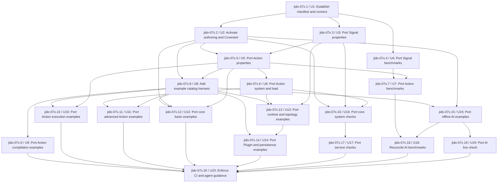

# Consolidated quality backpressure import

## Goal capsule

Bring the useful authoring, example, property, fuzz, system, load, live, and benchmark checks from the four source packages into the consolidated `jido` project. Adapt every check to the current `Jido.*` namespaces, one `:jido` application, Reach layers, and Covenant components.

Land only quality work in this effort. Do not change `lib/**`. If an imported check finds a product gap, record the asset as deferred and create later architecture work.

### Success conditions

- Each quality surface has one focused Mix command.
- `mix test` stays fast, offline, and deterministic.
- `mix test.ci` runs every required offline surface.
- Every supported example has one executable test.
- Property and fuzz suites keep regression inputs and complete reports.
- Load and system suites prove isolation, cleanup, and recovery without timing gates.
- Benchmarks validate results before they report measurements.
- Covenant and Reach remain required gates.
- Provider and external service checks stay opt-in.

### Non-goals

- Do not bulk-copy old trees without a source record.
- Do not import old benchmark result directories.
- Do not make paid provider calls or external services part of the pull request gate.
- Do not restore old package applications or package namespace boundaries.
- Do not change `lib/**` or any file under `../refs/**`.
- Do not complete the Covenant component rename in this effort.

## Evidence and current state

- **Fact F1:** `test/` already has a large unit and Covenant test base.
- **Fact F2:** `test/test_helper.exs` already excludes all planned special tags.
- **Fact F3:** The split core authoring corpus is already adapted under `test/jido/core_authoring/`, but no `test.authoring` alias exists.
- **Fact F4:** `mix.exs` has general `ci`, `quality`, and ReAct `bench` aliases. The current CI alias does not run Covenant.
- **Fact F5:** `.formatter.exs` does not format `examples/**` or `bench/**`.
- **Fact F6:** The target already has the main test dependencies, including StreamData, Mimic, SQLite, PostgreSQL, and OpenTelemetry.
- **Fact F7:** `bench/react_memory.exs` is the current consolidated ReAct memory benchmark.
- **Fact F8:** The target has no GitHub CI workflow.
- **Fact F9:** The local Signal and split core refs are at their required baseline commits.
- **Fact F10:** The local Action ref is clean at `40ec1f0af3a373bae5e6d869017cc229c85aef92` on `main`. Its required baseline object is not in the local clone.
- **Fact F11:** The local AI ref is clean at `65cc5fda0380c0b95fef955687495b8786d03e3b` on an experimental branch. Its required baseline object is available locally.
- **Fact F12:** Source suites use fixed seeds, explicit tags, complete fuzz reports, process barriers, result validation, and opt-in service boundaries.
- **Assumption A1:** Action quality assets at `40ec1f0af3a373bae5e6d869017cc229c85aef92` are explicit new quality work, not replacement production source. Record that commit on each selected asset.

## Requirements

- **R1:** Record source repository, commit, source path, target path, quality surface, owner, disposition, and reason for every reviewed asset.
- **R2:** Keep `../refs/**` read-only and make no change under `lib/**`.
- **R3:** Keep `mix test` fast and give each special surface one focused command with fixed seed `0`.
- **R4:** Run public authoring forms and supported examples as executable compatibility checks.
- **R5:** Keep bounded property and fuzz checks, regression inputs, and complete run reports.
- **R6:** Prove system isolation, process cleanup, recovery, and ownership with deterministic coordination.
- **R7:** Validate benchmark inputs, outputs, cleanup, and report shape without performance thresholds.
- **R8:** Keep provider and external service checks explicit and opt-in.
- **R9:** Use current Covenant owners and require Covenant and Reach gates.
- **R10:** Enforce all required offline surfaces in CI and document commands for coding agents.

## Key technical decisions

- **KTD1:** Use `test/quality/source_manifest.yml` as the source ledger. It has the fields in R1 and the states `ported`, `superseded`, `deferred`, and `excluded`.
- **KTD2:** Use the required baseline commits for Signal, split core, and AI. Use Action commit `40ec1f0af3a373bae5e6d869017cc229c85aef92` only for quality assets and record it as post-baseline work.
- **KTD3:** Use target folders `test/authoring`, `test/examples`, `test/property`, `test/system`, `test/load`, `test/live`, `test/bench`, and `bench`.
- **KTD4:** Import behavior, not old package setup. Remove separate application startup and legacy test namespaces during adaptation.
- **KTD5:** Keep all special tags excluded by default. Add `test.authoring`, `test.examples`, `test.property`, `test.fuzz`, `test.system`, `test.load`, `test.peer`, `test.bench`, `test.live`, and `test.services`.
- **KTD6:** Use the split core example catalog as the broad catalog. Use Action examples for Flow depth and AI examples for AI depth. Exclude proposal and research folders.
- **KTD7:** Keep the current consolidated ReAct memory benchmark. Add only distinct state-growth or fresh-workflow checks.
- **KTD8:** Do not weaken a source assertion to make a port pass. Defer it with the failing command when current product behavior does not satisfy it.

## Implementation units

### U1: Establish the source manifest and runner skeleton

**Goal:** Create the shared quality structure and command interface.

**Covers:** R1, R2, R3; KTD1, KTD2, KTD3, KTD5.

**Dependencies:** None.

**Files:** Change `mix.exs`, `.formatter.exs`, and `test/test_helper.exs`. Add `test/quality/source_manifest.yml`, `test/quality/source_manifest_test.exs`, and `test/quality/README.md`. Do not change `lib/**`.

**Directive:**

1. Add all focused aliases with empty-safe target paths and fixed seed `0`.
2. Extend formatter inputs to `examples/**` and `bench/**`.
3. Add the manifest schema and records for every source suite root.
4. Add validation for full commit SHAs, allowed states, unique target paths, and existing files for `ported` records.

**Acceptance criteria:**

- [ ] Manifest validation rejects missing commits, unknown states, duplicate target paths, and missing ported files.
- [ ] Default `mix test` excludes every special tag.
- [ ] No file under `lib/**` changes.

**Verification:** `mix test test/quality/source_manifest_test.exs` and `mix format --check-formatted` exit with status `0`.

### U2: Activate authoring and Covenant gates

**Goal:** Give the existing authoring corpus and Covenant checks stable commands.

**Covers:** R2, R3, R4, R9; KTD3, KTD4, KTD5.

**Dependencies:** U1.

**Files:** Move `test/jido/core_authoring/**` to `test/authoring/**`. Change `mix.exs`, `test/quality/source_manifest.yml`, and `AGENTS.md`. Do not change `lib/**`.

**Directive:**

1. Move the adapted authoring files without copying a second corpus.
2. Update support loading and ignored support paths.
3. Add `mix test.authoring` and `mix test.contracts`.
4. Add the two commands to the offline CI command.

**Acceptance criteria:**

- [ ] The authoring test count does not change during the move.
- [ ] `mix test.authoring` runs all `:authoring` tests with seed `0`.
- [ ] `mix test.contracts` runs `mix covenant.check`.
- [ ] No `test/jido/core_authoring` duplicate remains.

**Verification:** `mix test.authoring`, `mix test.contracts`, and `mix reach.check --arch --smells` exit with status `0`.

### U3: Port Signal property and fuzz checks

**Goal:** Restore generated checks for Signal values, routing, dispatch, Bus behavior, wire data, trace IDs, and diagnostics.

**Covers:** R1, R2, R5, R9; KTD1, KTD2, KTD4, KTD8.

**Dependencies:** U1.

**Files:** Read `../refs/jido_signal/test/property/**` at `7b825f1d050a0e0159bb2a72ba79c100b5d362d3`. Add `test/property/signal/**` and `test/property/corpus/signal/**`. Change the manifest. Do not change `lib/**`.

**Directive:**

1. Port all bounded Signal property cases and reviewed corpus files.
2. Adapt support modules to current public modules.
3. Keep complete-report validation and required case IDs.
4. Mark product gaps as deferred with the exact failing command.

**Acceptance criteria:**

- [ ] Every property has a bounded generator or fixed corpus.
- [ ] The report gate fails when a required case has no measurement.
- [ ] Reviewed regression corpus files remain versioned.

**Verification:** `mix test.property test/property/signal` and `mix test.fuzz test/property/signal` exit with status `0`.

### U4: Port Signal benchmark smoke checks

**Goal:** Restore Signal benchmark correctness and the manual Signal benchmark runner.

**Covers:** R1, R2, R7; KTD1, KTD2, KTD4.

**Dependencies:** U1.

**Files:** Read `../refs/jido_signal/test/bench/**` and `../refs/jido_signal/bench/**` at the Signal baseline. Add `test/bench/signal/**` and `bench/signal/**`. Exclude `../refs/jido_signal/bench/results/**`. Change the manifest.

**Directive:**

1. Port the three correctness tests and benchmark support code.
2. Write new reports only under ignored `tmp/bench/signal/`.
3. Keep result validation and environment metadata.
4. Remove timing and memory pass thresholds.

**Acceptance criteria:**

- [ ] Smoke tests validate results and cleanup before measurement.
- [ ] No historical result file is copied.
- [ ] The manual runner needs no network or service.

**Verification:** `mix test.bench test/bench/signal` and `mix run bench/signal/run.exs --profile smoke` exit with status `0`.

### U5: Port Action and Flow property checks

**Goal:** Restore bounded expression property and fuzz checks.

**Covers:** R1, R2, R5, R9; KTD1, KTD2, KTD4, KTD8.

**Dependencies:** U2 and U3.

**Files:** Read `../refs/jido_action/test/property/**` at `40ec1f0af3a373bae5e6d869017cc229c85aef92`. Add `test/property/action_flow/**`. Change the manifest. Do not change `lib/**`.

**Directive:**

1. Port expression tree generators, parser limits, operator checks, report support, and reduced failure handling.
2. Rename test support to current `Jido.*` ownership.
3. Keep the required fuzz case list and full-report gate.

**Acceptance criteria:**

- [ ] Generated expression trees have explicit depth and size limits.
- [ ] Short-circuit and parser limit checks pass.
- [ ] Fuzz output records every required case.

**Verification:** `mix test.property test/property/action_flow` and `mix test.fuzz test/property/action_flow` exit with status `0`.

### U6: Port Action system and load checks

**Goal:** Restore Flow form equivalence, concurrent input isolation, and cleanup checks.

**Covers:** R1, R2, R6; KTD1, KTD2, KTD4, KTD8.

**Dependencies:** U5.

**Files:** Read `../refs/jido_action/test/system/**` and `../refs/jido_action/test/load/**` at Action commit `40ec1f0af3a373bae5e6d869017cc229c85aef92`. Add `test/system/runtime/action_flow/**` and `test/load/action_flow/**`. Change the manifest.

**Directive:**

1. Port the Flow module, compiled program, and Instruction equivalence test.
2. Port the fixed 200-workflow isolation check.
3. Port the fresh-VM burn-in command.
4. Assert cleanup and result ownership. Do not use elapsed time as a pass condition.

**Acceptance criteria:**

- [ ] All three Flow forms return the same required result.
- [ ] Every load result keeps its own input.
- [ ] No task or managed execution process remains after the run.

**Verification:** `mix test.system test/system/runtime/action_flow` and `mix test.load test/load/action_flow` exit with status `0`.

### U7: Port Action and Flow benchmark smoke checks

**Goal:** Restore Flow compile, Flow run, DSL compile, and deterministic stress measurement.

**Covers:** R1, R2, R7; KTD1, KTD2, KTD4.

**Dependencies:** U4 and U5.

**Files:** Read `../refs/jido_action/test/bench/**` at Action commit `40ec1f0af3a373bae5e6d869017cc229c85aef92`. Add `test/bench/action_flow/**` and `bench/action_flow/**`. Exclude checked-in result JSON. Change the manifest.

**Directive:**

1. Port compile, run, DSL probe, and ReAct stress workloads that use current production paths.
2. Store reports under `tmp/bench/action_flow/`.
3. Validate result data and process cleanup before measurement.
4. Keep quick, standard, and stress profiles. Run only quick profiles in smoke tests.

**Acceptance criteria:**

- [ ] Quick smoke profiles complete and validate results.
- [ ] Reports include environment and source fingerprint data.
- [ ] No performance threshold fails CI.

**Verification:** `mix test.bench test/bench/action_flow` exits with status `0`, and each quick runner writes one valid report under `tmp/bench/action_flow/`.

### U8: Add the example catalog harness

**Goal:** Create one enforced layout for all supported examples.

**Covers:** R1, R2, R3, R4; KTD1, KTD3, KTD5, KTD6.

**Dependencies:** U2 and U5.

**Files:** Add `examples/README.md`, `test/examples/README.md`, `test/examples/catalog_test.exs`, and shared `test/examples/support/**`. Change the manifest.

**Directive:**

1. Define one stable example ID format and category register.
2. Require one README, one primary source, and one paired test for every supported example.
3. Make the catalog test reject missing files, duplicate IDs, and unlisted examples.
4. Load example source only when example paths or the `:example` tag are selected.

**Acceptance criteria:**

- [ ] An orphan README, source, or test makes the catalog test fail.
- [ ] Default `mix test` does not compile the example tree.
- [ ] `mix test.examples` is offline and uses seed `0`.

**Verification:** `mix test test/examples/catalog_test.exs --include example --seed 0` exits with status `0`.

### U9: Port Action compilation examples

**Goal:** Add executable examples for Action and Flow compilation.

**Covers:** R1, R2, R4; KTD1, KTD2, KTD4, KTD6, KTD8.

**Dependencies:** U8.

**Files:** Read `../refs/jido_action/examples/01_compilation/**` and matching source tests at Action commit `40ec1f0af3a373bae5e6d869017cc229c85aef92`. Add `examples/flow/compilation/**` and `test/examples/flow/compilation/**`. Change the manifest.

**Directive:**

1. Port the single-step, dependency graph, DSL Flow, stored JSON, authoring equivalence, validation, input/output, and compiled program examples.
2. Use current modules and one application.
3. Keep exact documented output assertions.

**Acceptance criteria:**

- [ ] Each of the eight source example IDs has a manifest disposition.
- [ ] Every ported example has a README, source, and passing paired test.
- [ ] No separate-package application module appears.

**Verification:** `mix test.examples test/examples/flow/compilation` exits with status `0`.

### U10: Port Action execution examples

**Goal:** Add executable examples for current Flow execution forms.

**Covers:** R1, R2, R4; KTD1, KTD2, KTD4, KTD6, KTD8.

**Dependencies:** U8 and U5.

**Files:** Read `../refs/jido_action/examples/02_execution/**` and matching tests at Action commit `40ec1f0af3a373bae5e6d869017cc229c85aef92`. Add `examples/flow/execution/**` and `test/examples/flow/execution/**`. Change the manifest.

**Directive:**

1. Port all 15 numbered execution examples.
2. Preserve serial, parallel, choice, collection, iteration, child, wait, control, failure, and dynamic invoke behavior.
3. Use deterministic fixtures and explicit result assertions.

**Acceptance criteria:**

- [ ] All 15 source example IDs have a manifest disposition.
- [ ] Every ported example has one paired offline test.
- [ ] Wait and parallel examples use deterministic coordination.

**Verification:** `mix test.examples test/examples/flow/execution` exits with status `0`.

### U11: Port advanced Action examples

**Goal:** Add executable durability, pattern, and distribution examples for Action and Exec.

**Covers:** R1, R2, R4, R6; KTD1, KTD2, KTD4, KTD6, KTD8.

**Dependencies:** U6 and U8.

**Files:** Read Action example groups `03_durability/**`, `04_patterns/**`, and `05_distribution/**` with their tests at commit `40ec1f0af3a373bae5e6d869017cc229c85aef92`. Add `examples/flow/advanced/**` and matching tests. Change the manifest.

**Directive:**

1. Port each example that passes against current public behavior.
2. Keep process recovery, cancellation, compaction, worker claim, fencing, compensation, and distribution assertions.
3. Defer a source example instead of changing `lib/**` when behavior is missing.

**Acceptance criteria:**

- [ ] Every source example in the three groups has a manifest disposition.
- [ ] Ported examples use barriers or monitors for ordering.
- [ ] Deferred examples record the exact failing command and expected behavior.

**Verification:** `mix test.examples test/examples/flow/advanced` exits with status `0`.

### U12: Port core basic and workflow examples

**Goal:** Add the basic Agent and workflow learning path.

**Covers:** R1, R2, R4; KTD1, KTD4, KTD6, KTD8.

**Dependencies:** U8, U2, and U5.

**Files:** Read split core `examples/01_basic/**`, `examples/02_workflow/**`, and matching tests at `21d0dd4c4da2f9c096fbd1cec9ad1d22dce95e61`. Add `examples/agent/basic/**`, `examples/agent/workflow/**`, and matching tests. Change the manifest.

**Directive:**

1. Port all supported basic Agent and workflow examples.
2. Keep typed commands, Plugins, Directives, supervision, routing, JSON definitions, sequential work, effects, parallel joins, batches, loops, nested Flows, and continuations.
3. Mark split core LLM examples as superseded by the AI catalog.

**Acceptance criteria:**

- [ ] Every source example in the two groups has a manifest disposition.
- [ ] Ported examples use current Agent, Flow, Plugin, and application boundaries.
- [ ] No example calls a provider.

**Verification:** `mix test.examples test/examples/agent/basic test/examples/agent/workflow` exits with status `0`.

### U13: Port core runtime and topology examples

**Goal:** Add executable runtime, multi-Agent, and topology examples.

**Covers:** R1, R2, R4, R6; KTD1, KTD4, KTD6, KTD8.

**Dependencies:** U8, U6, and U3.

**Files:** Read split core `examples/04_runtime/**`, `05_multi_agent/**`, `07_topology/**`, and matching tests at the core baseline. Add `examples/runtime/**`, `examples/topology/**`, and matching tests. Change the manifest.

**Directive:**

1. Port supported runtime, multi-Agent, and topology examples.
2. Preserve scheduling, timers, Bus delivery, observation, trace, recovery, requests, Turn control, children, connections, and topology mutation checks.
3. Keep peer-dependent examples tagged `:peer`.

**Acceptance criteria:**

- [ ] Every source example in the three groups has a manifest disposition.
- [ ] Runtime ordering uses barriers or monitors.
- [ ] Peer examples do not run under default `mix test`.

**Verification:** `mix test.examples test/examples/runtime test/examples/topology` and `mix test.peer` exit with status `0`.

### U14: Port core Plugin and persistence examples

**Goal:** Add executable application, Plugin, persistence, and durable Agent examples.

**Covers:** R1, R2, R4, R6, R9; KTD1, KTD4, KTD6, KTD8.

**Dependencies:** U8 and U13.

**Files:** Read split core example groups `08_applications/**`, `09_plugins/**`, `10_persistence/**`, and supported `11_durable/**` at the core baseline. Exclude `11_durable/proposals/**`. Add `examples/plugin/**`, `examples/persistence/**`, `examples/durable/**`, and matching tests. Change the manifest.

**Directive:**

1. Port supported application, Plugin, persistence, and durable examples.
2. Reuse current persistence test adapters and fixtures.
3. Exclude proposal and research-only examples with manifest reasons.

**Acceptance criteria:**

- [ ] Every source example in the four groups has a manifest disposition.
- [ ] Proposal folders are not presented as supported examples.
- [ ] Persistence examples clean all temporary state.

**Verification:** `mix test.examples test/examples/plugin test/examples/persistence test/examples/durable` exits with status `0`.

### U15: Port offline AI examples

**Goal:** Add the supported AI basic and conversation learning paths.

**Covers:** R1, R2, R4, R8; KTD1, KTD2, KTD4, KTD6, KTD8.

**Dependencies:** U8 and U2.

**Files:** Read AI baseline example groups `00_graph_first/**`, `01_basics/**`, and `02_conversations/**` at `2d3cac6700fcb850b632c2ce5f552ccfd0e5459e`. Exclude `99_proposed/**`. Add `examples/ai/**` and `test/examples/ai/**`. Change the manifest.

**Directive:**

1. Port graph-first, basic Agent, tool, structured output, controls, streaming, request, composition, model helper, JSON, Session, and Thread examples.
2. Use deterministic local model fixtures.
3. Keep provider calls out of the example suite.

**Acceptance criteria:**

- [ ] Every baseline AI example has a manifest disposition.
- [ ] `99_proposed/**` is excluded with a reason.
- [ ] All ported AI examples pass without a provider key.

**Verification:** `mix test.examples test/examples/ai` exits with status `0`.

### U16: Port core property, system, and peer checks

**Goal:** Restore broad local runtime, persistence, recovery, observation, load, and peer pressure.

**Covers:** R1, R2, R5, R6, R9; KTD1, KTD4, KTD8.

**Dependencies:** U2, U3, and U6.

**Files:** Read split core `test/property/**`, `test/system/runtime/**`, and peer-tagged tests at the core baseline. Add `test/property/runtime/**` and `test/system/runtime/core/**`. Reuse `test/support/persistence/**`. Change the manifest.

**Directive:**

1. Port core properties after removing cases already owned by Signal or Action property suites.
2. Port local runtime and persistence system checks.
3. Reuse current persistence conformance support.
4. Replace sleep-based ordering with barriers or monitors.

**Acceptance criteria:**

- [ ] Duplicate property cases are marked superseded.
- [ ] Local system checks cover cleanup, recovery, observation, and storage behavior supported by current APIs.
- [ ] Peer checks remain opt-in.

**Verification:** `mix test.property test/property/runtime`, `mix test.system test/system/runtime/core`, and `mix test.peer` exit with status `0`.

### U17: Port opt-in external service checks

**Goal:** Restore safe Redis, PostgreSQL, MinIO, and Bedrock service checks.

**Covers:** R1, R2, R6, R8; KTD1, KTD4, KTD5, KTD8.

**Dependencies:** U16.

**Files:** Read split core `test/system/services/**` at the core baseline. Add `test/system/services/**` and its README. Change only test dependencies that are required by selected services. Change the manifest. Do not change `lib/**`.

**Directive:**

1. Port each service family under the `:service` tag.
2. Use ephemeral services and test-only credentials.
3. List exact prerequisites and commands.
4. Defer a service when its required client is not part of the consolidated project.

**Acceptance criteria:**

- [ ] Service checks do not run under `mix test`, `mix test.ci`, or `mix test.all`.
- [ ] Setup does not use ambient production services or credentials.
- [ ] Every service family has a manifest disposition.

**Verification:** Each documented `mix test.services` command exits with status `0` in its declared test environment.

### U18: Reconcile offline AI benchmarks

**Goal:** Keep one ReAct benchmark family with distinct memory, state-growth, and fresh-workflow checks.

**Covers:** R1, R2, R7; KTD1, KTD2, KTD4, KTD7, KTD8.

**Dependencies:** U7 and U15.

**Files:** Read AI baseline `test/bench/**`, post-baseline `react_fresh_memory.exs` at `65cc5fda0380c0b95fef955687495b8786d03e3b`, and current `bench/react_memory.exs`. Add `test/bench/ai/**` and `bench/ai/**` only for distinct checks. Change the manifest.

**Directive:**

1. Keep `bench/react_memory.exs` as the current memory owner.
2. Add the baseline state-growth check when it proves a distinct invariant.
3. Add the fresh-workflow check with its post-baseline commit when it proves a distinct invariant.
4. Use deterministic model and tool fixtures.

**Acceptance criteria:**

- [ ] Each AI benchmark metric has one documented owner.
- [ ] No duplicate ReAct implementation enters `lib/**`.
- [ ] Offline benchmark checks need no provider key.

**Verification:** `mix test.bench test/bench/ai` and all documented offline `mix bench.*` commands exit with status `0`.

### U19: Port the AI live provider check

**Goal:** Restore opt-in provider, telemetry, usage, and trace-redaction validation.

**Covers:** R1, R2, R8, R9; KTD1, KTD2, KTD4, KTD5, KTD8.

**Dependencies:** U15.

**Files:** Read AI baseline `test/live/chain_of_thought_live_test.exs`. Add `test/live/ai_reasoning_live_test.exs` and test-only support. Write traces under `tmp/live/`. Change the manifest.

**Directive:**

1. Adapt the live test to current AI and AgentServer APIs.
2. Keep provider output, telemetry correlation, token usage, and trace redaction assertions.
3. Fail with a clear missing-secret message when the test is selected without a key.
4. Sanitize prompts and secrets from written traces.

**Acceptance criteria:**

- [ ] Default and offline CI runs never select the live test.
- [ ] Selected live runs require an explicit test key.
- [ ] Written traces contain no prompt or secret value.

**Verification:** `mix test.live` exits with status `0` with approved test credentials, and trace scans find no prompt or secret value.

### U20: Enforce quality gates in CI and agent guidance

**Goal:** Make all imported offline surfaces persistent repository backpressure.

**Covers:** R2, R3, R4, R5, R6, R7, R8, R9, R10; KTD3, KTD5, KTD8.

**Dependencies:** U9, U10, U11, U12, U14, U17, U18, and U19.

**Files:** Add `.github/workflows/ci.yml`. Change `mix.exs`, `AGENTS.md`, `README.md`, and `test/quality/README.md`. Do not change `lib/**`.

**Directive:**

1. Add named pull request jobs for formatting, warnings, unit tests, Covenant, Reach, authoring, examples, bounded properties, local system, load, and benchmark smoke.
2. Add scheduled or manual extended fuzz, burn-in, and benchmark jobs.
3. Keep service and live jobs manual.
4. Add a change-to-command matrix to `AGENTS.md`.
5. Make README commands match Mix aliases.

**Acceptance criteria:**

- [ ] Each required offline surface has a named CI job.
- [ ] CI runs Covenant and Reach.
- [ ] Live and service checks are not required pull request jobs.
- [ ] Agent guidance names the focused command for each change type.

**Verification:** `mix test.ci`, `mix quality`, `mix covenant.check`, and `mix reach.check --arch --smells` exit with status `0`.

## Beadwork ticket graph

Epic: `jido-07x` — Import consolidated quality backpressure.

An arrow means that the source ticket blocks the destination ticket.

## Ticket register

| Unit | Ticket | Title | Blocked by | Plan state |
|---|---|---|---|---|
| U1 | jido-07x.1 | Establish the quality source manifest and runners | None | Created |
| U2 | jido-07x.2 | Activate authoring and Covenant gates | jido-07x.1 | Created |
| U3 | jido-07x.3 | Port Signal property and fuzz checks | jido-07x.1 | Created |
| U4 | jido-07x.4 | Port Signal benchmark smoke checks | jido-07x.1 | Created |
| U5 | jido-07x.5 | Port Action and Flow property checks | jido-07x.2, jido-07x.3 | Created |
| U6 | jido-07x.6 | Port Action system and load checks | jido-07x.5 | Created |
| U7 | jido-07x.7 | Port Action and Flow benchmark smoke checks | jido-07x.4, jido-07x.5 | Created |
| U8 | jido-07x.8 | Add the example catalog harness | jido-07x.2, jido-07x.5 | Created |
| U9 | jido-07x.9 | Port Action compilation examples | jido-07x.8 | Created |
| U10 | jido-07x.10 | Port Action execution examples | jido-07x.8, jido-07x.5 | Created |
| U11 | jido-07x.11 | Port advanced Action examples | jido-07x.6, jido-07x.8 | Created |
| U12 | jido-07x.12 | Port core basic and workflow examples | jido-07x.8, jido-07x.2, jido-07x.5 | Created |
| U13 | jido-07x.13 | Port core runtime and topology examples | jido-07x.8, jido-07x.6, jido-07x.3 | Created |
| U14 | jido-07x.14 | Port core Plugin and persistence examples | jido-07x.8, jido-07x.13 | Created |
| U15 | jido-07x.15 | Port offline AI examples | jido-07x.8, jido-07x.2 | Created |
| U16 | jido-07x.16 | Port core property, system, and peer checks | jido-07x.2, jido-07x.3, jido-07x.6 | Created |
| U17 | jido-07x.17 | Port opt-in external service checks | jido-07x.16 | Created |
| U18 | jido-07x.18 | Reconcile offline AI benchmarks | jido-07x.7, jido-07x.15 | Created |
| U19 | jido-07x.19 | Port the AI live provider check | jido-07x.15 | Created |
| U20 | jido-07x.20 | Enforce quality gates in CI and agent guidance | jido-07x.9, jido-07x.10, jido-07x.11, jido-07x.12, jido-07x.14, jido-07x.17, jido-07x.18, jido-07x.19 | Created |

## Verification contract

- Every unit runs its focused commands before handoff.
- Every unit runs `mix format --check-formatted`.
- Units that change test ownership or component proof run `mix covenant.check`.
- Every unit runs `mix reach.check --arch --smells` and confirms no `lib/**` change.
- The final gate runs `mix test.ci`, `mix quality`, `mix covenant.check`, and `mix reach.check --arch --smells`.

## Definition of done

- [ ] Every reviewed quality asset has a manifest disposition and exact source commit.
- [ ] All focused aliases exist and match their documentation.
- [ ] Authoring, example, property, fuzz, system, load, and benchmark smoke surfaces pass offline.
- [ ] Live and external service surfaces are explicit and documented.
- [ ] Required CI runs every offline surface, Covenant, and Reach.
- [ ] No source ref changed.
- [ ] No file under `lib/**` changed.

## Sources

- `../AGENTS.md` — workspace source and ref rules.
- `AGENTS.md` — target architecture and work rules.
- `mix.exs` — current aliases, dependencies, and coverage settings.
- `test/test_helper.exs` — current special tag exclusions.
- `test/contracts/README.md` — Covenant ownership and gate rules.
- `.reach.exs` — current dependency layers.
- `README.md` — stated missing quality surfaces and current benchmark.
- `../refs/jido_action/test/{examples,load,property,system,bench}/` and `../refs/jido_action/examples/`.
- `../refs/jido_signal/test/{property,bench}/` and `../refs/jido_signal/bench/`.
- `../refs/jido_v3_split/test/{authoring,examples,property,system,bench}/` and `../refs/jido_v3_split/examples/`.
- `../refs/jido_ai/test/{bench,live}/` and `../refs/jido_ai/examples/`.
