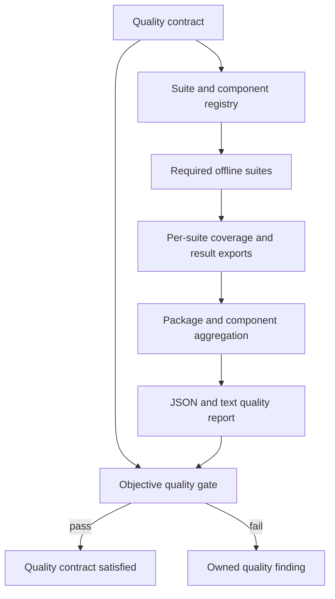
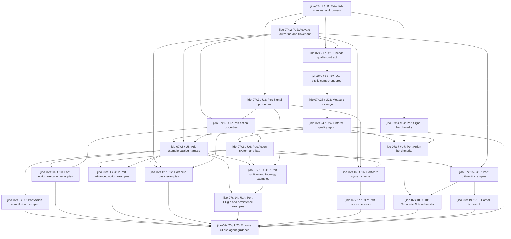

# Consolidated Quality Backpressure - Plan

## Goal Capsule

- **Objective:** Maintainers can decide whether Jido V3 meets its quality standard from reproducible evidence for every public component.
- **Means:** Encode one quality contract, measure its gates, and import the useful quality assets from the four source packages. See KTD9 through KTD17.
- **Authority:** Product requirements in this plan override implementation preferences. The quality contract overrides suite-local conventions when they disagree.
- **Execution profile:** Apply quality-only changes directly to `main`. Do not create a branch or pull request.
- **Stop conditions:** Stop an import when it requires a product change, weakens a source assertion, or changes a reference repository.
- **Tail ownership:** The `jido-07x` epic owns the work until the final gate produces a complete quality report.

---

## Product Contract

### Summary

Define quality as a set of machine-evaluable gates for package coverage, component coverage, public API proof, authoring, examples, fuzzing, system behavior, load behavior, and benchmark correctness. Use the old package repositories as evidence sources and keep external services opt-in.

### Problem Frame

The consolidated package has strong unit tests, Reach rules, and Covenant obligations. It does not have one objective definition of package quality. The current 90% code-coverage threshold can hide weak components, and it does not show which suite contributes proof.

Five completed quality-import tickets were present only on worktree branches. They were merged into `main` on 2026-11-04 before this plan update. The merge exposed one non-repeatable Covenant shutdown failure. This is evidence that a later passing run must not erase stability findings.

### Requirements

#### Source evidence and suite structure

- R1. Record the source repository, commit, source path, target path, quality surface, owner, disposition, and reason for every reviewed asset.
- R2. Keep `../refs/**` read-only and make no change under `lib/**`.
- R3. Keep `mix test` fast and give each special surface one focused command with seed `0`.
- R4. Run public authoring forms and supported examples as executable compatibility checks.
- R5. Keep bounded property and fuzz checks, regression inputs, and complete run reports.
- R6. Prove system isolation, process cleanup, recovery, and ownership with deterministic coordination.
- R7. Validate benchmark inputs, outputs, cleanup, and report shape before measurement.
- R8. Keep provider and external-service checks explicit and opt-in.
- R9. Use current Covenant owners and require Covenant and Reach gates.
- R10. Enforce all required offline surfaces in the repository quality gate and document commands for coding agents.

#### Objective quality contract

- R11. Store one versioned quality contract that declares every suite, component owner, applicability rule, threshold, report artifact, and required or opt-in state.
- R12. Register every active Covenant component and every public module under exactly one primary component owner.
- R13. Require 100% Covenant obligation coverage for all active components.
- R14. Require every public component to declare property or fuzz proof, or a specific machine-validated not-applicable reason.
- R15. Require every fuzz group to use a bounded generator, a fixed seed, a replayable reduced input, and a complete report.
- R16. Require every supported example and authoring form to have a catalog entry and an executable offline test.

#### Coverage and stability

- R17. Measure combined line coverage across all required offline suites and fail when package coverage is below 90%.
- R18. Measure line coverage by Covenant component and fail when a component is below its recorded floor, below 80%, or more than 0.5 percentage points below its committed baseline.
- R19. Report each suite's total and unique line contribution without using contribution size as a pass threshold.
- R20. Treat any failure in a required suite as a stability defect until the cause is resolved or a versioned waiver identifies the owner, reason, and expiry condition.
- R21. Keep format, warnings, Credo, Dialyzer, ExDNA, Reach architecture, and Covenant checks as required zero-error gates.
- R22. Produce one JSON report and one concise text report that contain the exact revision, dirty state, runtime versions, suite results, thresholds, waivers, and coverage results.

### Success Criteria

- The quality checker returns one deterministic pass or fail result from the committed contract and current evidence.
- Package line coverage is at least 90%, Covenant obligation coverage is 100%, and each component satisfies R18.
- Every active public component has a valid proof classification under R14.
- Every required offline suite passes and produces its declared report.
- A repeated failure remains visible after a later passing run until its stability record is resolved.

### Scope Boundaries

- Do not bulk-copy old trees without a source record.
- Do not import historical benchmark result directories.
- Do not use elapsed time as a required gate on an uncontrolled runner.
- Do not put paid providers or external services in the required offline gate.
- Do not restore old package applications or package namespace boundaries.
- Do not change `lib/**` or files under `../refs/**` in this quality effort.
- Do not complete the Covenant component rename in this effort.
- Record product defects as separate architecture work. Do not weaken tests to keep this plan green.

---

## Planning Contract

### Evidence and Current State

Land only quality work in this effort. Do not change `lib/**`. If an imported check finds a product gap, record the asset as deferred and create later architecture work.

- **Fact F1:** `test/` has 364 default test files plus the imported authoring, property, fuzz, and benchmark surfaces.
- **Fact F2:** `test/test_helper.exs` excludes all special tags by default.
- **Fact F3:** `test/authoring/` has 74 passing JSON and DSL authoring tests.
- **Fact F4:** The focused quality aliases and Covenant alias are present on `main`.
- **Fact F5:** `.formatter.exs` includes `examples/**` and `bench/**`.
- **Fact F6:** The target already has the main test dependencies, including StreamData, Mimic, SQLite, PostgreSQL, and OpenTelemetry.
- **Fact F7:** `bench/react_memory.exs` is the current consolidated ReAct memory benchmark.
- **Fact F8:** The target has no GitHub CI workflow and no single quality report.
- **Fact F9:** The local Signal and split core refs are at their required baseline commits.
- **Fact F10:** The local Action ref is clean at `40ec1f0af3a373bae5e6d869017cc229c85aef92` on `main`. Its required baseline object is not in the local clone.
- **Fact F11:** The local AI ref is clean at `65cc5fda0380c0b95fef955687495b8786d03e3b` on an experimental branch. Its required baseline object is available locally.
- **Fact F12:** Source suites use fixed seeds, explicit tags, complete fuzz reports, process barriers, result validation, and opt-in service boundaries.
- **Fact F13:** Covenant has 40 active components and 323 active obligations. The verified merge run covered 323 of 323 obligations.
- **Fact F14:** The current code-coverage gate measures only the package total at 90%. It does not measure components or suite contribution.
- **Fact F15:** A full Covenant run failed once during `JidoTest.Persistence.TokenTest` cleanup and passed on a focused rerun and a full rerun.
- **Fact F16:** The old core package has 483 test files and 249 example files. The old AI package has 63 test files, 43 example files, offline ReAct benchmarks, and one opt-in live test.
- **Assumption A1:** Action quality assets at `40ec1f0af3a373bae5e6d869017cc229c85aef92` are explicit new quality work, not replacement production source. Record that commit on each selected asset.

### Key Technical Decisions

- KTD1. **Source ledger:** Use `test/quality/source_manifest.yml` as the source ledger with the fields in R1 and the states `ported`, `superseded`, `deferred`, and `excluded`.
- KTD2. **Source commits:** Use the required baseline commits for Signal, split core, and AI. Use Action commit `40ec1f0af3a373bae5e6d869017cc229c85aef92` only for quality assets.
- KTD3. **Suite layout:** Use `test/authoring`, `test/examples`, `test/property`, `test/system`, `test/load`, `test/live`, `test/bench`, and `bench`.
- KTD4. **Behavior import:** Import behavior, not old package setup. Remove separate application startup and legacy test namespaces during adaptation.
- KTD5. **Suite selection:** Keep all special tags excluded by default. Use focused aliases for each suite.
- KTD6. **Example sources:** Use the split core example catalog as the broad catalog. Use Action examples for Flow depth and AI examples for AI depth. Exclude proposal and research folders.
- KTD7. **ReAct benchmark ownership:** Keep the current consolidated ReAct memory benchmark. Add only distinct state-growth or fresh-workflow checks.
- KTD8. **Product gaps:** Do not weaken a source assertion to make a port pass. Defer it with the failing command when current product behavior does not satisfy it.
- KTD9. **Quality contract:** Store the normative quality model in `test/quality/quality_contract.yml`. Validate it with executable tests before any suite runs.
- KTD10. **Component ownership:** Use Covenant components as behavior owners and Reach module ownership as the module-to-component map. Reject missing and duplicate owners.
- KTD11. **Coverage aggregation:** Export coverage from each required offline suite. Normalize each executable line to its repository-relative source path and line number before union. Compute the package union and component union from those identities. A suite has unique contribution only when no other required suite covers that identity. This avoids double counting when suites compile the same module in separate BEAM runs.
- KTD12. **Coverage thresholds:** Use the fixed package and component floors in R17 and R18. Commit the first complete clean measurement as the component baseline. A later lower floor needs a versioned waiver. This keeps the first run from redefining a failing threshold while allowing an owned exception to remain visible.
- KTD13. **Public API fuzz classification:** Require each active public component to declare `required` or `not_applicable`. Validate the reason for each exception.
- KTD14. **Benchmark gates:** Gate benchmark result correctness, cleanup, bounded work, and report shape. Treat timing and memory values as trends unless the runner has a committed stability profile with a named host class and repeatability evidence. Uncontrolled runner variance must not produce a false package failure.
- KTD15. **External boundaries:** Keep provider and service suites opt-in. Do not include them in combined offline coverage.
- KTD16. **Direct delivery:** Apply this quality work directly to `main`. (session-settled: user-directed — chosen over a branch and local pull request: the user requested direct main delivery.)
- KTD17. **Stability evidence:** Preserve every required-suite failure in the quality report until a versioned resolution or waiver closes it.
- KTD18. **Numbered examples:** Keep the source teaching order as `NN_chapter/NN_NN_lesson` under each category. Mirror that path in `test/examples`, use `category/NN_NN_lesson` catalog IDs, preserve intentional gaps, and reject a lesson whose prefix does not match its parent chapter.

### High-Level Technical Design

The quality contract is the normative input. Suite reports are evidence. The aggregate report does not redefine thresholds.

### System-Wide Impact

- **Mix command surface:** U21, U23, U24, and U20 add aliases. Existing focused aliases remain the suite entry points. The quality aliases compose them and do not change default `mix test` selection.
- **Compiled instrumentation:** U23 runs required suites in separate instrumented runs. It keys evidence by repository-relative source path and line number, then maps each production module to the owner established by U22.
- **Persistent repository data:** The contract, component proof map, coverage baseline, waivers, and stability resolutions are reviewed source files. Per-run coverage and reports are disposable files under ignored `tmp/quality/` paths.
- **Failure propagation:** A missing artifact, unknown owner, expired waiver, threshold miss, or required-suite failure makes the combined result fail. A later passing suite result does not remove an unresolved stability finding.
- **Public runtime:** This effort does not change `lib/**`, OTP startup, public types, or runtime data. It changes development and CI evidence only.
- **Direct-main recovery:** Each unit must leave focused checks passing before the next unit starts. If a unit cannot meet its acceptance conditions without a product change, stop that unit, record the defect, and do not weaken or partially activate the gate.

### Risks and Mitigations

- **Coverage attribution can be incomplete.** Fail when a production module has no component owner. Do not classify it as package-only coverage.
- **Generated modules can distort the denominator.** Keep ignore rules versioned in the quality contract and test each rule against current compiled modules.
- **Timing varies by host.** Gate correctness and cleanup on all runners. Gate performance values only on a committed stable-runner profile.
- **A later pass can hide a race.** Preserve unresolved failures as stability findings per R20 and KTD17.
- **Direct main delivery reduces review isolation.** Run each focused gate before the next unit and keep each unit as one local commit.

---

## Implementation Units

All units execute directly on `main` after their dependency tickets close, per KTD16.

| Unit | Outcome | Primary files | Depends on |
|---|---|---|---|
| U1 | Establish manifest and runners | `test/quality/source_manifest.yml`, `mix.exs` | None |
| U2 | Activate authoring and Covenant | `test/authoring/**`, `mix.exs` | U1 |
| U3 | Port Signal properties | `test/property/signal/**` | U1 |
| U4 | Port Signal benchmarks | `test/bench/signal/**`, `bench/signal/**` | U1 |
| U5 | Port Action properties | `test/property/action_flow/**` | U2, U3 |
| U21 | Encode quality contract | `test/quality/quality_contract.yml` | U1, U2 |
| U22 | Map component proof | `test/quality/component_proof.yml` | U21 |
| U23 | Measure coverage | `test/quality/coverage_baseline.json` | U22 |
| U24 | Enforce quality report | `test/quality/support/report.exs` | U23 |
| U6 | Port Action system and load | `test/system/runtime/action_flow/**`, `test/load/action_flow/**` | U5, U24 |
| U7 | Port Action benchmarks | `test/bench/action_flow/**` | U4, U5, U24 |
| U8 | Add example catalog | `test/examples/**`, `examples/**` | U2, U5, U24 |
| U9 | Port compilation examples | `test/examples/flow/01_compilation/**` | U8 |
| U10 | Port execution examples | `test/examples/flow/02_execution/**` | U5, U8 |
| U11 | Port advanced examples | `test/examples/flow/03_durability/**`, `04_patterns/**`, `05_distribution/**` | U6, U8 |
| U12 | Port core learning examples | `test/examples/agent/**` | U2, U5, U8 |
| U13 | Port runtime examples | `test/examples/runtime/**`, `test/examples/topology/**` | U3, U6, U8 |
| U14 | Port Plugin and persistence examples | `test/examples/plugin/**`, `test/examples/persistence/**` | U8, U13 |
| U15 | Port offline AI examples | `test/examples/ai/**` | U2, U8 |
| U16 | Port core runtime pressure | `test/property/runtime/**`, `test/system/runtime/core/**` | U2, U3, U6 |
| U17 | Port service checks | `test/system/services/**` | U16 |
| U18 | Reconcile AI benchmarks | `test/bench/ai/**`, `bench/ai/**` | U7, U15 |
| U19 | Port AI live check | `test/live/**` | U15 |
| U20 | Enforce final gates | `.github/workflows/ci.yml`, `mix.exs` | U9-U19, U24 |

### U1. Establish the source manifest and runner skeleton

**Goal:** Create the shared quality structure and command interface.

**Covers:** R1, R2, R3; KTD1, KTD2, KTD3, KTD5.

**Dependencies:** None.

**Files:** Change `mix.exs`, `.formatter.exs`, and `test/test_helper.exs`. Add `test/quality/source_manifest.yml`, `test/quality/source_manifest_test.exs`, and `test/quality/README.md`. Do not change `lib/**`.

**Directive:**

1. Add all focused aliases with empty-safe target paths and fixed seed `0`.
2. Extend formatter inputs to `examples/**` and `bench/**`.
3. Add the manifest schema and records for every source suite root.
4. Add validation for full commit SHAs, allowed states, unique target paths, and existing files for `ported` records.

**Test scenarios and acceptance criteria:**

- [ ] Manifest validation rejects missing commits, unknown states, duplicate target paths, and missing ported files.
- [ ] Default `mix test` excludes every special tag.
- [ ] No file under `lib/**` changes.

**Verification:** `mix test test/quality/source_manifest_test.exs` and `mix format --check-formatted` exit with status `0`.

### U2. Activate authoring and Covenant gates

**Goal:** Give the existing authoring corpus and Covenant checks stable commands.

**Covers:** R2, R3, R4, R9; KTD3, KTD4, KTD5.

**Dependencies:** U1.

**Files:** Move `test/jido/core_authoring/**` to `test/authoring/**`. Change `mix.exs`, `test/quality/source_manifest.yml`, and `AGENTS.md`. Do not change `lib/**`.

**Directive:**

1. Move the adapted authoring files without copying a second corpus.
2. Update support loading and ignored support paths.
3. Add `mix test.authoring` and `mix test.contracts`.
4. Add the two commands to the offline CI command.

**Test scenarios and acceptance criteria:**

- [ ] The authoring test count does not change during the move.
- [ ] `mix test.authoring` runs all `:authoring` tests with seed `0`.
- [ ] `mix test.contracts` runs `mix covenant.check`.
- [ ] No `test/jido/core_authoring` duplicate remains.

**Verification:** `mix test.authoring`, `mix test.contracts`, and `mix reach.check --arch --smells` exit with status `0`.

### U3. Port Signal property and fuzz checks

**Goal:** Restore generated checks for Signal values, routing, dispatch, Bus behavior, wire data, trace IDs, and diagnostics.

**Covers:** R1, R2, R5, R9; KTD1, KTD2, KTD4, KTD8.

**Dependencies:** U1.

**Files:** Read `../refs/jido_signal/test/property/**` at `7b825f1d050a0e0159bb2a72ba79c100b5d362d3`. Add `test/property/signal/**` and `test/property/corpus/signal/**`. Change the manifest. Do not change `lib/**`.

**Directive:**

1. Port all bounded Signal property cases and reviewed corpus files.
2. Adapt support modules to current public modules.
3. Keep complete-report validation and required case IDs.
4. Mark product gaps as deferred with the exact failing command.

**Test scenarios and acceptance criteria:**

- [ ] Every property has a bounded generator or fixed corpus.
- [ ] The report gate fails when a required case has no measurement.
- [ ] Reviewed regression corpus files remain versioned.

**Verification:** `mix test.property test/property/signal` and `mix test.fuzz test/property/signal` exit with status `0`.

### U4. Port Signal benchmark smoke checks

**Goal:** Restore Signal benchmark correctness and the manual Signal benchmark runner.

**Covers:** R1, R2, R7; KTD1, KTD2, KTD4.

**Dependencies:** U1.

**Files:** Read `../refs/jido_signal/test/bench/**` and `../refs/jido_signal/bench/**` at the Signal baseline. Add `test/bench/signal/**` and `bench/signal/**`. Exclude `../refs/jido_signal/bench/results/**`. Change the manifest.

**Directive:**

1. Port the three correctness tests and benchmark support code.
2. Write new reports only under ignored `tmp/bench/signal/`.
3. Keep result validation and environment metadata.
4. Remove timing and memory pass thresholds.

**Test scenarios and acceptance criteria:**

- [ ] Smoke tests validate results and cleanup before measurement.
- [ ] No historical result file is copied.
- [ ] The manual runner needs no network or service.

**Verification:** `mix test.bench test/bench/signal` and `mix run bench/signal/run.exs --profile smoke` exit with status `0`.

### U5. Port Action and Flow property checks

**Goal:** Restore bounded expression property and fuzz checks.

**Covers:** R1, R2, R5, R9; KTD1, KTD2, KTD4, KTD8.

**Dependencies:** U2 and U3.

**Files:** Read `../refs/jido_action/test/property/**` at `40ec1f0af3a373bae5e6d869017cc229c85aef92`. Add `test/property/action_flow/**`. Change the manifest. Do not change `lib/**`.

**Directive:**

1. Port expression tree generators, parser limits, operator checks, report support, and reduced failure handling.
2. Rename test support to current `Jido.*` ownership.
3. Keep the required fuzz case list and full-report gate.

**Test scenarios and acceptance criteria:**

- [ ] Generated expression trees have explicit depth and size limits.
- [ ] Short-circuit and parser limit checks pass.
- [ ] Fuzz output records every required case.

**Verification:** `mix test.property test/property/action_flow` and `mix test.fuzz test/property/action_flow` exit with status `0`.

### U6. Port Action system and load checks

**Goal:** Restore Flow form equivalence, concurrent input isolation, and cleanup checks.

**Covers:** R1, R2, R6; KTD1, KTD2, KTD4, KTD8.

**Dependencies:** U5 and U24.

**Files:** Read `../refs/jido_action/test/system/**` and `../refs/jido_action/test/load/**` at Action commit `40ec1f0af3a373bae5e6d869017cc229c85aef92`. Add `test/system/runtime/action_flow/**` and `test/load/action_flow/**`. Change the manifest.

**Directive:**

1. Port the Flow module, compiled program, and Instruction equivalence test.
2. Port the fixed 200-workflow isolation check.
3. Port the fresh-VM burn-in command.
4. Assert cleanup and result ownership. Do not use elapsed time as a pass condition.

**Test scenarios and acceptance criteria:**

- [ ] All three Flow forms return the same required result.
- [ ] Every load result keeps its own input.
- [ ] No task or managed execution process remains after the run.

**Verification:** `mix test.system test/system/runtime/action_flow` and `mix test.load test/load/action_flow` exit with status `0`.

### U7. Port Action and Flow benchmark smoke checks

**Goal:** Restore Flow compile, Flow run, DSL compile, and deterministic stress measurement.

**Covers:** R1, R2, R7; KTD1, KTD2, KTD4.

**Dependencies:** U4, U5, and U24.

**Files:** Read `../refs/jido_action/test/bench/**` at Action commit `40ec1f0af3a373bae5e6d869017cc229c85aef92`. Add `test/bench/action_flow/**` and `bench/action_flow/**`. Exclude checked-in result JSON. Change the manifest.

**Directive:**

1. Port compile, run, DSL probe, and ReAct stress workloads that use current production paths.
2. Store reports under `tmp/bench/action_flow/`.
3. Validate result data and process cleanup before measurement.
4. Keep quick, standard, and stress profiles. Run only quick profiles in smoke tests.

**Test scenarios and acceptance criteria:**

- [ ] Quick smoke profiles complete and validate results.
- [ ] Reports include environment and source fingerprint data.
- [ ] No performance threshold fails CI.

**Verification:** `mix test.bench test/bench/action_flow` exits with status `0`, and each quick runner writes one valid report under `tmp/bench/action_flow/`.

### U8. Add the example catalog harness

**Goal:** Create one enforced layout for all supported examples.

**Covers:** R1, R2, R3, R4; KTD1, KTD3, KTD5, KTD6, KTD18.

**Dependencies:** U2, U5, and U24.

**Files:** Add `examples/README.md`, `test/examples/README.md`, `test/examples/catalog_test.exs`, and shared `test/examples/support/**`. Change the manifest.

**Directive:**

1. Define `category/NN_NN_lesson` IDs and a category register.
2. Require one README, one primary source, and one paired test for every supported example.
3. Make the catalog test reject missing files, duplicate IDs, and unlisted examples.
4. Load example source only when example paths or the `:example` tag are selected.
5. Require `NN_chapter/NN_NN_lesson` source and test paths, matching chapter prefixes, preserved gaps, and ID-sorted catalog entries.

**Test scenarios and acceptance criteria:**

- [ ] An orphan README, source, or test makes the catalog test fail.
- [ ] A malformed chapter, malformed lesson, mismatched prefix, mirrored-path error, or unsorted ID makes the catalog test fail.
- [ ] Default `mix test` does not compile the example tree.
- [ ] `mix test.examples` is offline and uses seed `0`.

**Verification:** `mix test test/examples/catalog_test.exs --include example --seed 0` exits with status `0`.

### U9. Port Action compilation examples

**Goal:** Add executable examples for Action and Flow compilation.

**Covers:** R1, R2, R4; KTD1, KTD2, KTD4, KTD6, KTD8.

**Dependencies:** U8.

**Files:** Read `../refs/jido_action/examples/01_compilation/**` and matching source tests at Action commit `40ec1f0af3a373bae5e6d869017cc229c85aef92`. Add `examples/flow/01_compilation/**` and `test/examples/flow/01_compilation/**`. Change the manifest.

**Directive:**

1. Port the single-step, dependency graph, DSL Flow, stored JSON, authoring equivalence, validation, input/output, and compiled program examples.
2. Use current modules and one application.
3. Keep exact documented output assertions.

**Test scenarios and acceptance criteria:**

- [ ] Each of the eight source example IDs has a manifest disposition.
- [ ] Every ported example has a README, source, and passing paired test.
- [ ] No separate-package application module appears.

**Verification:** `mix test.examples test/examples/flow/01_compilation` exits with status `0`.

### U10. Port Action execution examples

**Goal:** Add executable examples for current Flow execution forms.

**Covers:** R1, R2, R4; KTD1, KTD2, KTD4, KTD6, KTD8.

**Dependencies:** U8 and U5.

**Files:** Read `../refs/jido_action/examples/02_execution/**` and matching tests at Action commit `40ec1f0af3a373bae5e6d869017cc229c85aef92`. Add `examples/flow/02_execution/**` and `test/examples/flow/02_execution/**`. Change the manifest.

**Directive:**

1. Port all 15 numbered execution examples.
2. Preserve serial, parallel, choice, collection, iteration, child, wait, control, failure, and dynamic invoke behavior.
3. Use deterministic fixtures and explicit result assertions.

**Test scenarios and acceptance criteria:**

- [ ] All 15 source example IDs have a manifest disposition.
- [ ] Every ported example has one paired offline test.
- [ ] Wait and parallel examples use deterministic coordination.

**Verification:** `mix test.examples test/examples/flow/02_execution` exits with status `0`.

### U11. Port advanced Action examples

**Goal:** Add executable durability, pattern, and distribution examples for Action and Exec.

**Covers:** R1, R2, R4, R6; KTD1, KTD2, KTD4, KTD6, KTD8.

**Dependencies:** U6 and U8.

**Files:** Read Action example groups `03_durability/**`, `04_patterns/**`, and `05_distribution/**` with their tests at commit `40ec1f0af3a373bae5e6d869017cc229c85aef92`. Add matching numbered chapters under `examples/flow/**` and `test/examples/flow/**`. Change the manifest.

**Directive:**

1. Port each example that passes against current public behavior.
2. Keep process recovery, cancellation, compaction, worker claim, fencing, compensation, and distribution assertions.
3. Defer a source example instead of changing `lib/**` when behavior is missing.

**Test scenarios and acceptance criteria:**

- [ ] Every source example in the three groups has a manifest disposition.
- [ ] Ported examples use barriers or monitors for ordering.
- [ ] Deferred examples record the exact failing command and expected behavior.

**Verification:** `mix test.examples test/examples/flow/03_durability test/examples/flow/04_patterns test/examples/flow/05_distribution` exits with status `0`.

### U12. Port core basic and workflow examples

**Goal:** Add the basic Agent and workflow learning path.

**Covers:** R1, R2, R4; KTD1, KTD4, KTD6, KTD8.

**Dependencies:** U8, U2, and U5.

**Files:** Read split core `examples/01_basic/**`, `examples/02_workflow/**`, and matching tests at `21d0dd4c4da2f9c096fbd1cec9ad1d22dce95e61`. Add `examples/agent/01_basic/**`, `examples/agent/02_workflow/**`, and matching tests. Change the manifest.

**Directive:**

1. Port all supported basic Agent and workflow examples.
2. Keep typed commands, Plugins, Directives, supervision, routing, JSON definitions, sequential work, effects, parallel joins, batches, loops, nested Flows, and continuations.
3. Mark split core LLM examples as superseded by the AI catalog.

**Test scenarios and acceptance criteria:**

- [ ] Every source example in the two groups has a manifest disposition.
- [ ] Ported examples use current Agent, Flow, Plugin, and application boundaries.
- [ ] No example calls a provider.

**Verification:** `mix test.examples test/examples/agent/01_basic test/examples/agent/02_workflow` exits with status `0`.

### U13. Port core runtime and topology examples

**Goal:** Add executable runtime, multi-Agent, and topology examples.

**Covers:** R1, R2, R4, R6; KTD1, KTD4, KTD6, KTD8.

**Dependencies:** U8, U6, and U3.

**Files:** Read split core `examples/04_runtime/**`, `05_multi_agent/**`, `07_topology/**`, and matching tests at the core baseline. Add `examples/runtime/04_runtime/**`, `examples/runtime/05_multi_agent/**`, `examples/topology/07_topology/**`, and matching tests. Change the manifest.

**Directive:**

1. Port supported runtime, multi-Agent, and topology examples.
2. Preserve scheduling, timers, Bus delivery, observation, trace, recovery, requests, Turn control, children, connections, and topology mutation checks.
3. Keep peer-dependent examples tagged `:peer`.

**Test scenarios and acceptance criteria:**

- [ ] Every source example in the three groups has a manifest disposition.
- [ ] Runtime ordering uses barriers or monitors.
- [ ] Peer examples do not run under default `mix test`.

**Verification:** `mix test.examples test/examples/runtime/04_runtime test/examples/runtime/05_multi_agent test/examples/topology/07_topology` and `mix test.peer` exit with status `0`.

### U14. Port core Plugin and persistence examples

**Goal:** Add executable application, Plugin, persistence, and durable Agent examples.

**Covers:** R1, R2, R4, R6, R9; KTD1, KTD4, KTD6, KTD8.

**Dependencies:** U8 and U13.

**Files:** Read split core example groups `08_applications/**`, `09_plugins/**`, `10_persistence/**`, and supported `11_durable/**` at the core baseline. Exclude `11_durable/proposals/**`. Add `examples/plugin/08_applications/**`, `examples/plugin/09_plugins/**`, `examples/persistence/10_persistence/**`, `examples/durable/11_durable/**`, and matching numbered test paths. Change the manifest.

**Directive:**

1. Port supported application, Plugin, persistence, and durable examples.
2. Reuse current persistence test adapters and fixtures.
3. Exclude proposal and research-only examples with manifest reasons.

**Test scenarios and acceptance criteria:**

- [ ] Every source example in the four groups has a manifest disposition.
- [ ] Proposal folders are not presented as supported examples.
- [ ] Persistence examples clean all temporary state.

**Verification:** `mix test.examples test/examples/plugin/08_applications test/examples/plugin/09_plugins test/examples/persistence/10_persistence test/examples/durable/11_durable` exits with status `0`.

### U15. Port offline AI examples

**Goal:** Add the supported AI basic and conversation learning paths.

**Covers:** R1, R2, R4, R8; KTD1, KTD2, KTD4, KTD6, KTD8.

**Dependencies:** U8 and U2.

**Files:** Read AI baseline example groups `00_graph_first/**`, `01_basics/**`, and `02_conversations/**` at `2d3cac6700fcb850b632c2ce5f552ccfd0e5459e`. Exclude `99_proposed/**`. Add `examples/ai/00_graph_first/**`, `examples/ai/01_basics/**`, `examples/ai/02_conversations/**`, and matching paths under `test/examples/ai/**`. Change the manifest.

**Directive:**

1. Port graph-first, basic Agent, tool, structured output, controls, streaming, request, composition, model helper, JSON, Session, and Thread examples.
2. Use deterministic local model fixtures.
3. Keep provider calls out of the example suite.

**Test scenarios and acceptance criteria:**

- [x] Every baseline AI example has a manifest disposition.
- [x] `99_proposed/**` is excluded with a reason.
- [x] All ported AI examples pass without a provider key.

**Verification:** `mix test.examples test/examples/ai` exits with status `0`.

### U16. Port core property, system, and peer checks

**Goal:** Restore broad local runtime, persistence, recovery, observation, load, and peer pressure.

**Covers:** R1, R2, R5, R6, R9; KTD1, KTD4, KTD8.

**Dependencies:** U2, U3, and U6.

**Files:** Read split core `test/property/**`, `test/system/runtime/**`, and peer-tagged tests at the core baseline. Add `test/property/runtime/**` and `test/system/runtime/core/**`. Reuse `test/support/persistence/**`. Change the manifest.

**Directive:**

1. Port core properties after removing cases already owned by Signal or Action property suites.
2. Port local runtime and persistence system checks.
3. Reuse current persistence conformance support.
4. Replace sleep-based ordering with barriers or monitors.

**Test scenarios and acceptance criteria:**

- [x] Duplicate property cases are marked superseded.
- [x] Local system checks cover cleanup, recovery, observation, and storage behavior supported by current APIs.
- [x] Peer checks remain opt-in.

**Verification:** `mix test.property test/property/runtime`, `mix test.system test/system/runtime/core`, and `mix test.peer` exit with status `0`.

### U17. Port opt-in external service checks

**Goal:** Restore safe Redis, PostgreSQL, MinIO, and Bedrock service checks.

**Covers:** R1, R2, R6, R8; KTD1, KTD4, KTD5, KTD8.

**Dependencies:** U16.

**Files:** Read split core `test/system/services/**` at the core baseline. Add `test/system/services/**` and its README. Change only test dependencies that are required by selected services. Change the manifest. Do not change `lib/**`.

**Directive:**

1. Port each service family under the `:service` tag.
2. Use ephemeral services and test-only credentials.
3. List exact prerequisites and commands.
4. Defer a service when its required client is not part of the consolidated project.

**Test scenarios and acceptance criteria:**

- [x] Service checks do not run under `mix test`, `mix test.ci`, or `mix test.all`.
- [x] Setup does not use ambient production services or credentials.
- [x] Every service family has a manifest disposition.

**Verification:** Each documented `mix test.services` command exits with status `0` in its declared test environment.

### U18. Reconcile offline AI benchmarks

**Goal:** Keep one ReAct benchmark family with distinct memory, state-growth, and fresh-workflow checks.

**Covers:** R1, R2, R7; KTD1, KTD2, KTD4, KTD7, KTD8.

**Dependencies:** U7 and U15.

**Files:** Read AI baseline `test/bench/**`, post-baseline `react_fresh_memory.exs` at `65cc5fda0380c0b95fef955687495b8786d03e3b`, and current `bench/react_memory.exs`. Add `test/bench/ai/**` and `bench/ai/**` only for distinct checks. Change the manifest.

**Directive:**

1. Keep `bench/react_memory.exs` as the current memory owner.
2. Add the baseline state-growth check when it proves a distinct invariant.
3. Add the fresh-workflow check with its post-baseline commit when it proves a distinct invariant.
4. Use deterministic model and tool fixtures.

**Test scenarios and acceptance criteria:**

- [x] Each AI benchmark metric has one documented owner.
- [x] No duplicate ReAct implementation enters `lib/**`.
- [x] Offline benchmark checks need no provider key.

**Verification:** `mix test.bench test/bench/ai` and all documented offline `mix bench.*` commands exit with status `0`.

### U19. Port the AI live provider check

**Goal:** Restore opt-in provider, telemetry, usage, and trace-redaction validation.

**Covers:** R1, R2, R8, R9; KTD1, KTD2, KTD4, KTD5, KTD8.

**Dependencies:** U15.

**Files:** Read AI baseline `test/live/chain_of_thought_live_test.exs`. Add `test/live/ai_reasoning_live_test.exs` and test-only support. Write traces under `tmp/live/`. Change the manifest.

**Directive:**

1. Adapt the live test to current AI and AgentServer APIs.
2. Keep provider output, telemetry correlation, token usage, and trace redaction assertions.
3. Fail with a clear missing-secret message when the test is selected without a key.
4. Sanitize prompts and secrets from written traces.

**Test scenarios and acceptance criteria:**

- [ ] Default and offline CI runs never select the live test.
- [ ] Selected live runs require an explicit test key.
- [ ] Written traces contain no prompt or secret value.

**Verification:** `mix test.live` exits with status `0` with approved test credentials, and trace scans find no prompt or secret value.

### U20. Enforce quality gates in CI and agent guidance

**Goal:** Make all imported offline surfaces persistent repository backpressure.

**Covers:** R2 through R10 and R17 through R22; KTD3, KTD5, KTD8, KTD11, KTD14, KTD15, KTD16, KTD17.

**Dependencies:** U9, U10, U11, U12, U14, U17, U18, U19, and U24.

**Files:** Add `.github/workflows/ci.yml`. Change `mix.exs`, `AGENTS.md`, `README.md`, and `test/quality/README.md`. Do not change `lib/**`.

**Directive:**

1. Add named jobs for formatting, warnings, unit tests, Covenant, Reach, authoring, examples, bounded properties, local system, load, benchmark smoke, and the objective quality gate.
2. Add scheduled or manual extended fuzz, burn-in, and benchmark jobs.
3. Keep service and live jobs manual.
4. Add a change-to-command matrix to `AGENTS.md`.
5. Make README commands match Mix aliases.

**Test scenarios and acceptance criteria:**

- [ ] Each required offline surface has a named CI job.
- [ ] CI runs Covenant and Reach.
- [ ] Live and service checks are not required offline jobs.
- [ ] Agent guidance names the focused command for each change type.
- [ ] The quality report is available as a job artifact.

**Verification:** `mix test.ci`, `mix quality`, `mix quality.report`, `mix covenant.check`, and `mix reach.check --arch --smells` exit with status `0`.

### U21. Encode the objective quality contract

**Goal:** Make the repository quality definition versioned, reviewable, and executable.

**Requirements:** R11, R13, R15, R17 through R22.

**Dependencies:** U1 and U2.

**Files:** Add `test/quality/quality_contract.yml` and `test/quality/quality_contract_test.exs`. Change `test/quality/README.md` and `mix.exs`.

**Approach:**

1. Define the schema for suites, thresholds, waivers, reports, and stability findings.
2. Record required and opt-in suites with their focused aliases and evidence artifacts.
3. Reject missing fields, duplicate suite IDs, invalid thresholds, expired waivers, and paths that leave the repository.
4. Add a focused contract-validation alias that runs before evidence collection.

**Patterns to follow:** Use `test/quality/source_manifest.yml` and `test/quality/source_manifest_test.exs` for YAML loading, schema validation, path validation, and diagnostic style.

**Test scenarios:**

- A complete contract with unique suite IDs and valid thresholds passes.
- A missing required suite, duplicate suite ID, or unknown suite state fails with the affected ID.
- A package threshold below 90 or component threshold below 80 fails.
- An expired waiver or a waiver without an owner, reason, and expiry condition fails.
- An evidence path outside the repository fails.

**Verification:** The focused quality-contract test passes with seed `0`. The test proves each invalid fixture is rejected.

### U22. Map public components to required proof

**Goal:** Give every public component one objective proof classification and one module owner.

**Requirements:** R12 through R16.

**Dependencies:** U21.

**Files:** Add `test/quality/component_proof.yml` and `test/quality/component_proof_test.exs`. Change `test/quality/quality_contract.yml` and `test/quality/README.md`.

**Approach:**

1. Derive active component IDs from Covenant records and public production modules from compiled documentation metadata.
2. Map each module to its Covenant owner through the Reach layer and Covenant component registers.
3. Require each component to list its unit, Covenant, authoring, example, property, and fuzz proof states.
4. Permit `not_applicable` only with a validated reason and named owner.

**Patterns to follow:** Use `test/contracts/coverage.json`, `test/contracts/README.md`, `.reach.exs`, and the source manifest ownership fields.

**Test scenarios:**

- All 40 current Covenant components have one register entry.
- A new active component without a proof entry fails.
- A public module with no owner or two primary owners fails.
- A fuzz-required component without a fuzz group fails.
- A not-applicable fuzz entry without a reason and owner fails.
- A supported authoring or example entry without an executable test fails.

**Verification:** The focused component-proof test passes and reports the exact missing component, module, or proof type for each invalid fixture.

### U23. Measure package, component, and suite coverage

**Goal:** Produce reproducible line-coverage evidence at all three required levels.

**Requirements:** R17 through R19 and R22.

**Dependencies:** U21 and U22.

**Files:** Change `mix.exs` and `mix.lock`. Add `coveralls.json`, `test/quality/coverage_baseline.json`, `test/quality/coverage_test.exs`, and `test/quality/support/coverage.exs`. Write run artifacts only under `tmp/quality/coverage/`.

**Approach:**

1. Add ExCoveralls as a development and test dependency.
2. Export line coverage separately for every required offline suite.
3. Union suite exports for package coverage and map covered modules to Covenant components.
4. Calculate total and unique line contribution for each suite.
5. Compare results with the fixed floors and committed component baseline from KTD12.

**Execution note:** Establish the baseline from one complete clean run before activation. Do not lower a threshold to make the first run pass.

**Patterns to follow:** Use the old core package's ExCoveralls export, `coveralls.json`, and focused suite aliases. Keep generated reports under ignored `tmp/` paths.

**Test scenarios:**

- Two suites that cover the same line count that line once in the package union.
- A line covered by one suite appears as that suite's unique contribution.
- A module maps to its Covenant component and contributes to that component result.
- An unmapped production module fails the aggregation.
- Package coverage below 90 fails.
- A component below 80, below its floor, or more than 0.5 points below baseline fails.
- Ignored generated modules do not enter the denominator.

**Verification:** The coverage unit tests pass. One clean full run writes per-suite exports, a component table, and a package union that reproduce from the same revision.

### U24. Generate and enforce the quality report

**Goal:** Give maintainers one result that explains every pass, failure, waiver, and missing artifact.

**Requirements:** R11, R13 through R22.

**Dependencies:** U21, U22, and U23.

**Files:** Add `test/quality/report_test.exs` and `test/quality/support/report.exs`. Change `test/quality/README.md`, `mix.exs`, `AGENTS.md`, and `README.md`. Write reports to `tmp/quality/quality.json` and `tmp/quality/quality.txt`.

**Approach:**

1. Load the quality contract and reject it before suite execution when it is invalid.
2. Collect suite results, Covenant coverage, component proof, code coverage, stability findings, and waivers.
3. Write a complete JSON artifact and a concise text summary.
4. Return a nonzero result when any required condition fails or evidence is missing.
5. Preserve unresolved stability failures across later successful runs through the committed waiver or resolution record.

**Patterns to follow:** Use the property and fuzz report modules for revision metadata, dirty-state reporting, complete-run markers, and failure diagnostics.

**Test scenarios:**

- A complete passing evidence set produces matching JSON and text pass results.
- A missing suite artifact produces a fail result and names the suite.
- A Covenant obligation gap, coverage regression, or proof gap produces a fail result and names the component.
- An unresolved prior failure remains visible after a later passing suite result.
- A valid waiver changes only its owned finding and remains visible in both reports.
- A dirty worktree and runtime version appear in the report metadata.

**Verification:** The focused report test passes. A complete offline quality run writes both reports and returns a result that matches their recorded outcome.

---

## Beadwork Ticket Graph

Epic: `jido-07x` — Import consolidated quality backpressure.

An arrow means that the source ticket blocks the destination ticket.

---

## Ticket Register

| Unit | Ticket | Title | Blocked by | Plan state |
|---|---|---|---|---|
| U1 | jido-07x.1 | Establish the quality source manifest and runners | None | Created |
| U2 | jido-07x.2 | Activate authoring and Covenant gates | jido-07x.1 | Created |
| U3 | jido-07x.3 | Port Signal property and fuzz checks | jido-07x.1 | Created |
| U4 | jido-07x.4 | Port Signal benchmark smoke checks | jido-07x.1 | Created |
| U5 | jido-07x.5 | Port Action and Flow property checks | jido-07x.2, jido-07x.3 | Created |
| U6 | jido-07x.6 | Port Action system and load checks | jido-07x.5, jido-07x.24 | Created |
| U7 | jido-07x.7 | Port Action and Flow benchmark smoke checks | jido-07x.4, jido-07x.5, jido-07x.24 | Created |
| U8 | jido-07x.8 | Add the example catalog harness | jido-07x.2, jido-07x.5, jido-07x.24 | Created |
| U9 | jido-07x.9 | Port Action compilation examples | jido-07x.8 | Created |
| U10 | jido-07x.10 | Port Action execution examples | jido-07x.8, jido-07x.5 | Created |
| U11 | jido-07x.11 | Port advanced Action examples | jido-07x.6, jido-07x.8 | Created |
| U12 | jido-07x.12 | Port core basic and workflow examples | jido-07x.8, jido-07x.2, jido-07x.5 | Created |
| U13 | jido-07x.13 | Port core runtime and topology examples | jido-07x.8, jido-07x.6, jido-07x.3 | Created |
| U14 | jido-07x.14 | Port core Plugin and persistence examples | jido-07x.8, jido-07x.13 | Created |
| U15 | jido-07x.15 | Port offline AI examples | jido-07x.8, jido-07x.2 | Created |
| U16 | jido-07x.16 | Port core property, system, and peer checks | jido-07x.2, jido-07x.3, jido-07x.6 | Created |
| U17 | jido-07x.17 | Port opt-in external service checks | jido-07x.16 | Created |
| U18 | jido-07x.18 | Reconcile offline AI benchmarks | jido-07x.7, jido-07x.15 | Created |
| U19 | jido-07x.19 | Port the AI live provider check | jido-07x.15 | Created |
| U20 | jido-07x.20 | Enforce quality gates in CI and agent guidance | jido-07x.9, jido-07x.10, jido-07x.11, jido-07x.12, jido-07x.14, jido-07x.17, jido-07x.18, jido-07x.19, jido-07x.24 | Created |
| U21 | jido-07x.21 | Encode the objective quality contract | jido-07x.1, jido-07x.2 | Created |
| U22 | jido-07x.22 | Map public components to required proof | jido-07x.21 | Created |
| U23 | jido-07x.23 | Measure package, component, and suite coverage | jido-07x.22 | Created |
| U24 | jido-07x.24 | Generate and enforce the quality report | jido-07x.23 | Created |

---

## Verification Contract

- Every unit runs its focused commands before handoff.
- Every unit runs `mix format --check-formatted`.
- Units that change test ownership or component proof run `mix covenant.check`.
- Every unit runs `mix reach.check --arch --smells` and confirms no `lib/**` change.
- U21 validates the quality contract before other quality commands run.
- U22 proves complete component ownership and proof classification.
- U23 proves package coverage of at least 90% and every component rule in R18.
- U24 proves that JSON and text reports agree and that missing evidence fails closed.
- The final gate runs `mix test.ci`, `mix quality`, `mix quality.report`, `mix covenant.check`, and `mix reach.check --arch --smells`.

---

## Definition of Done

- [ ] Every reviewed quality asset has a manifest disposition and exact source commit.
- [ ] All focused aliases exist and match their documentation.
- [ ] Authoring, example, property, fuzz, system, load, and benchmark smoke surfaces pass offline.
- [ ] Live and external service surfaces are explicit and documented.
- [ ] The quality contract registers every required suite and active public component.
- [ ] Package coverage is at least 90%, every component meets R18, and Covenant covers 100% of active obligations.
- [ ] Each suite's total and unique line contribution is present in the quality report.
- [ ] Every public component has required fuzz or property proof, or a validated not-applicable reason.
- [ ] Required CI runs every offline surface, Covenant, Reach, and the objective quality report.
- [ ] No unresolved stability finding is hidden by a later passing run.
- [ ] No source ref changed.
- [ ] No file under `lib/**` changed.
- [ ] No abandoned experiment or generated report remains outside ignored `tmp/quality/` paths.

---

## Appendix

### Sources and Research

- `../AGENTS.md` — workspace source and ref rules.
- `AGENTS.md` — target architecture and work rules.
- `mix.exs` — current aliases, dependencies, and coverage settings.
- `test/test_helper.exs` — current special tag exclusions.
- `test/contracts/README.md` — Covenant ownership and gate rules.
- `.reach.exs` — current dependency layers.
- `README.md` — stated missing quality surfaces and current benchmark.
- `../refs/jido_action/test/{examples,load,property,system,bench}/` and `../refs/jido_action/examples/`.
- `../refs/jido_signal/test/{property,bench}/` and `../refs/jido_signal/bench/`.
- `../refs/jido_v3_split/test/{authoring,examples,property,system,bench}/` and `../refs/jido_v3_split/examples/`.
- `../refs/jido_ai/test/{bench,live}/` and `../refs/jido_ai/examples/`.
