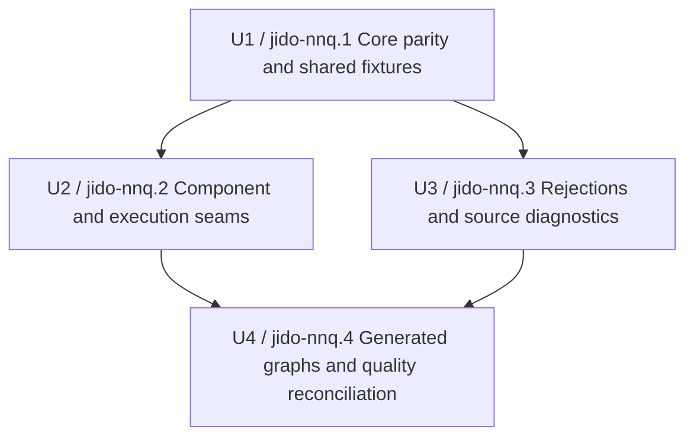
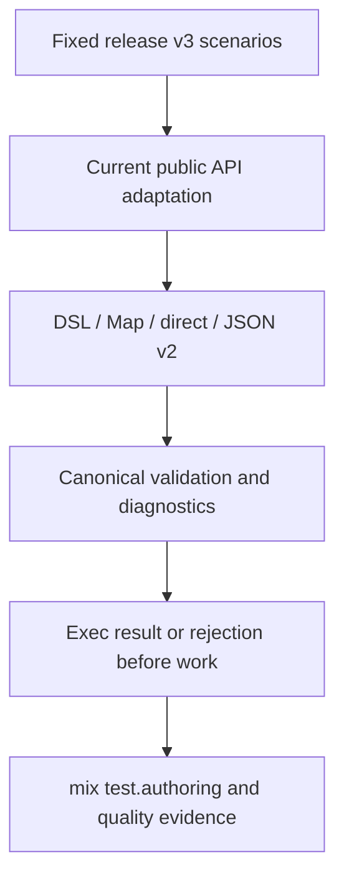

# Port Flow Authoring Suite - Plan

## Goal Capsule

- **Objective:** Maintainers can use the required authoring gate to detect regressions across both Agent and Flow authoring paths.
- **Means:** Adapt the fixed `jido_action` Flow authoring corpus to the consolidated Catalog, Flow, Codec, and Exec contracts while preserving each supported scenario's intent (KTD1).
- **Authority:** The fixed source commit and current public Jido contracts govern behavior. Current contracts replace removed source APIs.
- **Execution profile:** Four dependency-ordered test slices, one Beadwork task and worktree per slice.
- **Stop conditions:** Stop a slice when a supported current contract fails and the correction would require `lib/**`, when a source scenario has no evidence-backed disposition, or when a reference repository would need a write.
- **Tail ownership:** The final slice owns source reconciliation, the full authoring gate, and clean quality evidence.

---

## Product Contract

### Summary

Port the dedicated Flow authoring corpus from `agentjido/jido_action` commit `177e7a4ce4342a9a6b7bc668f540dafbd7169d54` into the consolidated repository's required `mix test.authoring` lane.
Adapt the tests to current public APIs and record an explicit disposition for every source asset.

### Problem Frame

The consolidated authoring lane contains Agent tests only.
Flow has strong focused unit and example coverage, but those checks do not supply dedicated end-to-end authoring evidence under `test/authoring`.
The fixed `jido_action` baseline contains 12 Flow authoring test files, nine support assets, one README, and 60 declared tests or properties plus generated guide cases.
The earlier quality import recorded only the split-core Agent authoring corpus.

### Requirements

**Source coverage and traceability**

- R1. Every one of the 22 source assets has a target path or an explicit superseded disposition tied to the fixed source commit.
- R2. Eleven source test files, all nine support assets, and the source README are adapted into the consolidated authoring tree.
- R3. `guides_test.exs` is superseded only by named current guide and example evidence; removed guide paths are not restored.
- R4. The quality source manifest records the fixed `jido_action` authoring source and its target disposition.

**Authoring behavior**

- R5. DSL, Map data, direct construction, and stored JSON produce equivalent canonical Flow values and execution results for supported scenarios.
- R6. Stored Flow tests use explicit typed `Jido.Catalog` entries, current version 2 documents, deterministic identifiers, and the built-in `JSON` module.
- R7. Invalid source, stored data, graph data, schemas, and local references fail at the current public boundary with stable paths or source locations before Action work runs.
- R8. Map, Reduce, Iterate, Subflow, Choice, Invoke, inline Action, extension, dependency, schema, and continuation scenarios preserve the old behavior intent under current component contracts.
- R9. The authoring matrix includes small current-only checks for public Parallel and Handoff forms where the old corpus has no equivalent, without expanding into general execution coverage.
- R10. Generated dependency graphs compare authoring forms, results, call order, and invalid graph rejection with bounded deterministic property runs and seed-based replay.

**Suite integration**

- R11. Every new Flow authoring module has `@moduletag :authoring`; tests that compile or replace modules use isolated names and serial execution.
- R12. `mix test.authoring` runs both Agent and Flow authoring tests with seed `0`, while default `mix test` continues to exclude the authoring lane.
- R13. The port changes tests, support assets, the source manifest, and this plan only. It does not change `lib/**` or `refs/**`.
- R14. A supported current-contract failure that requires product code becomes a separate reported correction. The test port does not weaken the assertion or silently change product behavior.

### Key Decisions

- **Adapt behavior coverage instead of copying removed APIs.** (session-settled: user-approved — chosen over a literal source copy: the earlier review showed that Registry, stored version 1, and old error modules no longer define the current contract.) Governs R5-R10.
- **Keep the dedicated Flow authoring lane end to end.** Focused unit tests remain in place, but they do not replace cross-form authoring proof. Governs R5-R12.
- **Supersede the old guide runner.** Current registered examples and Spark guide tests own guide execution. Governs R3.

### Scope Boundaries

**In scope**

- Dedicated Flow authoring tests and their support fixtures.
- Current-contract adaptation for Catalog, Codec, stored Flow version 2, Joi, errors, and component records.
- A fixed source-to-target disposition ledger and quality-manifest record.
- Current-only Parallel and Handoff authoring gaps that belong in the same public matrix.

**Deferred to Follow-Up Work**

- Any product correction under `lib/**` exposed by a supported ported scenario.
- A durable solution note for the Registry-to-Catalog and stored-v1-to-v2 migration pattern.

**Out of scope**

- Writes to `refs/**` or source history imports.
- New Mix projects, new test aliases, or changes to the authoring tag policy.
- Duplicate guide runners, general runtime load tests, or unrelated unit-test cleanup.

### Acceptance Examples

- AE1. Given one valid Flow expressed through DSL, Map data, direct construction, and stored JSON, when each form is inspected and executed, then all forms return equal canonical data and the same result. Covers R5, R6.
- AE2. Given a malformed graph or untrusted stored target, when each supported authoring form is constructed, then it fails at the matching current boundary and no probe Action runs. Covers R6, R7.
- AE3. Given a generated valid DAG, when direct, Map, and stored forms execute, then each matches the arithmetic model and dependency order. Given a duplicate, missing dependency, or cycle mutation, each form rejects it. Covers R10.
- AE4. Given the completed port, when `mix test.authoring` runs, then Agent and Flow authoring tests run under seed `0`; when default `mix test` runs, the authoring lane remains excluded. Covers R11, R12.

### Sources / Research

- Fixed source: `agentjido/jido_action` commit `177e7a4ce4342a9a6b7bc668f540dafbd7169d54`, especially `test/authoring/**`.
- Current authoring harness: `mix.exs`, `test/test_helper.exs`, and `test/authoring/agents/**`.
- Current Flow helpers: `test/support/jido_flow/component.ex`, `test/support/jido_flow/generated_codec.ex`, `test/support/jido_flow/authoring_compiler.ex`, and `test/support/jido_codec/fixtures/registry.ex`.
- Current focused evidence: `test/jido/flow/**`, `test/jido/exec/**`, `test/jido/flow/dsl/spark_surface_test.exs`, and `test/examples/02_flow_authoring/**`.
- Quality evidence: `test/quality/source_manifest.yml`, `test/quality/component_proof.yml`, and `test/quality/quality_contract.yml`.

---

## Planning Contract

### Key Technical Decisions

- KTD1. **Preserve scenario intent across current public contracts.** (session-settled: user-approved — chosen over a literal source copy: current APIs deliberately replaced old Registry, stored version 1, and error contracts.) Each source scenario keeps its observable behavior or receives an explicit superseded disposition. Implements R1-R10.
- KTD2. **Use the established suite layout.** New tests live under `test/authoring/flows/**`; shared fixtures live under `test/authoring/support/flows/**`; every test module carries `@moduletag :authoring`. Implements R2, R11, R12.
- KTD3. **Reuse current test infrastructure.** Use `JidoActionTest.FlowBuilder`, `JidoActionTest.FlowComponent`, `JidoActionTest.FlowCodec`, existing Catalog fixture patterns, and `JidoTest.AuthoringCompiler` instead of adding another builder, codec, registry, or compiler helper. Implements R5-R11.
- KTD4. **Map removed APIs at the test boundary.** Registry becomes `Jido.Catalog`; Zoi becomes `Jido.Joi`; old Flow and Action error modules become current `Jido.Error` forms; stored version 1 becomes version 2; removed internal fields become current public records. Implements R6-R9.
- KTD5. **Isolate dynamic source tests.** Use unique module namespaces, purge generated modules, and set `async: false` for compilation, module replacement, or message-order scenarios. Implements R7, R11.
- KTD6. **Treat product failures as separate work.** A supported scenario that needs a `lib/**` correction stops its slice with the exact command and evidence. It does not expand this test-port plan. Implements R13, R14.

### High-Level Technical Design

The dependency graph uses blocker-to-blocked arrows.



The authoring evidence path stays explicit.



### Output Structure

```text
test/authoring/
├── flows/
│   ├── README.md
│   └── *_test.exs
└── support/
    └── flows/
        ├── *.ex
        └── saved_flow.json
```

### Source API and Behavior Map

| Source contract | Current contract | Assertion rule |
| --- | --- | --- |
| `Jido.Authoring.Registry` | `Jido.Catalog` | Use explicit typed entries and stable IDs. |
| Stored Flow version 1 | Stored Flow version 2 | Preserve semantic output and diagnostic paths, not the removed envelope. |
| `Zoi.*` | `Jido.Joi.*` | Use only public schema constructors. |
| Old Action and Flow error structs | `Jido.Error` and codec errors | Assert stable message, phase, node, path, and source location. |
| Old component fields | Current canonical records | Assert public canonical data and execution behavior. |
| Old guide paths | Registered examples and Spark guide tests | Record supersession; do not duplicate guide execution. |

### Ticket Register and Integration Rules

| Unit | Ticket | Plan state | Branch and integration rule |
| --- | --- | --- | --- |
| U1 | `jido-nnq.1` | Created | Create one worktree from current `main`; land before U2 or U3 starts. |
| U2 | `jido-nnq.2` | Created | Create one worktree from `main` after U1 lands; may run in parallel with U3 only in an isolated worktree. |
| U3 | `jido-nnq.3` | Created | Create one worktree from `main` after U1 lands; may run in parallel with U2 only in an isolated worktree. |
| U4 | `jido-nnq.4` | Created | Create one worktree from `main` after U2 and U3 land; own final integration evidence. |

---

## Implementation Units

### U1. Port core parity and shared fixtures

- **Goal:** Establish the Flow authoring directory, source ledger, shared fixtures, and the core cross-form parity tests.
- **Requirements:** R1-R7, R11-R14; AE1, AE2.
- **Dependencies:** None.
- **Files:**
  - Add `test/authoring/flows/README.md`.
  - Add `test/authoring/flows/greeting_test.exs`.
  - Add `test/authoring/flows/adversarial_test.exs`.
  - Add `test/authoring/flows/boundaries_test.exs`.
  - Add `test/authoring/support/flows/adversarial.ex`.
  - Add `test/authoring/support/flows/boundaries.ex`.
  - Add `test/authoring/support/flows/components.ex`.
  - Add `test/authoring/support/flows/extension.ex`.
  - Add `test/authoring/support/flows/flow_edges.ex`.
  - Add `test/authoring/support/flows/greeting.ex`.
  - Add `test/authoring/support/flows/hostile.ex`.
  - Add `test/authoring/support/flows/missing_output.ex`.
  - Add `test/authoring/support/flows/saved_flow.json`.
  - Change `test/quality/source_manifest.yml`.
  - Include this plan file in the first landed slice.
- **Approach:**
  1. Add a README ledger for all 22 source assets, including the named current evidence that supersedes `guides_test.exs`.
  2. Adapt all shared fixtures to KTD3 and KTD4 without changing reference repositories.
  3. Port greeting, adversarial, and boundary scenarios across current authoring forms.
  4. Add the fixed baseline record to the quality source manifest.
- **Execution note:** Start with source behavior characterization. Preserve observable results and diagnostics before simplifying fixtures.
- **Patterns to follow:** `test/authoring/agents/**`, `test/jido/flow/canonical_authoring_test.exs`, `test/jido/flow/ref_path_authoring_test.exs`, `test/jido/flow/validation_inertness_test.exs`.
- **Test scenarios:**
  - Covers AE1. An authored Action validates input and context, and DSL, Map, direct, and JSON forms return the same canonical Flow and result.
  - Covers AE2. Unusual names, forward references, duplicate names, missing dependencies, cycles, and untrusted Catalog identifiers produce equivalent rejection behavior.
  - Inline binding forms, nested operations, reference paths, raw outputs, full runs, UTF-8 rejection, and document limits retain current boundary behavior.
  - Inspection, validation, decoding, and compilation do not execute probe Action work.
  - The saved version 2 document uses fixed Catalog IDs and round trips deterministically.
- **Verification:** The three focused Flow authoring files pass with warnings treated as errors. The source-manifest tests accept the fixed baseline entry. No `lib/**` or `refs/**` path changes.

### U2. Port component and execution seams

- **Goal:** Restore end-to-end authoring proof for the public Flow component matrix and dependency seams.
- **Requirements:** R5, R7-R9, R11-R14; AE1, AE2.
- **Dependencies:** U1.
- **Files:**
  - Add `test/authoring/flows/components_test.exs`.
  - Add `test/authoring/flows/flow_edges_test.exs`.
  - Add `test/authoring/flows/schema_pipeline_test.exs`.
  - Change shared files under `test/authoring/support/flows/**` only when the current component contract requires it.
- **Approach:**
  1. Adapt Map, Reduce, Iterate, Subflow, Choice, Invoke, and schema-pipeline scenarios to current component records.
  2. Preserve cross-form equivalence, local-scope rules, dependency order, fail-fast behavior, ordered results, context propagation, and continuation behavior.
  3. Add bounded Parallel and Handoff authoring cases only for current public forms missing from the source matrix.
- **Patterns to follow:** `test/jido/flow/canonical_authoring_test.exs`, `test/jido/flow/parallel_test.exs`, `test/jido/flow/component_validation_test.exs`, `test/jido/exec/node/**`.
- **Test scenarios:**
  - Map keyword and block forms match direct and JSON forms, including empty input, fail-fast, collect-errors, stable input order, and repeated-item identity.
  - Reduce preserves source order, stops after failure, and validates initial and accumulator boundaries.
  - Fixed and bounded Iterate forms match, stop at the limit, and validate state before another body call.
  - Nested Flows preserve input, output, context, schemas, independent child values, and leaf error paths.
  - Choice uses first-match and fallback semantics, keeps static dependencies, and does not use fallback after a selected failure.
  - Invoke matches all forms and preserves Action or Flow continuation rules.
  - Parallel and Handoff have one small valid and invalid authoring case each under current contracts.
- **Verification:** The three focused files pass through `mix test.authoring` with seed `0` and warnings treated as errors. No assertion depends on removed internal records.

### U3. Port rejections and source diagnostics

- **Goal:** Restore compile-time, source-location, and hostile-authoring regression coverage.
- **Requirements:** R7-R9, R11-R14; AE2.
- **Dependencies:** U1.
- **Files:**
  - Add `test/authoring/flows/extension_test.exs`.
  - Add `test/authoring/flows/inline_hostile_test.exs`.
  - Add `test/authoring/flows/rejections_test.exs`.
  - Add `test/authoring/flows/source_boundary_test.exs`.
  - Change `test/authoring/support/flows/extension.ex`, `hostile.ex`, or `missing_output.ex` only as required by current public contracts.
- **Approach:**
  1. Compile each source scenario through the current isolated authoring compiler and KTD5.
  2. Replace removed exception-type assertions with stable current diagnostic fields.
  3. Preserve Action-only target rules, local reference scopes, condition and state validation, Handoff terminal rules, continuation rejection, and source ordering behavior.
- **Execution note:** Use unique generated module namespaces and purge them after each case before enabling any concurrency.
- **Patterns to follow:** `test/support/jido_flow/authoring_compiler.ex`, `test/jido/flow/dsl/extension_test.exs`, `test/jido/flow/dsl/inline_step_test.exs`, `test/jido/flow/dsl/source_map_test.exs`, `test/jido/flow/dsl/output_source_test.exs`.
- **Test scenarios:**
  - An extension lowers to ordinary canonical declarations, and extension failures point to the extension call.
  - Invalid inline bindings, duplicate names, missing helpers, and recompilation retain exact source locations and current replacement behavior.
  - Action-only slots reject Flow targets; Map, Reduce, and Iterate reject out-of-scope references before work.
  - Choice, Iterate, Handoff, and Invoke reject invalid conditions, state, sinks, outputs, or continuations at the current boundary.
  - Malformed references, unknown operators, unsafe source, duplicate names, cycles, absent references, and invalid output placement fail before Action work.
- **Verification:** The four focused files pass serially with warnings treated as errors. Generated modules are purged, no fixed module leaks between tests, and diagnostics identify the expected source declaration.

### U4. Port generated graphs and reconcile quality evidence

- **Goal:** Add the missing generated dependency-graph proof and certify the complete authoring migration.
- **Requirements:** R1-R4, R10-R14; AE3, AE4.
- **Dependencies:** U2, U3.
- **Files:**
  - Add `test/authoring/flows/generated_graph_test.exs`.
  - Change `test/authoring/flows/README.md` if implementation changed any source disposition.
  - Change `test/quality/source_manifest.yml` only if final reconciliation finds an inaccurate record.
  - Change `test/quality/coverage_baseline.json` only when the repository's documented coverage workflow requires an evidence-backed update.
- **Approach:**
  1. Port the two bounded StreamData properties for valid DAG equivalence and invalid graph mutations.
  2. Reconcile the README ledger against all 22 fixed source assets and the 60 declared source tests or properties.
  3. Run the focused and complete authoring gates, quality source checks, full offline CI, coverage, and quality report from a clean integrated tree.
- **Patterns to follow:** `test/property/action_flow/**`, current seed and replay rules in `test/quality/quality_contract.yml`, and `test/quality/source_manifest_test.exs`.
- **Test scenarios:**
  - Covers AE3. Small generated DAGs with two inputs per step match the arithmetic model, exact Action calls, dependency order, and every supported authoring form.
  - Covers AE3. Generated duplicate names, unknown dependencies, and cycles reject in direct, Map, and stored forms with a replayable seed.
  - Covers AE4. All Flow authoring tests carry the authoring tag and run beside Agent authoring tests; default unit selection remains unchanged.
  - The final ledger names all source assets and no source scenario disappears without a target or superseded reason.
- **Verification:** Focused generated properties pass with deterministic seed and bounded runs. `mix test.authoring`, source-manifest and component-proof checks, `mix test.ci`, `mix quality.coverage`, and `mix quality.report` pass on the clean integrated revision.

---

## Verification Contract

| Scope | Command | Required result |
| --- | --- | --- |
| Focused Flow authoring | `mix test.authoring test/authoring/flows --warnings-as-errors` | All Flow authoring tests run under seed `0` and pass. |
| Complete authoring gate | `mix test.authoring --warnings-as-errors` | Agent and Flow authoring tests pass together. |
| Source and proof metadata | `mix test test/quality/source_manifest_test.exs test/quality/component_proof_test.exs --seed 0` | Fixed source record and authoring evidence remain valid. |
| Static checks | `mix format --check-formatted` and `git diff --check` | Formatting and patch checks pass. |
| Offline integration | `mix test.ci` | Every required offline suite passes. |
| Coverage | `mix quality.coverage` | Package, component, and suite thresholds pass. |
| Final report | `mix quality.report` | Clean-tree report passes with no new finding or waiver. |

The implementation owner records exact counts, seeds, failures, and any superseded scenario in the Beadwork completion comments.

---

## Definition of Done

- All four implementation units are complete on their required dependency bases.
- The Beadwork graph has one task per U-ID and no hidden dependency between U2 and U3.
- The source ledger accounts for 12 test files, nine support assets, one README, and 60 declared tests or properties plus generated guide cases.
- Eleven adapted Flow authoring test files and all required fixtures run through `mix test.authoring`.
- `guides_test.exs` has named current evidence and an explicit superseded disposition.
- Every new test module has the authoring tag; dynamic modules are isolated and purged.
- Current Catalog, stored version 2, Joi, error, component, and JSON contracts replace removed source APIs without weakened behavior assertions.
- No `lib/**` or `refs/**` file changes.
- Focused tests, complete authoring, offline CI, coverage, and the final quality report pass on a clean integrated revision.
- Dead-end fixtures, duplicate helpers, temporary source copies, and abandoned experiments are removed before completion.
