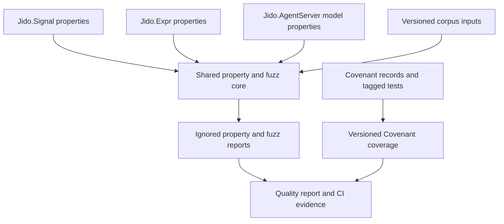
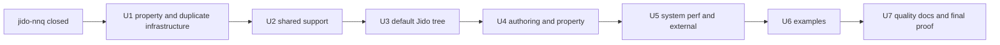

# Jido Test Tree Organization - Plan

## Goal Capsule

- **Objective:** Contributors can find each Jido test, fixture, and proof by its purpose and owning `Jido.*` namespace. They do not need to understand the four former package layouts.
- **Means:** Reorganize the complete `test/` tree after `jido-nnq` closes. Consolidate shared support and reports. Assign one canonical owner to each proof claim. Remove only proven duplication. Update every active path consumer in the same change as each move. (KTD1-KTD9)
- **Authority:** The confirmed scope in this plan controls organization. `AGENTS.md` controls repository boundaries. Existing Covenant records and quality contracts control proof meaning.
- **Stop conditions:** Stop a unit if it needs a `lib/**` or `refs/**` change, a public behavior change, an active Covenant component-ID change, or a compatibility path. Record the need as follow-up work.
- **Next executor:** A software implementation agent with local-write authority and one worktree for the active unit.

---

## Product Contract

### Summary

Reorganize all active files under `test/` into clear purpose lanes and `Jido.*` ownership paths. Keep Covenant and property testing as separate proof methods. Consolidate their duplicated infrastructure. Remove old package names, duplicate support, unused helpers, and general layout enforcement.

### Problem Frame

The consolidated package still carries the structure of four source packages. At the planning snapshot after `jido-nnq.3`, `test/` contains 840 files and 152,332 lines. The main `test/jido` tree contains 366 files. It mixes normal tests, Covenant-tagged tests under `core_contract`, AI tests under a second `contract` convention, and a second compiled support root.

The special-purpose lanes are valuable, but their internal names are inconsistent. `action_flow` and `runtime` describe imported package or role boundaries. Nested `jido/<namespace>` paths add a level that the lane already scopes. `JidoActionTest`, `JidoSignalTest`, `JidoTest`, and `Jido.AITest` are inconsistent test-only module namespaces. Path consumers in Mix aliases, ExUnit setup, CI, catalogs, quality maps, manifests, loaders, and documentation make an unplanned move unsafe.

Covenant records and property tests are not duplicate test systems. Covenant owns named obligations and behavior ownership. Property tests own generated-input, replay, and state-model evidence. The duplication is in the property reporters, fuzz harnesses, helper modules, and parallel contract-ID vocabulary.

### Actors

- Jido contributors locate, change, and review tests.
- CI and local Mix aliases select required and opt-in proof lanes.
- Covenant and the quality-report tooling consume versioned records and generated evidence.

### Requirements

**Baseline and organization**

- R1. Start from the integrated revision after `jido-nnq` closes, including the complete Agent and Flow authoring corpus.
- R2. Use `jido`, `authoring`, `property`, `examples`, `system`, `external`, and `perf` as the executable proof lanes, with flattened `jido_<namespace>` ownership below special lanes.
- R3. Use `test/support` as the only compiled test-support root.
- R4. Use production `Jido.*` namespaces for executable test modules and `Jido.Test.*` for shared helpers and fixtures.
- R5. Remove active `core_contract`, `ai/contract`, `action_flow`, and second-support-root paths after their files reach final destinations.

**Proof and streamlining**

- R6. Keep Covenant records and property tests as separate proof methods.
- R7. Replace the two property fuzz harnesses and two reporters with one configured core for `Jido.Signal`, `Jido.Expr`, and `Jido.AgentServer`.
- R8. Preserve versioned corpus inputs, isolated consumer projects, special suite tags, replay behavior, and required proof while removing only unused or proven duplicate code and tests.
- R9. Remove general path-layout enforcement. Keep catalog, manifest, and proof validation that checks registered evidence or behavior.

**Integration and boundaries**

- R10. Update every active alias, ignore filter, loader, manifest target, catalog, CI command, current README, and quality map in the same unit as its path move.
- R11. Preserve default, required-offline, live, service, and peer suite selection rules. Live and service tests remain opt-in.
- R12. Add no compatibility paths, redirects, aliases for old test modules, or legacy shims.
- R13. Change no file under `lib/**` or `refs/**`, no public behavior, and no active Covenant component ID.
- R14. Keep `test/contracts/coverage.json` as versioned Covenant evidence. Keep disposable reports and counterexamples under ignored `tmp/` or `_build/` paths, and remove unconsumed `coverage.static.json`.
- R15. Finish with fewer test-tree clone groups than the post-`jido-nnq` baseline and no known clone group between former property harness or reporter copies. This is a completion measurement, not a new layout gate.
- R16. Give each behavior claim one canonical executable owner and record every supplemental proof with its distinct claim in `test/quality/component_proof.yml`.
- R17. Keep `quality` limited to proof registries and report infrastructure. Move useful deferred probes to their owning proof lane and keep non-executable gaps in the source manifest.

### Key Flows

- A contributor starts from a proof purpose, follows the owning `Jido.*` namespace, and finds the test plus its nearest support.
- A lane alias selects its final paths, ExUnit applies the same tags, and generated evidence reaches the existing quality report.
- A file move updates all active consumers and removes the old path before the unit can complete.

### Acceptance Examples

- **Covers R6-R8:** Given a full property run, when the shared reporter receives Signal, Expr, and AgentServer results, then each family appears once and property-only execution does not require fuzz measurements.
- **Covers R10-R12:** Given a moved lane, when its focused alias and the default suite run, then the focused alias finds the lane and the default suite keeps the prior inclusion or exclusion rule without an old-path fallback.
- **Covers R13-R14:** Given the completed refactor, when Covenant runs, then active component IDs and obligation counts are unchanged and `coverage.json` remains the versioned evidence file.

### Success Criteria

| Signal | Expected result |
|---|---|
| Baseline | The recorded start revision is the first integrated revision after `jido-nnq` closes. |
| Active path residue | No active code, config, current README, manifest target, or CI command uses the retired paths in R5. Historical plan text and manifest `source_path` values are unchanged. |
| Test-only modules | No active `JidoActionTest.*`, `JidoSignalTest.*`, `JidoTest.*`, or `Jido.AITest.*` module remains. |
| Proof parity | Active Covenant component IDs and active obligation counts are unchanged. Obligation coverage remains 100 percent. |
| Property proof | Full and focused property and fuzz runs select the correct configured families. Versioned Signal corpus replay still runs. |
| Duplication | The property harness and reporter clone groups are gone. The full test-tree clone count and duplicated-line count are below the start baseline. |
| Suite parity | All required offline aliases pass. Live and service aliases remain opt-in. Any test-count reduction has a deletion-ledger entry. |
| Proof ownership | Each registered claim has one canonical owner. Supplemental authoring, property, example, system, external, or perf evidence names a distinct risk or invariant. |

### Scope Boundaries

**In scope**

- All files under `test/`, including support inputs, isolated consumers, Covenant record storage, proof ownership metadata, and lane documentation.
- Active path consumers outside `test/`, including `mix.exs`, configuration, CI, current repository documentation, and example links.
- Test-only module renames, helper extraction, duplicate support removal, and proven duplicate test removal.

**Deferred to Follow-Up Work**

- Covenant component ownership and ID realignment in `../docs/covenant-component-refactor-plan.md`.
- Any change from `not_applicable` to `required` for AgentServer property proof in `test/quality/component_proof.yml`.
- Production duplication or namespace work under `lib/**`.

**Out of scope**

- New layout guards or tests that enforce the target tree.
- Old-path compatibility, redirect modules, deprecated aliases, and transition periods with two copies.
- Product behavior, public API, dependency, or reference-repository changes.

### Key Decisions

- **Organization without enforcement.** (session-settled: user-directed — chosen over layout guards and compatibility scaffolding: the user identified both as cruft) Governs R2, R9, R12, and R15.
- **No product or compatibility work.** (session-settled: user-approved — chosen over combining the refactor with public API or legacy-path support: the confirmed scope is file and test-code organization) Governs R10-R13.

### Rejected Alternatives

- Keep the imported package trees and add documentation. This leaves duplicate support and old ownership names in active code.
- Force every file into one uniform namespace layout. This damages the semantic order of examples and changes Covenant IDs.
- Add compatibility modules and old-path loaders. This creates two active organizations and conflicts with R12.

### Dependencies

- Satisfied: `jido-nnq.4` and the parent `jido-nnq` epic closed and were integrated at `d620b31` before U1 started.
- The current Covenant realignment plan remains separate and must not be implemented through this refactor.

### Outstanding Questions

None. The organization boundary, compatibility policy, proof methods, and start condition are settled.

### Sources

- The direct user request and confirmed scope define the outcome and non-goals.
- `docs/plans/2026-11-04-1255-test-flow-authoring-suite-plan.md` defines the upstream authoring baseline.
- `AGENTS.md` defines repository and architecture rules.

---

## Planning Contract

### Product Contract Preservation

Product Contract unchanged. The technical plan keeps the confirmed organization-only scope, removes no proof method, and adds no product or compatibility behavior.

### Current System

The planning snapshot was taken after `jido-nnq.3` and before `jido-nnq.4`. The execution baseline starts from integrated revision `d620b31`. U1 must refresh all counts before it changes test code.

| Area | Evidence | Planning consequence |
|---|---|---|
| Full tree | 840 files and 152,332 lines under `test/` | Use serial, bounded slices. Do not attempt one mass move. |
| Main tests | 366 files and 93,342 lines under `test/jido` | Give the default tree its own unit. |
| Covenant | 97 record files and 189 executable files that use `Covenant.Case` | Keep record IDs stable. Move executable tests by namespace. |
| Property | 31 files and 4,484 lines | Keep generated proof. Replace its duplicate infrastructure. |
| Duplication | `mix ex_dna test` reports 59 clone groups and 2,348 duplicated lines | Record a fresh start baseline and require a decrease. |
| Property duplication | 17 clone groups and 740 duplicated lines; the two 262-line fuzz harnesses differ in seven family-specific lines | Use one configurable harness and reporter core. |
| Path coupling | Mix, ExUnit, CI, quality YAML, catalogs, loaders, Dialyzer ignores, and many READMEs contain test paths or module names | Update consumers atomically with moves. |

### Target System

The target has one compiled support root and clear proof-purpose lanes. Each special lane uses a flattened `jido_<namespace>` directory. Executable tests use production `Jido.*` module ownership. Shared helpers and ordinary fixtures use `Jido.Test.*`. Numbered examples and Covenant record IDs keep their semantic taxonomies. `test/quality/component_proof.yml` records which lane owns each claim and why any supplemental proof exists.

| Lane | Proof ownership |
|---|---|
| `jido` | Canonical API and behavior semantics |
| `authoring` | DSL compilation, lowering, and diagnostics |
| `property` | Generated invariants, state models, replay, and shrinking |
| `examples` | Public teaching material remains executable |
| `system` | Local process, lifecycle, recovery, and integration boundaries |
| `external` | Live provider and external service boundaries |
| `perf` | Load and benchmark workloads, profiles, and limiters |
| `contracts` | Covenant obligation and ownership records; executable proof stays with its owning lane |
| `quality` | Proof registry, source manifest, coverage baseline, and report infrastructure only |

The proof registry uses stable claim IDs. Each claim names its component, one canonical evidence group, optional Covenant obligations, and zero or more supplemental evidence groups. Each supplemental entry states the different invariant, boundary, documentation promise, or capacity question that it proves. The same executable test can satisfy more than one registry entry through tags; the repository does not copy the test.

### Key Technical Decisions

- KTD1. **Decision:** Use a small set of proof lanes with flattened namespace directories. **Reason:** Proof purpose controls selection, and `jido_<namespace>` keeps ownership visible without another directory level. **Rejected alternative:** Separate `bench`, `load`, `live`, and service trees classify execution profiles as ownership. **Consequences:** The default tree keeps `test/jido/<namespace>` because it mirrors `lib/jido/**`; special lanes use `test/<purpose>/jido_<namespace>`. `perf` contains load and benchmark profiles. `external` contains live and service profiles. Numbered examples and Covenant IDs remain semantic exceptions. **Governs:** R2, R5, R9, R17; U3-U6.
- KTD2. **Decision:** Use one compiled support root. **Reason:** Separate support and ordinary fixture roots hide ownership and duplicate setup. **Rejected alternative:** Keeping both roots preserves the current ambiguity. **Consequences:** Ordinary fixtures move under owner-specific support. Lane-local `.exs` support remains only for explicit loaders. Isolated consumer projects stay under `test/consumers`. **Governs:** R3, R8, R10; U2-U6.
- KTD3. **Decision:** Normalize test-only modules without aliases. **Reason:** Old package test namespaces obscure current ownership. **Rejected alternative:** Forwarding modules create compatibility code that R12 forbids. **Consequences:** Executable tests mirror `Jido.*`; shared helpers and fixtures use `Jido.Test.*`. **Governs:** R4, R10, R12; U2-U6.
- KTD4. **Decision:** Co-locate executable contract proof with its namespace. **Reason:** Covenant tags carry proof meaning; a separate imported executable tree does not. **Rejected alternative:** Keeping `core_contract` preserves a package-import boundary. **Consequences:** Record paths and active component IDs do not change. **Governs:** R5, R6, R13; U3.
- KTD5. **Decision:** Use one property evidence pipeline. **Reason:** The current family harnesses duplicate code and can record the wrong family. **Rejected alternative:** Two reporters keep 740 duplicated lines and inconsistent validation. **Consequences:** Family configuration owns selection, fuzz IDs, corpus paths, and measurements. Component-proof policy does not change. **Governs:** R6-R8, R11, R14; U1, U4.
- KTD6. **Decision:** Require proof before deletion. **Reason:** Similar setup does not mean two tests prove the same boundary. **Rejected alternative:** Clone-count-only deletion can remove distinct contract, adapter, load, or teaching proof. **Consequences:** Each unit records the removed item and surviving proof outside the plan. **Governs:** R8, R15; U1-U7.
- KTD7. **Decision:** Keep versioned evidence distinct from disposable output. **Reason:** Consumers require diffable Covenant coverage and replay inputs, but run reports do not belong in source. **Rejected alternative:** Moving all generated files would break Covenant evidence; tracking all reports would create stale source artifacts. **Consequences:** `coverage.json` and inputs stay versioned. `coverage.static.json` is removed after its consumer check. **Governs:** R8, R14; U1, U4, U7.
- KTD8. **Decision:** Integrate serially with no transition paths. **Reason:** Lane moves share Mix, ExUnit, quality, and CI consumers. **Rejected alternative:** Parallel moves create central-file conflicts or require old-path bridges. **Consequences:** Each unit starts from its dependency and leaves one valid active path. **Governs:** R1, R10-R12, R15; U1-U7.
- KTD9. **Decision:** Make `test/quality/component_proof.yml` the semantic proof-ownership registry. **Reason:** File placement alone cannot show whether similar tests prove the same claim or a distinct risk. **Rejected alternative:** A path-layout guard enforces shape without explaining proof value. **Consequences:** Each claim has one canonical owner. Supplemental evidence records its proof mode and distinct claim. Registry validation rejects missing owners, duplicate canonical owners, and orphan evidence, but does not enforce directory style. **Governs:** R6, R8, R9, R16, R17; U3-U7.

### System Boundaries and Change Surface

The target structure uses purpose lanes. It then uses the production namespace below each lane.

```text
test/
  authoring/
    {jido_agent,jido_flow}/
    support/{jido_agent,jido_flow}/
  consumers/
    inline_consumer/               # isolated external-consumer project
  contracts/                       # Covenant records and versioned coverage
  examples/                        # numbered public lesson catalog
  external/
    {jido_ai,bedrock,minio,postgres,redis}/
  jido/
    {action,agent,agent_server,ai,catalog,codec,conversation,error,exec,expr,flow,id,instance,instruction,joi,persistence,plugin,signal,telemetry,trace}/
  perf/
    {jido_agent_server,jido_ai,jido_exec,jido_flow,jido_signal}/
  property/
    corpus/jido_signal/
    {jido_agent_server,jido_expr,jido_signal}/
    support/
  quality/
    support/
  support/
    {jido_action,jido_agent,jido_agent_server,jido_ai,jido_codec,jido_exec,jido_flow,jido_persistence,jido_plugin,jido_signal}/
  system/
    {jido_agent_server,jido_exec,jido_persistence,jido_telemetry}/
```

The property pipeline has one reporter and one fuzz harness. Family configuration supplies selection, fuzz IDs, corpus paths, and measurement policy.



#### System-Wide Impact

- Contributors get one predictable ownership path for each test and helper.
- CI and local aliases keep the same required and opt-in boundaries, but their active paths change.
- Quality reports, component proof, source manifests, and the consolidated perf catalog must agree on final paths and proof roles.
- Current documentation and external example links must point to the new locations.
- End-user runtime behavior does not change.

#### Risks and Mitigations

| Risk | Mitigation |
|---|---|
| `jido-nnq` changes the authoring baseline after planning | Block U1 on the parent epic and record the actual start revision and counts. |
| Ignore filters miss a new directory depth | Update filters in the move unit and verify both default exclusion and explicit lane selection. |
| Module renames break dynamic references | Check `Mimic.copy`, ExCoveralls ignores, string-based report filters, dynamic module creation, and Dialyzer ignores in each unit. |
| Relative loaders break after moves | Update every `Code.require_file/2` and path expansion from the new caller location. |
| Two files have the same destination name | Rename by specific behavior. Keep both Agent `authoring_contract_test.exs` suites. |
| Covenant meaning changes during a file move | Keep record paths, component IDs, obligation tags, and active counts stable. Compare semantic coverage, not byte-identical output. |
| A clone is purposeful proof | Apply KTD6. Keep adapter conformance, system versus perf, corpus, and external-consumer duplication when the proof boundary differs. |
| A proof group exists without a distinct claim | Require a canonical claim or a stated supplemental risk in the component proof registry. Remove orphan evidence instead of preserving it by path. |
| Separate worktrees conflict in central files | Use the serial dependency graph in KTD8. Do not start a unit from an older branch. |

#### Grounding Sources

- `docs/plans/2026-11-04-1255-test-flow-authoring-suite-plan.md` defines the authoring work that must finish first.
- `mix.exs` defines compiled test paths, aliases, coverage ignores, property reporters, and path-based ignores.
- `test/test_helper.exs` defines special tag selection and report formatters.
- `test/quality/quality_contract.yml` and `test/quality/component_proof.yml` define suite evidence and proof ownership.
- `test/quality/source_manifest.yml` distinguishes historical source paths from current target paths.
- `test/contracts/README.md` defines Covenant record-path semantics.
- `../docs/covenant-component-refactor-plan.md` owns component-ID and ownership realignment.

---

### Implementation Units

#### U1. Consolidate property and duplicate infrastructure

**Outcome:** One property evidence pipeline replaces the duplicate property and fuzz infrastructure before any family path moves. Proven unused and layout-only helpers are gone.

**Requirements:** R1, R6-R9, R11, R14, R15; KTD5-KTD8.

**Dependencies:** `jido-nnq` is closed.

**Affected surfaces:** `test/property/support/**`, `test/property/action_flow/**`, `test/property/signal/**`, `test/property/runtime/**`, `test/test_helper.exs`, `mix.exs`, `test/quality/quality_contract.yml`, `test/quality/support/report.exs`, `test/authoring/support/compiler.exs`, `test/bench/layout_test.exs`, and focused reporter tests. These surfaces own selection, evidence, or the proven duplicate code.

**Implementation direction:**

1. Record the integrated start revision, file count, test count by lane, and full test-tree ExDNA result.
2. Extract one configurable fuzz harness and one reporter core for Signal, Expr, and AgentServer.
3. Use family filters for full, focused-family, and focused-file runs.
4. Remove the custom contract-ID and `contract_cases` bookkeeping. Keep family and fuzz measurement ownership.
5. Add complete AgentServer lifecycle measurement evidence for its existing fuzz case without changing component-proof policy.
6. Remove the unused authoring compiler and the benchmark layout test. Record each deletion under KTD6.

**Patterns to follow:** Keep ignored evidence under the output roots already defined by `test/quality/quality_contract.yml`. Keep corpus replay behavior from the Signal property suite.

**Test scenarios:**

- A full property run records Signal, Expr, and AgentServer once and does not require fuzz measurements.
- A focused family or focused file run records only its configured family.
- A full fuzz run requires every configured fuzz ID, including AgentServer lifecycle evidence.
- An invalid, duplicate, orphaned, failed, or missing fuzz measurement fails the report check.
- Signal corpus replay reads each versioned JSON input and reports its family correctly.
- Reports and reduced counterexamples are created only under ignored output paths.

**Verification:** Property and fuzz harness self-tests pass. Full and focused suite selection is correct. The former harness and reporter clone groups are absent.

**Completion signal:** U2 can start when the three-family reporter contract passes, deleted infrastructure has ledger entries, and the U1 baseline is recorded.

#### U2. Consolidate shared support and helper namespaces

**Outcome:** The repository has one compiled support root and one test-helper namespace without compatibility modules.

**Requirements:** R3, R4, R8, R10-R13, R15, R17; KTD2, KTD3, KTD6, KTD8.

**Dependencies:** U1.

**Affected surfaces:** `test/jido/support/**`, `test/support/**`, `test/fixtures/**`, `test/consumers/**`, `mix.exs`, `.dialyzer_ignore.exs`, `test/test_helper.exs`, and every active caller of moved or renamed support modules. These surfaces compile helpers, store ordinary test inputs, or isolate external-consumer projects.

**Implementation direction:**

1. Move `test/jido/support/**` into flattened owner paths below `test/support/jido_<namespace>/**` and remove the second test compile path.
2. Move ordinary fixtures under owner-specific support paths. Move the isolated inline consumer project to `test/consumers/inline_consumer`.
3. Rename shared helpers and fixtures to `Jido.Test.*` and update all active callers atomically.
4. Merge the two OpenTelemetry tracer helpers behind one configurable support module.
5. Extract repeated public-API documentation and AgentServer resource fixtures into owner-specific support modules.
6. Keep case templates separate when they own different setup. Share only common module-compilation and assertion helpers.
7. Remove old `JidoActionTest.*`, `JidoSignalTest.*`, `JidoTest.*`, and `Jido.AITest.*` support modules instead of forwarding them.

**Patterns to follow:** Use `test/support/jido_<namespace>` for compiled helpers. Use lane-local support only for explicit loaders or isolated scripts.

**Test scenarios:**

- The test environment compiles with only `lib` and `test/support` as compile roots.
- A representative Action, Signal, AI, AgentServer, and persistence test loads the renamed helper.
- Dynamic test modules still use unique names and preserve diagnostics.
- Mimic, ExCoveralls, and Dialyzer references resolve the new module names.

**Verification:** The default suite and the affected focused suites compile without duplicate-module warnings. No active second support root or retired support module remains.

**Completion signal:** U3 can start when `test/support` is the only compiled support root and all active helper callers use final module names.

#### U3. Flatten the default Jido test tree

**Outcome:** Normal and Covenant-tagged executable tests live under their owning `Jido.*` namespace paths.

**Requirements:** R2, R4-R6, R8, R10, R12, R13, R16; KTD3, KTD4, KTD6, KTD8, KTD9.

**Dependencies:** U2.

**Affected surfaces:** `test/jido/core_contract/**`, `test/jido/ai/contract/**`, `test/jido/**`, `test/contracts/coverage.json`, Covenant-tagged test files, and active path consumers for this lane. These surfaces own default and Covenant executable proof.

**Implementation direction:**

1. Move each `core_contract` subtree to the matching component namespace. Use a local `contract` segment only when it helps distinguish proof files inside that namespace.
2. Move AI contract families below their specific AI namespace owners.
3. Rename executable modules to their production `Jido.*` namespace and local fixtures to `Jido.Test.*`.
4. Resolve the two Agent `authoring_contract_test.exs` destination names by their specific behavior. Keep both suites.
5. Preserve Covenant component IDs, obligation tags, active obligation counts, and mutation ownership.
6. Apply KTD6 to any overlapping unit and Covenant test. Keep both when they prove a different boundary or named obligation.
7. Register each component's canonical behavior owner in `test/quality/component_proof.yml`.

**Patterns to follow:** Mirror the `lib/jido/**` module path. Keep `Covenant.Case` next to the behavior it proves.

**Test scenarios:**

- Default tests find every moved file and do not load support files as tests.
- Covenant discovers every prior active obligation and reports 100 percent coverage.
- A unit test and a Covenant-tagged test can share setup without sharing the proof assertion.
- The two renamed Agent authoring suites both execute and retain their distinct test counts.

**Verification:** Default and Covenant suites pass. Active Covenant IDs and obligation counts match the U1 baseline. The old default-tree paths are empty and removed.

**Completion signal:** U4 can start when default and Covenant proof pass from namespace-owned paths with unchanged active IDs and counts.

#### U4. Reorganize authoring and property lanes

**Outcome:** Authoring, property, corpus, and fixture files use their final namespace owners.

**Requirements:** R1-R8, R10-R14, R16; KTD1-KTD5, KTD7-KTD9.

**Dependencies:** U3.

**Affected surfaces:** `test/authoring/**`, `test/property/**`, `test/test_helper.exs`, `mix.exs`, `test/quality/component_proof.yml`, `test/quality/quality_contract.yml`, `test/quality/source_manifest.yml`, and lane READMEs. These surfaces own authored-form and generated-input proof.

**Implementation direction:**

1. Move the complete Agent and Flow authoring corpus to `test/authoring/{jido_agent,jido_flow}` and its explicit support to `test/authoring/support/{jido_agent,jido_flow}`.
2. Move property families to `test/property/{jido_agent_server,jido_expr,jido_signal}` and Signal corpus files to `test/property/corpus/jido_signal`.
3. Rename executable and fixture modules under KTD3. Update relative loaders, report selection, and generated module filters.
4. Register authoring and property claims in the component proof registry. Make the lane canonical for DSL or generated-invariant claims that only it proves. Link any repeated runtime claim as supplemental evidence instead of creating a second canonical owner.
5. Update only current `target_path` values in the source manifest. Preserve historical `source_path` values.

**Patterns to follow:** Preserve the final `jido-nnq` authoring assertions and counts. Preserve corpus JSON byte-for-byte unless its recorded path must change.

**Test scenarios:**

- Agent and Flow authoring tests run together from the new paths and remain excluded from the default suite.
- Property and fuzz aliases select all three families from their new paths.
- A focused property file selects only its family reporter policy.
- Signal corpus replay succeeds from its new location.
- Authoring and property evidence groups either own a distinct DSL or invariant claim, or link to an existing canonical claim as supplemental evidence.
- Source-manifest targets exist and remain unique after each move.

**Verification:** Authoring, property, and fuzz suites pass. Default selection does not run them. Component-proof and quality path checks resolve only final paths and claims.

**Completion signal:** U5 can start when both lanes pass from final paths, supplemental claims are registered, and the source manifest has only current target paths.

#### U5. Reorganize system, perf, and external lanes

**Outcome:** System, perf, and external proof use clear ownership lanes, and their catalogs and CI commands use final paths.

**Requirements:** R2, R4, R5, R8-R13, R16, R17; KTD1-KTD3, KTD6-KTD9.

**Dependencies:** U4.

**Affected surfaces:** `test/system/**`, `test/load/**`, `test/bench/**`, `test/live/**`, `test/quality/deferred/**`, `test/perf/**`, `test/external/**`, perf catalogs, `.github/workflows/ci.yml`, `mix.exs`, quality maps, source-manifest targets, and lane READMEs. These surfaces own local integration, perf, external-boundary, and deferred evidence.

**Implementation direction:**

1. Keep local OTP, lifecycle, and recovery proof under `system/jido_<namespace>`.
2. Move load and benchmark assets into `perf/jido_<namespace>`. Keep load and benchmark as profiles or tags, not ownership trees.
3. Move live AI and external service proof into `external/<owner>`. Keep live and service selection opt-in.
4. Move each useful deferred probe to its owning proof lane with its existing exclusion and disposition. Remove non-useful executable probes after recording the gap in the source manifest.
5. Register system, external, and perf claims in the component proof registry. These lanes own lifecycle, boundary, and capacity claims that only they can prove. Repeated runtime claims stay supplemental.
6. Update catalogs, scheduled burn-in commands, aliases, evidence paths, and current lane documentation in the same changes.

**Patterns to follow:** Keep one perf catalog family per stable workload and owner. Use profiles for load versus benchmark execution. Keep external service and live execution opt-in.

**Test scenarios:**

- System, load, and benchmark aliases run their complete registered families from `system` and `perf`.
- Extended CI commands resolve each burn-in and benchmark runner.
- Live and service tests run from `external`, remain excluded from offline aliases, and require their existing explicit inputs.
- Useful deferred probes remain excluded under their proof owner. `quality` contains no executable deferred tests.
- Catalog validation finds every evidence file and no duplicate family ID.
- Component-proof validation finds one canonical owner for each lifecycle, boundary, capacity, or runtime claim and no duplicate canonical ownership.

**Verification:** Required system and perf proof passes. Catalog and CI validation pass. External proof remains opt-in. Every deferred probe has an explicit owner or a non-executable backlog record.

**Completion signal:** U6 can start when system and perf pass, external remains opt-in, deferred proof has an owner, and the proof registry has no orphan group.

#### U6. Normalize the numbered example lane

**Outcome:** The public lesson order stays stable while support modules, loaders, and links use final names and paths.

**Requirements:** R2, R4, R8, R10-R13, R16; KTD1-KTD3, KTD6, KTD8, KTD9.

**Dependencies:** U5.

**Affected surfaces:** `test/examples/**`, `examples/**`, shared example support under `test/support/**`, `test/examples/catalog.yml`, and current README links. These surfaces define the teaching catalog and its executable proof.

**Implementation direction:**

1. Keep the numbered example directory and catalog structure unchanged.
2. Rename executable modules to production `Jido.*` owners and shared fixtures to `Jido.Test.*`.
3. Update lane-local loaders and common example runtime support after the U2 helper moves.
4. Preserve `:example` and `:peer` together on the two peer examples.
5. Apply KTD6 to repeated lesson code. Keep repetition when it is part of the standalone teaching example.
6. Register examples as the owner of executable documentation claims. Link their runtime assertions to the canonical behavior claim as supplemental evidence.

**Patterns to follow:** Treat lesson order and standalone readability as semantic content, not folder residue.

**Test scenarios:**

- The example catalog resolves every numbered lesson and current documentation link.
- Example tests remain excluded from the default suite and run through the example alias.
- Both peer examples run through the peer alias and still belong to the example catalog.
- A standalone lesson still loads only documented support and does not depend on an old module name.

**Verification:** Example and peer suites pass. The numbered catalog order is unchanged. Current example documentation has no retired active path.

**Completion signal:** U7 can start when the catalog, examples, and peer cases pass with the original lesson order and final helper names.

#### U7. Reconcile quality evidence, current documentation, and final parity

**Outcome:** Quality evidence, current documentation, and the full repository agree on one final test tree.

**Requirements:** R1-R17; KTD1-KTD9.

**Dependencies:** U6.

**Affected surfaces:** `mix.exs`, `config/config.exs`, `.github/workflows/ci.yml`, `.dialyzer_ignore.exs`, `README.md`, current `examples/**/README.md`, `test/**/README.md`, `test/contracts/README.md`, `test/contracts/coverage.json`, `test/contracts/coverage.static.json`, `test/quality/**`, and all final catalogs and manifests. These surfaces define final integration and evidence.

**Implementation direction:**

1. Sweep active code, config, current README files, CI, catalog commands, manifest targets, and quality maps for old paths and module names.
2. Preserve old paths in historical plans and source-manifest `source_path` values.
3. Confirm that `coverage.static.json` has no active consumer, then remove it. Regenerate the required versioned Covenant coverage.
4. Reconcile every unit's deletion ledger against test-count changes and surviving proof.
5. Validate one canonical owner per claim, a distinct claim for each supplemental proof, and no orphan evidence group.
6. Run the complete required-offline and quality verification on a clean integrated revision.
7. Measure the final full test-tree duplication result against the U1 baseline. Do not add a permanent path-layout gate.

**Patterns to follow:** Use `test/quality/quality_contract.yml` as the suite registry and `test/quality/source_manifest.yml` as the imported-asset ledger.

**Test scenarios:**

- Every current manifest target exists and is unique. Historical source records are unchanged.
- Every quality evidence path resolves to a final source or ignored output path.
- Every proof claim has one canonical owner, and every supplemental proof states its distinct value.
- Covenant coverage reports the same active IDs and counts with 100 percent obligation coverage.
- Required offline aliases all pass from the final paths.
- Live and service aliases remain opt-in and their configuration validation still works.
- A scoped residue scan finds no retired active path, old test-only module, compatibility module, or layout guard.

**Verification:** The complete Verification Contract passes. Final clone counts are below the start baseline. The working tree contains no abandoned copy, redirect, temporary loader, or stale generated report.

**Completion signal:** The plan is done when the Definition of Done is true on the clean integrated revision.

### Work Graph

- **Initial frontier:** U1 is ready from integrated revision `d620b31` because `jido-nnq` is closed.
- **Parallel groups:** None. Each unit changes shared selectors or evidence maps and must use the integrated result of the prior unit.
- **Critical path:** U1 -> U2 -> U3 -> U4 -> U5 -> U6 -> U7.
- **Final integration unit:** U7 proves removal, path parity, quality evidence, and complete offline acceptance.



### Verification Contract

Run commands from the `jido/` repository. U1 records the post-`jido-nnq` baseline before it changes test code.

| Gate | Command | Expected result |
|---|---|---|
| Upstream blocker | Source manifest review | The prerequisite authoring work is complete before U1 starts. |
| Compile and format | `mix compile --warnings-as-errors` and `mix format --check-formatted` | No warning and no format change. |
| Default | `mix test --seed 0 --warnings-as-errors` | All default tests pass from final paths. |
| Authoring | `mix test.authoring --warnings-as-errors` | Complete Agent and Flow authoring proof passes. |
| Covenant | `mix test.contracts` | Active IDs and counts match the baseline. Obligation coverage is 100 percent. |
| Examples and peer | `mix test.examples --warnings-as-errors` and `mix test.peer --warnings-as-errors` | Numbered examples and peer cases pass. |
| Generated proof | `mix test.property --warnings-as-errors` and `mix test.fuzz --warnings-as-errors` | All configured families pass with complete, correctly filtered evidence. |
| System and perf lanes | `mix test.system --warnings-as-errors`, `mix test.load --warnings-as-errors`, and `mix test.bench --warnings-as-errors` | Every registered system and perf family passes from the consolidated lanes. |
| Offline aggregate | `mix test.ci` | The complete required-offline contract passes. |
| Proof ownership | `mix test test/quality/component_proof_test.exs --seed 0` | Every claim has one canonical owner, every supplemental group states distinct proof value, and no evidence is orphaned. |
| Quality contract | `mix quality.contract`, `mix quality.coverage`, and `mix quality.report` | Registries, coverage, proof maps, and reports agree on the final paths. |
| Architecture and duplication | `mix reach.check --arch --smells` and `mix ex_dna test --max-clones 999` | Reach stays clean. Test clone groups and duplicated lines are below the U1 baseline, with no former property harness or reporter pair. |
| Patch hygiene | `git diff --check` | No whitespace error or unresolved merge marker exists. |
| Conditional services | `mix test.services --warnings-as-errors` | Run only with the required approved local services. The alias remains opt-in. |
| Conditional live provider | `mix test.live --warnings-as-errors` | Run only with an approved test key. The alias remains opt-in. |

The final residue review is a one-time implementation check. It scans active code, config, current READMEs, manifest targets, catalogs, and CI. It does not scan historical plan prose or source-manifest `source_path` values. It does not become a repository guard.


| Requirements | Units | Primary evidence |
|---|---|---|
| R1 | U1, U7 | Closed upstream epic and recorded integrated baseline |
| R2-R5 | U2-U6, U7 | Focused lane aliases, final path sweep, and module residue review |
| R6-R9 | U1, U3, U4, U7 | Property reporter tests, Covenant coverage, and deletion ledgers |
| R10-R12 | U1-U7 | Atomic focused verification and final offline aggregate |
| R13 | U3, U7 | Scoped diff, unchanged Covenant IDs, and no `lib/**` or `refs/**` change |
| R14 | U1, U4, U7 | Versioned input review and final quality evidence paths |
| R15 | U1, U7 | Start and final full-tree ExDNA measurements |
| R16-R17 | U3-U7 | Component proof ownership validation and no executable tests under `quality` |

### Rollout and Recovery

This refactor has no production deployment or mixed-version window. Each serial unit is the integration boundary. A unit does not land until its focused suites and active path consumers pass. If a move cannot stay within R12 or R13, stop that unit and create separate follow-up work. Do not add a transition path to make the unit land.

### Risks and Assumptions

- **Risk:** `jido-nnq.4` can change file and test counts. **Control:** U1 records the real integrated baseline and uses it for all comparisons.
- **Risk:** A string-based or relative path consumer can escape the initial search. **Control:** Each unit runs focused selection checks, and U7 performs a repository-wide active-path sweep.
- **Risk:** Module renames can change Covenant test names. **Control:** Compare semantic IDs, active obligation counts, and outcomes instead of byte identity.
- **Assumption:** Current Mix aliases, Covenant configuration, and quality registries remain the accepted suite contract when U1 starts. U1 must recheck them before edits.

### Open Planning Decisions

None. Implementation-time file naming can vary when it preserves KTD1-KTD9 and the unit completion signal.

### Definition of Done

#### Global Completion

- R1-R17 are true on the integrated revision.
- The start revision and baseline counts are recorded after `jido-nnq` closes.
- Every deletion has a surviving-proof or unused-infrastructure entry.
- No active retired path or test-only module root remains.
- No compatibility file, layout guard, temporary duplicate, or abandoned experiment remains.
- Covenant meaning, special tags, suite selection, and opt-in boundaries are unchanged.
- Every registered claim has one canonical owner. Every supplemental proof states its distinct value.
- `quality` contains no executable behavior or deferred probe.
- The complete Verification Contract passes, except conditional external checks that lack approved inputs.

#### Per-Unit Completion

| Unit | Done signal |
|---|---|
| U1 | One property evidence pipeline proves full and focused selection. Known harness and reporter clones are gone. |
| U2 | `test/support` is the only compiled support root. Shared inputs have owners, isolated consumers are separate, and helpers use `Jido.Test.*` with no aliases. |
| U3 | Default and Covenant tests live under namespace owners. Active Covenant meaning is unchanged, and canonical owners are registered. |
| U4 | Authoring, property, and corpus lanes use final paths, have clear canonical or supplemental claim ownership, and pass their focused gates. |
| U5 | System, perf, and external assets use final owner paths, and deferred probes have explicit owners or backlog records. |
| U6 | The numbered example catalog is unchanged in meaning, uses current modules and links, owns documentation claims, and links repeated runtime proof. |
| U7 | Quality evidence, proof ownership, CI, documentation, and final counts agree on one final tree. Full offline verification passes. |

### Planning Sources

- `AGENTS.md`
- `README.md`
- `docs/plans/2026-11-04-1255-test-flow-authoring-suite-plan.md`
- `mix.exs`
- `config/config.exs`
- `test/test_helper.exs`
- `test/contracts/README.md`
- `test/quality/quality_contract.yml`
- `test/quality/component_proof.yml`
- `test/quality/source_manifest.yml`
- `../docs/covenant-component-refactor-plan.md`

---

## Adapter Results

- Markdown: canonical at `docs/plans/2026-11-04-1314-refactor-jido-test-tree-plan.md`
- HTML: not requested
- Work graph: seven serial implementation units, U1 through U7.
