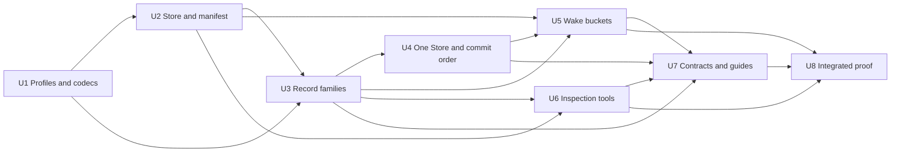

# Make Persistence Inspectable and Durability-Complete

## Goal Capsule

- Objective: Give each durable Jido Instance one recoverable persistence authority with inspectable records, stable format metadata, and no missed committed timer wake.
- Means: Compose one namespace-fixed codec with one binary compare-and-swap Store, make the Agent record the commit point, shard wake buckets, harden Store adapters, and add redacted inspection and JSONL export tools.
- Authority: Local implementation and verification in the requested worktree.
- Stop conditions: Do not commit, push, publish, run paid services, migrate external data, or add compatibility for unreleased storage formats. Stop if correctness requires a product decision that is not in this plan.
- Next executor: A Jido Elixir implementer with authority to change local source, tests, contracts, guides, and Mix tasks in this worktree.

## Product Contract

### Summary

Jido Persistence must own the complete storage side of durable Agent recovery. Developers must be able to inspect records without making Store adapters understand Jido record types. One Instance therefore owns one Store and one fixed codec. The default term codec preserves compact trusted Elixir storage. An opt-in JSON codec and redacted Mix tools provide readable inspection and JSONL export.

### Problem Frame

The current byte Store has a strong atomic compare-and-swap contract, but record encoding is embedded in record owners and is difficult to inspect. Per-Agent persistence overrides can split Agent and Flow records from the Instance wake store. Wake recovery uses one namespace-wide manifest and ignores a failed startup read. Store adapter options and write guarantees also differ in ways that can weaken durability.

### Actors

- Jido application developers configure one durable Instance and choose its Store and codec.
- Jido operators inspect record metadata, request full local output explicitly, and export records for diagnosis.
- AgentServer and Durable Runtime prepare Flow and wake records, then commit one Agent record.
- Store adapters preserve bytes and atomic single-key write conditions without interpreting Jido records.

### Requirements

- **R1 — One persistence authority:** One Jido Instance and namespace use one Store and one codec. Durable Agents cannot replace that Store per Agent.
- **R2 — Codec separation:** Record owners send logical values through a persistence codec before Store access. `Jido.Persistence.Codec.Term` is the default. `Jido.Persistence.Codec.JSON` is opt-in.
- **R3 — Compatible-release portability:** Saved values move between nodes that run the same compatible application release. Runtime-created atoms are unsupported. Process-local values remain rejected.
- **R4 — Namespace manifest:** A durable namespace manifest pins codec and record-family format versions, wake bucket width, and wake shard count. Startup rejects a mismatch before Agent admission.
- **R5 — Clean V3 format break:** New keys and formats have no runtime migration or compatibility path from current unreleased formats.
- **R6 — Durable commit order:** Flow execution and wake records are prepared before the Agent record. The Agent record is the commit point. Recovery treats unmatched auxiliary records as safe orphans.
- **R7 — Sharded wakes:** Wake entries use deterministic time buckets and fixed shards. Recovery uses a small active-bucket index and does not require adapter enumeration.
- **R8 — Wake recovery health:** A temporary wake read failure retries with bounded backoff and remains observable. It does not silently produce an empty recovered state.
- **R9 — Store contract:** `validate_options/1`, `get/2`, `compare_and_swap/4`, and `delete/2` are mandatory. Maintenance `put/3` and adapter `scan/4` are optional; the Store facade exposes `scan/3`.
- **R10 — Strict adapters:** Every built-in adapter rejects unknown and duplicate options. Redis has no automatic TTL. Ecto rejects persistence writes inside an outer Repo transaction.
- **R11 — Optional scan:** Store scanning is paged, prefix-bounded, and never required by runtime durability. Exact-key inspection works without scan.
- **R12 — Inspection tools:** Mix tasks inspect exact records and export supported scanned records as JSONL. State is redacted by default. Full state needs an explicit option and warning.
- **R13 — JSON file inspection:** A File Store with the JSON codec writes one valid JSON document per key that normal JSON tools can read.
- **R14 — Cleanup:** Completed Flow records can be physically deleted. Delivered wake entries are removed from their shard and inactive shards leave the active index; an inert empty shard value can remain to avoid a delete/write race. Agent deletion remains a tombstone write.
- **R15 — Contract alignment:** Covenant records, architecture ownership, public docs, guides, examples, and conformance tests describe the implemented V3 contract.

### Key Flows

#### Instance startup

1. Validate the persistence profile, Store options, codec, namespace, and wake layout.
2. Open the Store and compare-and-swap the namespace manifest when it is absent.
3. Validate an existing manifest exactly.
4. Recover active wake buckets. Retry temporary read failures before wake readiness becomes healthy.
5. Admit durable Agent work only after the persistence boundary is ready.

#### Durable Turn commit

1. Write or confirm Flow execution records.
2. Write or confirm each timed wake in its bucket and shard.
3. Compare-and-swap the Agent record as the authoritative commit.
4. Publish the committed result or waiting result.
5. Reconcile an uncertain Agent write from an authoritative read.

#### Inspection

1. Resolve a configured Store and namespace without starting Agent work.
2. Read an exact key or use optional paged scan for a prefix.
3. Detect a supported inspection codec and record family.
4. Produce redacted JSON by default.
5. Require an explicit full-state option before output or JSONL export includes state values.

### Acceptance Examples

- A File-backed Instance using the default Term codec restarts and restores an Agent, Flow progress, and a committed timed wake.
- A crash after wake preparation but before Agent commit leaves an orphan that cannot advance an uncommitted Turn.
- A crash after Agent commit cannot miss the wake because wake preparation completed first.
- A wake-store read error at startup retries and later schedules the saved wake without another Instance restart.
- A per-Agent Store override returns a configuration error instead of creating split storage authority.
- A File-backed Instance using the JSON codec creates valid JSON record files that a JSON parser accepts.
- The inspection task hides Agent state unless the caller supplies the full-state option.
- An adapter with an unknown or duplicate option fails at Instance startup.
- An Ecto direct write inside `Repo.transaction/2` returns a confirmed rejection and performs no persistence write.
- An adapter without `delete/2` cannot open as a V3 Store.

### Success Criteria

- No committed timed wait is lost at any tested crash boundary.
- No wake update rewrites all waits in one namespace.
- All bundled adapters pass the expanded common conformance contract.
- Exact record inspection works for every Store. Paged export works only for adapters that declare scan support.
- JSON storage and JSONL output are bounded and parseable.
- Focused persistence, durable activation, peer recovery, Covenant, architecture, formatting, and repository quality gates pass.

### Scope Boundaries

In scope:

- Persistence profiles, codecs, namespace manifest, Agent and auxiliary record encoding, wake storage, Store behavior, all bundled adapters, inspection Mix tasks, tests, contracts, architecture documents, and storage guides.

Out of scope:

- Native SQL queries into Agent state.
- Adapter-specific logical record formats.
- A domain-specific backend API or multi-record backend transaction.
- An authoritative JSONL journal.
- Automatic TTL or a general retention policy.
- Mixed codecs inside one namespace.
- Runtime migration of current unreleased formats.
- Commit, push, pull request, release, or external-service verification.

### Key Decisions

- One Store and one codec per Instance and namespace.
- Store stays an opaque binary and single-key atomicity boundary.
- Term is the default codec; JSON is opt-in.
- JSONL is an export format only.
- Agent record commit follows auxiliary preparation.
- Wake storage uses time buckets plus fixed shards.
- Scanning is optional and never part of runtime recovery.
- Codec identity is fixed by a durable namespace manifest.
- State is redacted by default in tools.
- Automatic TTL is forbidden in durable Store adapters.
- Delete and strict option validation are mandatory.
- Ecto rejects nested transaction writes.
- Current unreleased formats have no runtime migration.

### Rejected Alternatives

- Adapter-owned semantic conversion, because it couples every adapter to all Jido record families.
- Structured-map Store callbacks, because they remove one common byte and CAS contract.
- Domain-specific persistence backend callbacks, because they make simple adapters own runtime behavior.
- One transaction across Agent, Flow, and wake records, because it excludes simple File and S3 stores.
- One namespace-wide wake manifest, because it creates one unbounded and contended value.
- One authoritative JSONL log, because it requires indexing, replay, compaction, and crash-safe log maintenance.
- Mandatory scan for all adapters, because remote enumeration is not required for durability.
- Automatic mixed-codec reads, because they weaken the fixed namespace contract.

### Dependencies

- Existing `Jido.Persistence.Store`, Agent record, Snapshot, Checkpoint, ContinuationStore, Instance wake process, and AgentServer durable Turn flow.
- Existing Elixir `JSON` support; no new JSON dependency is required.
- Existing Covenant, Reach, peer test, and adapter conformance infrastructure.

### Outstanding Questions

None blocking. Bucket width, shard count, scan page size, exact Mix task names, and tagged JSON details are bounded technical decisions owned by this plan.

### Sources

- Confirmed design decisions in the Jido Grill session on 2026-11-13.
- [`../../AGENTS.md`](../../AGENTS.md)
- [`../architecture/module-dependency-map.md`](../architecture/module-dependency-map.md)
- [`../architecture/durable-agent-activation.md`](../architecture/durable-agent-activation.md)
- [`../components/persistence.md`](../components/persistence.md)
- [`../../guides/storage/persistence-storage-model.md`](../../guides/storage/persistence-storage-model.md)
- [`../../guides/storage/flow-continuations.md`](../../guides/storage/flow-continuations.md)
- [`../../guides/reference/persistence-adapter-matrix.md`](../../guides/reference/persistence-adapter-matrix.md)

## Planning Contract

### Product Contract Preservation

Product Contract unchanged.

### Current System

`Jido.Persistence.Store` reads binary values and returns exact bytes or adapter tokens as compare-and-swap conditions. `Jido.Persistence.Record` owns the Agent key and term envelope. `Snapshot` and `Checkpoint` own complete Agent data and Plugin conversions. `ContinuationStore` writes Runic batches and facts through the same Store. `WakeStore` writes one term-encoded manifest for the complete namespace. Instance configuration stores a normalized adapter tuple. AgentServer can replace it per Agent, while WakeStore always resolves the Instance adapter.

The current Store requires `get/2` and `compare_and_swap/4`. Option validation, maintenance put, and delete are optional. Redis can expire every key through one TTL. Ecto direct writes can join an outer transaction. The current wake process treats a startup read error as an empty timer set. The current contracts and guides also contain stale record-format claims.

### Target System

```text
Jido Instance
    -> Persistence.Config {Store, Codec, namespace policy}
       -> Namespace manifest
       -> Agent Record owner
       -> ContinuationStore
       -> Bucketed WakeStore
          -> Persistence.Codec
             -> Persistence.Store
                -> adapter

Mix inspection task
    -> exact key or optional paged Store scan
    -> inspection decoder
    -> redacted JSON or explicit full JSON/JSONL
```

The runtime uses one normalized persistence profile from Instance startup through Agent, Flow, and wake operations. Logical record owners keep key, version, validation, ordering, and recovery policy. The codec only maps supported logical values to bytes. The Store only validates and performs binary single-key operations.

### Key Technical Decisions

#### KTD1: Normalize persistence as a profile

- **Decision:** Add a `Jido.Persistence.Config` value with one opened Store tuple and one codec module. Accept current adapter declarations as shorthand for the default Term codec. Accept a unique keyword profile with `store:` and `codec:` for opt-in JSON.
- **Reason:** R1 and R2 need one authority without making simple existing declarations verbose.
- **Rejected alternative:** Pass independent Store and codec options through every caller.
- **Consequences:** Runtime Store calls use `config.store`; record owners use `config.codec`. Per-Agent adapter declarations are rejected. `:inherit` remains an internal selection of the Instance profile.
- **Governs:** R1-R4; U1, U4.

#### KTD2: Keep codecs small and record owners semantic

- **Decision:** Define a codec behavior with stable `id/0`, `version/0`, `encode/1`, and `decode/2` callbacks. Term uses deterministic ETF with a bounded referenced-module header. Decode loads those compatible-release modules before safe term decoding. JSON uses a bounded tagged representation for binary, atom, module, tuple, list, map, and exact-field struct values. Record owners keep format and identity validation after decode.
- **Reason:** R2, R3, and R13 require inspectability without semantic adapters.
- **Rejected alternative:** Move Agent and Flow schemas into each adapter.
- **Consequences:** JSON is verbose and restricted to compatible releases. Runtime-created atoms fail decode. Trusted Runic records use the same codec contract with an explicit trusted decoding mode or a separate codec entry point that the contract names.
- **Governs:** R2, R3, R5, R13; U1, U3.

#### KTD3: Pin storage policy in a namespace manifest

- **Decision:** Add a versioned manifest key and exact manifest value. Instance startup creates it with compare-and-swap or validates every field before wake recovery and Agent admission.
- **Reason:** R4 requires a stored guard against codec and layout mismatch across nodes.
- **Rejected alternative:** Trust local configuration on every node.
- **Consequences:** The manifest is the first V3 namespace record. It contains no credentials or adapter options. A missing manifest means a new V3 namespace under the clean-break policy.
- **Governs:** R4, R5; U2.

#### KTD4: Make all Store adapters complete and strict

- **Decision:** Require option validation, get, CAS, and delete. Add optional paged prefix scan. Reject unknown and duplicate options in every built-in adapter. Remove Redis TTL. Reject Ecto writes inside a caller transaction.
- **Reason:** R9-R11 and R14 require one visible lifecycle and no silent weakening.
- **Rejected alternative:** Preserve optional cleanup and backend-specific option leniency.
- **Consequences:** Custom adapters must add delete and validation. Scan remains capability-tested. The Ecto check uses the supported Repo transaction-state API available in the pinned Ecto version.
- **Governs:** R9-R11, R14; U2.

#### KTD5: Use new V3 keys with no runtime compatibility

- **Decision:** Version the manifest, Agent, execution, and wake key families for this design. Runtime and inspection use only the configured V3 formats.
- **Reason:** R5 follows the confirmed clean break and the repository's unreleased V3 policy.
- **Rejected alternative:** Add mixed-format runtime reads and migration state.
- **Consequences:** Existing development stores are not activated by the new runtime. Rollback after new writes means returning to a clean namespace, not running old code on new records.
- **Governs:** R5; U2, U3, U5, U6.

#### KTD6: Prepare auxiliary records before the Agent commit

- **Decision:** Persist Flow progress and timed wake entries before saving the Agent record that contains the matching durable Turn receipt. The Agent record is authoritative. Recovery and delivery validate the turn identity before they act.
- **Reason:** R6 prevents a committed Agent wait without its recovery data while keeping single-key Store adapters.
- **Rejected alternative:** Commit the Agent first or require a backend transaction.
- **Consequences:** Crashes can leave auxiliary orphans. Cleanup is idempotent and cannot change a committed Turn result.
- **Governs:** R6, R14; U4, U5.

#### KTD7: Partition wake manifests by time and identity

- **Decision:** Use a fixed one-minute UTC epoch bucket and 64 deterministic shards selected from the stable Address and Turn identity. Keep a small CAS-protected active-bucket index. Record one increasing shard generation in the shard and index. Confirm both records before Agent commit. Cleanup removes only the generation that it made empty. An inert empty shard value can remain.
- **Reason:** R7 needs predictable recovery and bounded contention without Store enumeration.
- **Rejected alternative:** One manifest or one key plus a second index for every wake.
- **Consequences:** One unusually dense minute can still fill a shard; adapter size rejection remains explicit. The constants live in the namespace manifest and can change only in a new format.
- **Governs:** R7, R8, R14; U5.

#### KTD8: Keep inspection read-only and safe by default

- **Decision:** Add `mix jido.persistence.inspect` for exact keys or Agent Addresses and `mix jido.persistence.export` for paged JSONL. Decode V3 record metadata without running Agent work. Exact inspection needs `--full` for saved values. Export needs `--include-state` for Agent state.
- **Reason:** R11-R13 require direct developer use without silent data disclosure.
- **Rejected alternative:** Full values by default or runtime key enumeration.
- **Consequences:** Export-all needs an adapter with scan. Commands warn before full output.
- **Governs:** R11-R13; U6.

### System Boundaries and Change Surface

| Surface | Current contract | Planned change | Compatibility or risk |
| --- | --- | --- | --- |
| `Jido` and `Jido.Instance.Options` | Instance accepts adapter declaration; AgentServer can accept override | Normalize one Instance profile and reject per-Agent Store replacement | Public V3 configuration change; guides and tests move together |
| `Jido.Persistence` | Resolves adapter tuples and record-owned ETF | Resolve `Config`; all durable families use its Store and codec | Broad call-path change; focused compile and boundary tests needed |
| `Jido.Persistence.Store` | Get and CAS required; delete optional | Validation, get, CAS, delete required; optional paged scan | Custom adapter break is intentional in unreleased V3 |
| Codec boundary | No persistence codec behavior | Add Term and JSON codecs plus bounded inspection projection | JSON tags and safe atom/module restoration need adversarial tests |
| Namespace lifecycle | Local config only | Persist and validate exact manifest before durable readiness | Startup must classify conflict and indeterminate writes correctly |
| Agent keys and records | `jido:agent:v2:` and record format 2 | New V3 key and exact record format aligned with contracts | No runtime migration or compatibility support |
| ContinuationStore | `jido:execution:` and direct ETF | New key version and Config codec for batches, facts, and indexes | Trusted Runic values need explicit decode trust rule |
| WakeStore | One `jido:wakes:v1:` list | Active-bucket index plus minute and shard values | Ordering, conflict retries, cleanup, and adapter limits are material |
| Instance wake process | One startup read; error becomes empty state | Recover all active buckets with retry and health state | Readiness and retry tests need deterministic fault adapters |
| Ecto and Redis | Nested Ecto write can be provisional; Redis TTL allowed | Reject nested Ecto write; remove TTL | Intentional V3 configuration break |
| Built-in adapters | Option policy differs; no scan contract | Strict options, mandatory delete, selected paged scans | External service scans can remain unsupported |
| Mix tools | None | Redacted inspect and JSONL export tasks | Output and file writes must be explicit and bounded |
| Covenant and docs | Stale format and ownership text | New obligations, decisions, ownership, guides, and API reference | Contract tests must agree with source |

### Implementation Units

#### U1: Add persistence profiles and codecs

- **Outcome:** One normalized `Jido.Persistence.Config` carries an opened Store and codec; Term and JSON codecs round-trip supported values and reject unsupported data.
- **Requirements:** R1-R3, R13.
- **Dependencies:** None.
- **Affected surfaces:** `lib/jido/persistence.ex`, new Config and codec modules, `lib/jido.ex`, Instance options/runtime config, source/config tests, codec tests, and public configuration docs.
- **Implementation direction:** Keep adapter module/tuple declarations as Term shorthand. Add unique keyword profile input. Make codec validation explicit at startup. Implement bounded tagged JSON with deterministic map-entry order, Base64 binary tags, existing-atom/module resolution, exact struct fields, and resource limits. Keep record meaning outside codecs.
- **Test scenarios:** Shorthand and profile normalization; invalid codec; duplicate profile keys; Term and JSON round-trip; readable JSON; runtime-created atom rejection; binary and map-key tags; struct and tuple recovery; process-local rejection.
- **Verification:** Focused Config and codec tests plus `mix test.authoring` for the public JSON surface.
- **Completion signal:** A normalized profile can encode and decode a representative Agent snapshot without Store access.

#### U2: Harden Store and establish the namespace

- **Outcome:** Store adapters meet the strict lifecycle contract, and Instance startup creates or validates the durable namespace manifest.
- **Requirements:** R4, R5, R9-R11, R14.
- **Dependencies:** U1.
- **Affected surfaces:** Store behavior, all seven built-in adapters, adapter support tests, Instance startup supervision, RuntimeStore, new manifest owner, Store telemetry, Covenant obligations, and adapter guides.
- **Implementation direction:** Require callbacks before open succeeds. Normalize delete errors with write uncertainty rules. Define optional paged scan result and cursor validation. Implement scan for ETS and File; leave Mnesia, Ecto, Redis, S3, and Bedrock explicitly unsupported unless their adapters can meet the bounded contract without new dependencies or backend-specific policy. Add exact manifest CAS and startup mismatch errors. Remove Redis TTL and reject all unknown and duplicate options. Use `repo.in_transaction?/0` to reject nested Ecto writes before SQL starts.
- **Test scenarios:** Missing delete or validator; strict option typos and duplicates; delete conformance; scan pages and prefixes; unsupported scan; manifest create/race/match/mismatch/indeterminate result; Redis TTL rejection; Ecto nested rejection and normal write.
- **Verification:** Store, adapter, Instance option, Ecto, Redis, and conformance tests.
- **Completion signal:** A namespaced durable Instance is not ready until one exact manifest is confirmed through a strict Store.

#### U3: Route every record family through Config and codec

- **Outcome:** Agent, Flow execution, fact, index, and wake logical values use the Instance profile and new V3 keys.
- **Requirements:** R1-R6, R13.
- **Dependencies:** U1, U2.
- **Affected surfaces:** Persistence facade, Record, Checkpoint, ContinuationStore, WakeStore value helpers, key tests, cross-BEAM tests, and storage-format contracts.
- **Implementation direction:** Centralize `encode` and `decode` calls on Config. Keep per-family exact validation after decode. Give trusted Continuation records an explicit trusted codec path. Reject a record whose configured codec and namespace manifest disagree. Remove direct `term_to_binary` calls from record families except inside the Term codec and stable key derivation. Version keys cleanly.
- **Test scenarios:** Term and JSON Agent lifecycle; Flow fact and batch recovery with both codecs; exact shape rejection; wrong codec; new keys; old formats are rejected; compatible-release peer recovery.
- **Verification:** Persistence, Durable, and peer-focused tests.
- **Completion signal:** A source search finds no record-family value serialization outside persistence codecs.

#### U4: Enforce one Instance Store and commit ordering

- **Outcome:** Durable Agent creation, activation, Turn execution, hibernation, thaw, child activation, and deletion all use the Instance profile, and auxiliary durability precedes Agent commit.
- **Requirements:** R1, R6, R14.
- **Dependencies:** U3.
- **Affected surfaces:** Public `Jido` Agent APIs, AgentServer defaults and validation, Lifecycle, Worker commit path, Topology, Durable Runtime registration, status results, tests, examples, and guides.
- **Implementation direction:** Remove public per-Agent adapter replacement. Keep durable enabled/disabled as an Instance property. Pass the resolved Config through Lifecycle and Durable Runtime. Before a waiting Turn commits its Agent receipt, confirm Flow checkpoint and timed wakes. Treat auxiliary failure as an uncommitted Turn. Keep Agent CAS uncertainty reconciliation unchanged.
- **Test scenarios:** Override rejection; no persistence Instance stays transient; durable Instance create/restore/thaw; event-only wait; timed wait; auxiliary conflict/failure before Agent save; crash windows around prepare and Agent commit; child Agents inherit the same profile.
- **Verification:** Public API, AgentServer persistence, durable activation, durable Turn, and peer recovery tests.
- **Completion signal:** No production caller can supply a second Store for one Agent inside an Instance.

#### U5: Replace the wake manifest and harden recovery

- **Outcome:** Timed waits use a durable active-bucket index and 64 shards per one-minute bucket; startup failures retry instead of losing scheduled work.
- **Requirements:** R6-R8, R14.
- **Dependencies:** U2, U3, U4.
- **Affected surfaces:** WakeStore, Instance wake process and supervision, AgentServer wait registration and completion, durable activation contract tests, load tests, telemetry, and wake documentation.
- **Implementation direction:** Derive bucket and shard deterministically. Write the next shard generation, then record that generation in the active index, and confirm both before the Agent commit. On completion, remove matching entries and remove index membership only when it does not name a newer generation. An inert empty shard value can remain. Recover all index entries and shard values. Keep retry state and bounded exponential backoff after transient read failures. Retry failed cleanup without delivering an accepted wake again. Validate turn identity on delivery so orphans cannot advance work.
- **Test scenarios:** Deterministic keys; separate shards; concurrent entries; value-size rejection; shard-before-index crash; shard-before-Agent crash; Agent-after-shard restart; startup read failures then recovery; duplicate wake; orphan wake; empty cleanup; Instance restart.
- **Verification:** Focused WakeStore tests, durable activation contract, peer tests, and a bounded concurrency load case.
- **Completion signal:** No committed timer depends on a namespace-wide value or a one-shot recovery read.

#### U6: Add redacted inspection and JSONL export

- **Outcome:** Developers can inspect exact records and export scanned records without Agent activation or default state disclosure.
- **Requirements:** R5, R11-R13.
- **Dependencies:** U2, U3.
- **Affected surfaces:** New Mix tasks and inspection module, task tests, codecs, Store scan, File and ETS scans, docs, and package task discovery.
- **Implementation direction:** Keep command parsing and output in Mix tasks; put read/decode/redact/projection behavior in Persistence. Require adapter and namespace configuration or a supported File path. Default to metadata and shape projection. Require `--full` for exact output and `--include-state` for export state. Stream JSONL pages to an explicit output path. Print full-data warnings to stderr. Never start Agent processes or write Store data.
- **Test scenarios:** Exact Agent Address; exact raw key; Term and JSON; redacted default; explicit full; unsupported scan; paged export; invalid record; old formats rejected; output file collision or explicit overwrite policy; bounded page handling.
- **Verification:** Mix task tests with captured IO and JSON parsing.
- **Completion signal:** A developer can inspect a JSON File record directly and can inspect either codec through the task with redaction by default.

#### U7: Align contracts, architecture, and guides

- **Outcome:** Current source ownership, formats, configuration, failure behavior, tools, and non-goals have one accurate documented contract.
- **Requirements:** R3-R15.
- **Dependencies:** U3, U4, U5, U6.
- **Affected surfaces:** Persistence and AgentServer Covenant obligations and decisions, module dependency map, durable activation architecture, Persistence component page, storage guides, adapter matrix, Ecto/Redis/File guides, public API reference, docs index, and relevant examples.
- **Implementation direction:** Replace stale format-1 claims. Record the clean break and namespace manifest. State that compatible-release portability does not include runtime-created atoms. Document commit order, wake sharding, retry, strict adapter contract, no TTL, Ecto rejection, codec selection, scan capability, and safe inspection.
- **Test scenarios:** Covenant coverage maps every changed public behavior; guide snippets compile or are covered by existing documentation tests; links resolve.
- **Verification:** Covenant checks, authoring/docs checks, architecture checks, and formatting.
- **Completion signal:** No current guide or contract describes per-Agent stores, format 1, automatic TTL, optional delete, or one wake manifest.

#### U8: Run integrated durability proof and clean the change

- **Outcome:** The full local candidate meets the Definition of Done without unrelated changes.
- **Requirements:** R1-R15.
- **Dependencies:** U5, U6, U7.
- **Affected surfaces:** Complete worktree diff, focused and broad offline gates, generated Covenant coverage, and static quality reports.
- **Implementation direction:** Run fast focused gates first. Repair failures within scope. Run peer and load checks for lifecycle and concurrency. Then run repository integration and static gates. Do not run external-service or paid live checks.
- **Test scenarios:** All requirement traceability scenarios plus repository regressions.
- **Verification:** Verification Contract below.
- **Completion signal:** All required offline gates pass, or each unavailable external proof is reported as a named limit that does not weaken local correctness claims.

### Work Graph

- Initial frontier: U1.
- U2 follows U1 because Store startup and manifest values use the normalized Config.
- U3 follows U1 and U2 because every record family needs both codec and strict Store contracts.
- U4 follows U3 because commit ordering uses encoded auxiliary records through the final profile.
- U5 follows U2-U4 because wake layout is part of the manifest and Agent commit sequence.
- U6 can start after U2 and U3 while U4 and U5 continue.
- U7 follows U3-U6.
- U8 is the final integration unit.
- Critical path: U1 -> U2 -> U3 -> U4 -> U5 -> U7 -> U8.



### Verification Contract

All commands run from the worktree root.

| Gate | Applies to | Evidence | Done signal |
| --- | --- | --- | --- |
| Config and codec behavior | U1 | Focused persistence config and codec tests | Term and JSON contracts pass, including rejection cases |
| Store and manifest | U2 | Store, adapter, conformance, and Instance option tests | Strict adapters and manifest lifecycle pass |
| Record families | U3 | Persistence, Durable, and peer-focused tests | Both codecs recover exact logical records |
| Commit order | U4 | AgentServer persistence and durable Turn tests | Auxiliary failures cannot publish an Agent commit |
| Wake recovery | U5 | Wake unit, durable activation, peer, and load tests | Crash and retry cases pass without missed committed wake |
| Inspection | U6 | Mix task tests and JSON parsing | Redaction, full output, scan, and JSONL cases pass |
| Contract alignment | U7 | Covenant, Reach, docs/authoring, and formatting | Ownership, public API, and formats agree |
| Repository integration | U8 | Offline suite and quality gate | No relevant regression or blocking static finding |

Focused commands:

```sh
mix test test/jido/persistence
mix test test/jido/durable test/jido/agent_server/durable_activation_contract_test.exs
mix test test/jido/instance test/jido/agent_server
mix test.peer
mix test.load
mix test.contracts
mix test.authoring
mix reach.check --arch --smells
mix format --check-formatted
```

Final offline gates:

```sh
mix test
mix test.all
mix quality
```

External Redis, PostgreSQL, S3, and Bedrock service checks are not authorized for this local request. Their absence limits claims about live service configuration, not the shared contract tests with local or injected backends.

Requirement traceability:

| Requirement | Units | Primary evidence |
| --- | --- | --- |
| R1 | U1, U4 | Instance config and override rejection tests |
| R2-R3 | U1, U3 | Codec round-trip and peer recovery tests |
| R4-R5 | U2, U3 | Manifest and new-key tests |
| R6 | U3, U4, U5 | Crash-boundary durable Turn tests |
| R7-R8 | U5 | Wake unit, restart, retry, and load tests |
| R9-R11 | U2, U6 | Adapter conformance and scan tests |
| R12-R13 | U1, U6 | Mix task and JSON parser tests |
| R14 | U2, U4, U5 | Delete and orphan cleanup tests |
| R15 | U7, U8 | Covenant, Reach, docs, format, and broad gates |

### Rollout and Recovery

This is a clean unreleased V3 format break. Use an empty namespace when the new runtime starts. The namespace manifest prevents a node with a different codec or wake layout from joining that namespace.

There is no mixed-version window. Do not deploy old and new runtime versions against the same namespace. The V3 runtime and inspection tools do not read or export older records.

Before new writes, verify the Instance can create and reread its namespace manifest. After new writes, rollback means stop the new runtime and use a different clean namespace with the old runtime. Do not point old code at new keys.

### Risks and Assumptions

- **Risk:** Tagged JSON can create large Flow records. Prevention: bounded codec limits and explicit adapter size rejection. Detection: size-bound tests and metadata in inspection output.
- **Risk:** Preparing wake and Flow records before Agent commit leaves orphans. Prevention: turn identity in every auxiliary record. Recovery: validation and idempotent cleanup.
- **Risk:** The active-bucket index remains a shared value. Mitigation: each entry carries the shard generation, so cleanup cannot erase newer membership; its size is bounded by active bucket retention. A future format can shard the index if measurement requires it.
- **Risk:** Term safe decode can fail for atoms not loaded by the compatible release. Contract: runtime-created atoms are unsupported; trusted module references are loaded before reconstruction where the logical record identifies them.
- **Risk:** Paged scan semantics differ across services. Runtime never depends on scan. Adapter-specific service proof remains separate.
- **Assumption:** Persistence backends and stored Continuation bytes are trusted application infrastructure.
- **Assumption:** One-minute buckets and 64 shards are safe initial constants for V3. U5 load evidence must reject this assumption before integration if value or contention bounds fail.
- **Assumption:** The pinned Ecto Repo exposes `in_transaction?/0`; U2 confirms this before implementation of the rejection.

### Open Planning Decisions

None blocking. If U5 load evidence rejects the initial bucket constants, the implementer can increase the shard count in the unreleased format and update the namespace manifest, tests, and plan decision record before U7.

### Definition of Done

- R1-R15 are implemented in U1-U8.
- One Instance profile controls Agent, Flow, and wake storage.
- Term is default, JSON is opt-in, and the namespace manifest rejects mismatch.
- Durable commit order and wake recovery pass crash, retry, and restart tests.
- Wake updates are bucketed and sharded.
- Store adapters have mandatory delete, strict options, no TTL, and correct Ecto transaction rejection.
- Exact inspection is redacted by default; optional scan and JSONL export behave as documented.
- Current contracts and guides match V3 formats and ownership.
- Required focused and final offline gates pass.
- External service checks are reported as not run.
- The worktree contains no unrelated changes.
- No commit or push exists for this work.

### Planning Sources

- [`../../lib/jido/persistence.ex`](../../lib/jido/persistence.ex)
- [`../../lib/jido/persistence/store.ex`](../../lib/jido/persistence/store.ex)
- [`../../lib/jido/persistence/record.ex`](../../lib/jido/persistence/record.ex)
- [`../../lib/jido/persistence/continuation_store.ex`](../../lib/jido/persistence/continuation_store.ex)
- [`../../lib/jido/persistence/wake_store.ex`](../../lib/jido/persistence/wake_store.ex)
- [`../../lib/jido/instance/wake.ex`](../../lib/jido/instance/wake.ex)
- [`../../lib/jido/instance/options.ex`](../../lib/jido/instance/options.ex)
- [`../../lib/jido/agent_server/lifecycle.ex`](../../lib/jido/agent_server/lifecycle.ex)
- [`../../lib/jido/agent_server/worker.ex`](../../lib/jido/agent_server/worker.ex)
- [`../../test/jido/persistence`](../../test/jido/persistence)
- [`../../test/jido/agent_server/durable_activation_contract_test.exs`](../../test/jido/agent_server/durable_activation_contract_test.exs)
- [`../../test/contracts/jido/persistence.obligations.md`](../../test/contracts/jido/persistence.obligations.md)

## Adapter Results

- Markdown: canonical at `docs/plans/2026-11-13-0758-persistence-durability-redesign-plan.md`
- HTML: not requested
- Beadwork: not requested
